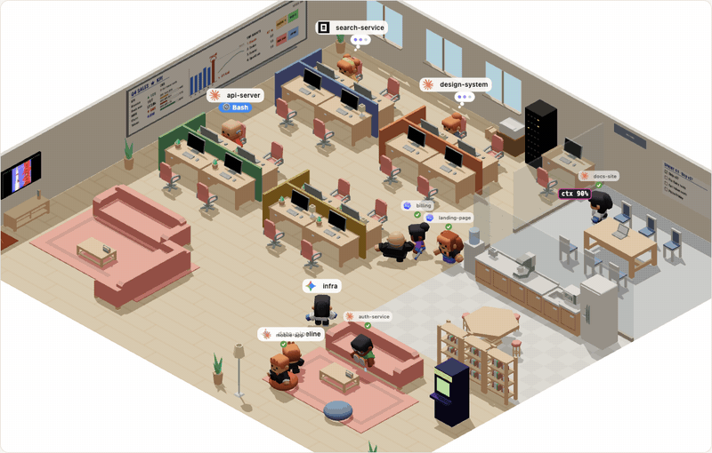
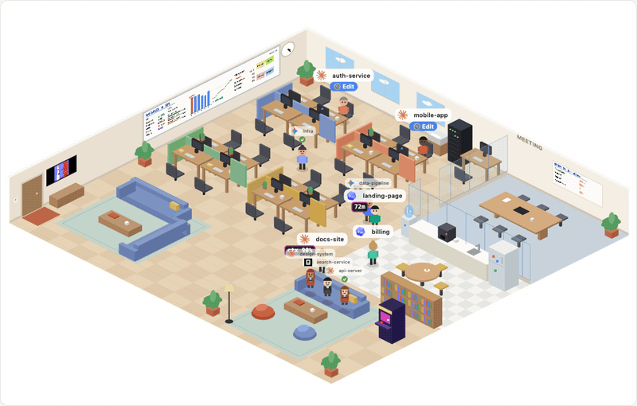
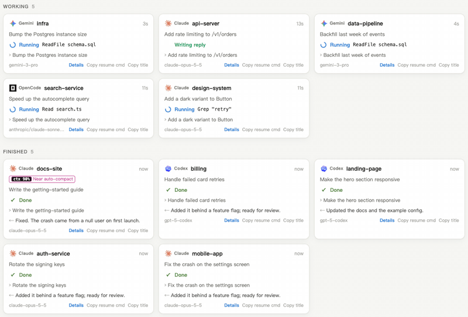

# 🪑 whatsmyagentdoing

**即時看到你機器上每一個 Claude Code、Codex、Gemini CLI 與 OpenCode agent 正在做什麼——在一間小小的辦公室裡。** 裝成 skill 輸入 `/myoffice`，或直接執行建好的單檔 Go 執行檔；兩者跑的是同一支 Go 程式。



| Medium（2D） | 清單 |
|---|---|
|  |  |

<sub>以 `--demo`（虛構團隊）錄製，畫面中沒有任何真實 session；`scripts/record-gifs.sh` 重錄（需要 Google Chrome 與 ffmpeg）。</sub>

## 倉庫結構

| 路徑 | 內容 |
|---|---|
| [`skills/myoffice/`](skills/myoffice/) | skill 本體：`SKILL.md`、網頁與 3D 模型的真源、建好後放進 `bin/` 的 Go 執行檔（不進版控）。可被 ai-global 安裝。 |
| [`go-app/`](go-app/) | Go 後端原始碼：skill 呼叫的執行檔從這裡建出，網頁與模型內嵌在執行檔裡，不依賴本倉庫其他目錄。 |
| [`scripts/`](scripts/) | `build.sh` 重建執行檔、`installSkill.sh` 把它複製進 skill、`start.sh` 兩者做完再重啟儀表板、`stop.sh` 停掉執行中的儀表板、`record-gifs.sh` 重錄 README 的示範 GIF。 |
| [`docs/`](docs/) | 示範動畫、資安檢視報告、施工筆記。 |
| [`jerry-report/`](jerry-report/) | 原 Node 版 skill 的系統分析（歷史文件）；現行 Go 版的在 [`go-app/jerry-report/`](go-app/jerry-report/)。 |

## 安裝 skill

**用 [ai-global](https://github.com/lazyjerry/ai-global) 一次裝給所有 AI 工具：**

```bash
ai-global add-skill lazyjerry/whatsmyagentdoing
```

它會找到 `skills/myoffice/`，裝進 `~/.ai-global/v-skills/` 並以 symlink 同步給 Claude Code、Codex 等工具；之後用 `ai-global update-skills` 更新，`ai-global remove-skill lazyjerry/whatsmyagentdoing` 移除。第一次輸入 `/myoffice` 時，agent 會檢查 Go、clone 本倉庫建出執行檔並放進 skill（沒有 Go 會先請你安裝）。

**或自己動手：** skill 不在倉庫根目錄，所以 clone 一份再把 `skills/myoffice/` 連進各工具的 skills 目錄。

```bash
git clone --depth 1 https://github.com/lazyjerry/whatsmyagentdoing ~/.whatsmyagentdoing/src

# Claude Code
ln -s ~/.whatsmyagentdoing/src/skills/myoffice ~/.claude/skills/myoffice
# Codex
ln -s ~/.whatsmyagentdoing/src/skills/myoffice ~/.codex/skills/myoffice

# 建執行檔並放進 skill（需要 Go 1.22 以上；跳過也行，第一次 /myoffice 時 agent 會補做）
~/.whatsmyagentdoing/src/scripts/build.sh
~/.whatsmyagentdoing/src/scripts/installSkill.sh
```

**或請你的 agent 幫你裝。** 把這段貼進 Claude Code 或 Codex：

> Install the myoffice skill from https://github.com/lazyjerry/whatsmyagentdoing: clone it with `git clone --depth 1` into `~/.whatsmyagentdoing/src`, then symlink `~/.whatsmyagentdoing/src/skills/myoffice` to `~/.claude/skills/myoffice` (for Codex: `~/.codex/skills/myoffice`), check that `go version` is 1.22 or newer (if Go is missing, tell me how to install it and stop), run `~/.whatsmyagentdoing/src/scripts/build.sh` and `~/.whatsmyagentdoing/src/scripts/installSkill.sh`, then tell me to start a new session and type /myoffice.

接著輸入 **`/myoffice`**（或直接問「我的 agent 在做什麼？」）。辦公室會在瀏覽器裡開啟。要更新就說 `/myoffice update`（會 `git pull` 並重新 `go build`），或在頁面上按「檢查更新」；ai-global 安裝的用 `ai-global update-skills`，再輸入一次 `/myoffice` 重建執行檔。

建置需要 Go 1.22 以上，執行時不需要 Node.js。不想用 skill？直接執行 `go-app/whatsmyagentdoing` 也行。

## Go 版啟動

Go 版把網頁、3D 模型與版本號都用 `go:embed` 包進單一執行檔，建好後可以複製到任何地方執行，不需要 Node.js，也不需要這個 clone。以下節錄自 [go-app/README.md](go-app/README.md)，完整的旗標、更新流程與環境變數請看那份：

> ### 建置
>
> ```bash
> cd <clone>
> scripts/build.sh            # 同步 static/ 再 go build，產物在 go-app/whatsmyagentdoing
> scripts/installSkill.sh     # 複製到 skills/myoffice/bin/，SKILL.md 呼叫的就是這份
> scripts/start.sh            # 上面兩步做完再（重新）啟動儀表板；執行檔內嵌前端，改完一定要重啟才看得到
> scripts/stop.sh             # 停掉執行中的儀表板，確認埠已釋放才結束；--port 指定埠
> ```
>
> `scripts/build.sh` 找不到 `go` 會印出安裝方式並以非零結束。`static/` 是內嵌副本，真源在 `skills/myoffice/`；前端有改動就重跑建置。
>
> ### 啟動
>
> ```bash
> ./whatsmyagentdoing
> ```
>
> 會在 `127.0.0.1:4545` 架起儀表板並開啟瀏覽器；印出的那一行就是網址。已在執行時，同一道指令只會重新開瀏覽器分頁。連接埠被別的程式占住時，自動往後找最多 10 個埠。
>
> ### 重啟
>
> ```bash
> ./whatsmyagentdoing --stop
> ./whatsmyagentdoing
> ```

## 它長什麼樣

開啟的是一間等角視角的**辦公室**：每個 session 是一個人，狀態一變就走到對應的位置。辦公室下方直接接著同一批 session 的清單，右側是待辦清單；只有子母畫面的小視窗保留「辦公室／清單」切換。所有內容都即時更新。

兩種畫風：**Medium** 是手繪風 2D canvas（零依賴）。**High（3D）** 用即時光影渲染同一間辦公室，採用 [Kenney](https://kenney.nl) 的 CC0 *Mini Characters*（含走路／坐下／互動動畫）與 *Furniture Kit*；拖曳旋轉，觸控板雙指滑動、滑鼠滾輪或方向鍵平移，捏合（或按住 Ctrl 滾動）縮放。3D bundle（three.js，gzip 後約 180 KB）與模型（約 1.3 MB，meshopt 壓縮）只在選擇 High 時才載入。

### 狀態與位置

| 狀態 | 意義 | 在辦公室裡 |
|---|---|---|
| 💭 思考中 | 正在推理，或在讀工具結果 | 坐在座位上，頭上冒出閃爍的思考泡泡 |
| ⏳ 執行中 | 有工具呼叫正在跑——會顯示是哪個（`Bash: npm test`、`Edit app.ts`、`github · create_pr`） | 坐著打字、螢幕上有程式碼捲動，頭上標籤寫著工具名稱（`⚙ Bash`） |
| ✍️ 撰寫回覆 | 已開始回答，但這一輪還沒結束 | 坐著打字，頭上是一個點點遞增的對話泡泡 |
| 🟠 等你回應 | 問了你問題／需要你核准 | 到伺服器旁的專線座位排隊找你：坐在電腦前的是等最久的那個，其他人在前方走道排隊；頭上有跳動的「!」 |
| ❗ 錯誤 | log 記下的錯誤事件（API 錯誤等） | 在座位上站起來揮手，頭上有跳動的「!」 |
| ✅ 完成 | 這一輪結束，附上最後的回覆 | 離開座位去休息：先坐右下角休息區的沙發（滑手機）和懶骨頭（聽音樂），坐滿了到左前方的沙發區看電視，再滿就坐旁邊的沙發滑手機，全滿才到茶水間晃；完工後 3 分鐘內頭上有綠色 ✓ |
| ■ 中斷 | 你中斷了這一輪 | 跟閒置一樣在茶水間與休息區晃，休息區的座位讓給還沒找到位子的已完成者 |
| – 閒置 | 還沒能判斷，或做到一半沒了動靜 | 在茶水間與休息區晃；坐上沙發或懶骨頭就打瞌睡（冒出 z） |

各狀態怎麼從 log 判定，見〈狀態判定〉。

**誰在辦公室：** 工作中（思考、執行、撰寫、等你回應、錯誤）的人都會進辦公室，座位依這一輪的開始時間分配，面向你的那排先坐滿；辦公室至少 16 個座位，人多了自動擴建。已完成、中斷與閒置的只留最近有動靜的 7 個，其他人回家了，門邊寫著「+N 已下班」；掛在未完成待辦上的 agent 不算在這 7 個裡，也不受設定面板關掉的狀態分組影響，一律留在辦公室。超過 `--hours`（預設 24 小時）沒活動的 session 不出現。

**名牌：** 每個人頭上有名牌，第一行是專案名稱（取不到就寫 agent 名稱），第二行是平台與姓名，旁邊是 agent 的 logo（見下方〈Agent 徽章〉）。已完成與閒置的人，名牌、泡泡與工具標籤縮成 75%（警告標記不縮），讓工作中與等你回應的人比較顯眼；滑鼠移上去就恢復原尺寸。

**姓名：** 每個 session 第一次出現時分到一個台灣辦公室常見的姓名（25 個名 × 20 個姓，共 500 組），同一天內不重複，之後不再改變。姓名只是好記的暱稱，不是識別碼；顯示在名牌、清單卡片與待辦清單上，存在 `~/.whatsmyagentdoing/office.db`。沒有 `sqlite3` 指令時不取名。

### 警告標記

跟狀態分開，同一個人可以同時有兩種。辦公室裡畫在人物頭部左側，是深色底、洋紅框的等寬字小塊，直接寫數字；清單卡片、hover 卡片與圖例用同樣的小塊。

| 標記 | 意思 |
|---|---|
| `ctx 92%` 快要 compact | 最新一次請求的 context 已達自動 compact 門檻的 85%，數字是目前的比例（不分狀態都顯示；hover 卡片的「Context」列寫出百分比與 token 數）。只支援 Claude Code 與 Codex |
| `72m` 本輪太久 | 思考／執行／撰寫中，這一輪已超過 60 分鐘（等你回應不算），數字是這一輪的分鐘數，超過 99 分鐘寫成 `1h40m`。卡片計時前面的「≥」表示 log 太大、只讀到這一輪的後段，實際開始得更早 |

工作中帶著警告的人離開座位進會議室：一個人就坐著，兩個以上就隔著桌子吵架；會議室坐不下的留在原座位。等你回應的人帶著警告仍到專線座位排隊。

### 老闆

一個穿黑西裝、胖嘟嘟的光頭老闆每分鐘巡一輪：先把業績白板擦掉、寫上新的（虛構）數字，再進會議室把白板擦掉重寫。兩輪之間，老闆輪流找剛完工的 agent 聊天，沒人可找就站到某個座位上的人背後看 4–8 秒；走路時會繞開椅子、凳子、懶骨頭與沒在走動的人。辦公室的人都走光時，他走到門邊關燈（電視一起關）再跑出去；第一個人回來就開燈，他跟著進門。開頁面時就沒人在的話，辦公室一開始就是暗的。點老闆會開一張報告卡（見〈設定〉的「老闆的報告」）。

### 場景

- **業績白板：** 座位旁的左牆，橫跨兩組辦公桌，畫 KPI、OKR、長條圖、趨勢、排行榜、圓餅圖，依白板寬度放得下幾塊就畫幾塊。
- **會議室白板：** 平常每幾秒翻一頁（議程、流程圖、燃盡圖、投票）。
- **電視：** 播放 GIF，預設是內建的幾段公有領域實拍（Muybridge 的賽馬與野牛、Apollo 發射與月面），也可以換成自己的（見下方 `--tv-dir`）。
- **冰箱**偶爾會冒出一陣冷氣；**窗景**跟著你的本地時間變化；Medium 模式還有一隻辦公室貓。

### 互動

- **滑鼠移到人身上：** 浮出跟清單卡片相同的卡片，看得到它正在處理什麼。
- **點人物：** 固定那張卡片。卡片下方列出它目前的待辦（× 取消指派）與「指派待辦…」選單，另有「詳細」按鈕開出全文視窗（見〈設定〉的「詳細資訊視窗」）。
- **點老闆：** 開報告卡。
- **點業績白板、會議室白板、專線座位、電視或冰箱：** 說明那一區的用途。
- **調整大小：** 辦公室下方與右側各有一條拖拉條，分別調整高度與寬度，可以拉得比視窗還大（頁面跟著上下、左右捲動）。尺寸會保存，雙擊拖拉條還原；拖拉條取得焦點後也能用方向鍵調整，每次 40 px。子母畫面不顯示拖拉條。

### 待辦清單

辦公室右側的待辦清單，用來記下要交給 agent 的事，並追蹤誰在做。設定面板的「待辦清單」開關可以隱藏它；子母畫面不顯示。

- **新增：** 在輸入框打一行，按 Enter 加入；最多 200 字，換行與 tab 會換成空白。
- **改名：** 點待辦文字變成輸入框，Enter 或點別處儲存，Esc 取消。
- **狀態：** 尚未開始、工作中、已完成、暫時擱置四種，用每則左側的選單切換。清單依工作中 → 尚未開始 → 暫時擱置 → 已完成排序，標題旁的數字是「未完成／全部」。每則附建立與更新時間。
- **指派：** 點辦公室裡的人物固定卡片，從「指派待辦…」選單挑一則未完成的待辦，待辦就變成工作中。一則待辦可以有多個 agent，一個 agent 同時只做一則——指派到別則就從原本那則移走。agent 正在工作時指派，進行中的這一輪也算數。
- **agent 狀態：** 待辦的狀態只能手動改，agent 完成不會動它。每個 agent 名字後面另標它自己的狀態：指派後完成過一輪標「已完成」，指派前就完成、還沒開工的標「閒置」，工作中就是當下狀態（思考中、執行中…），離開畫面的標「已離開」。
- **聚光燈：** 每則待辦下方列出它的 agent。點名字，辦公室周圍變暗、天花板打一道邊緣柔和的光在那個人身上、地面映出光暈 6 秒，再點一次就關掉；它不在辦公室時改顯示提示。名字旁的 × 取消指派，最後一個 agent 被拿掉時，待辦退回尚未開始。
- **刪除：** 已完成的確認一次，未完成的確認兩次；標題列的「刪除已完成項目」一次清掉全部已完成。

待辦存在 `~/.whatsmyagentdoing/office.db`，重啟後還在。這個檔案透過系統的 `sqlite3` 指令讀寫，沒有 `sqlite3` 時清單顯示提示、不能新增；`--demo` 改用暫存資料夾，不碰真正的資料。

### 清單、工具列與設定

介面支援 English、繁體中文、简体中文、日本語、한국어、Español、Français、Deutsch 與 Português。預設跟著你寫 prompt 的語言（沒有就跟瀏覽器語言）；可從 🌐 選單手動指定。

頁首右側的 **需要你／錯誤／工作中／已完成／閒置** 五個計數同時是開關：點一下就隱藏或顯示該狀態的 agent（辦公室與清單都適用，數字照算），設定面板的「顯示狀態」勾選與它同步；閒置預設隱藏。清單檢視中，session 依同樣五組分區，附目前這一輪的即時計時器、resume 指令的複製按鈕（`claude --resume …` / `codex resume …`）、agent 完工時的瀏覽器通知（可選），以及 Agent／平台多選篩選與 subagent 開關。分頁標題會顯示有多少個 agent 在工作。

**圖例：** 辦公室下方的圖例分兩行，上行是狀態與警告標記，下行是各 agent 的 logo，每一項後面附目前的數量，跟頁首計數算的是同一批 session；agent 只算工作中的，0 不顯示。

**Agent 徽章：** 2D 與 3D 中，每個 agent（含 subagent）名字旁都有透明底的 Claude、Codex、Gemini、OpenCode 官方 logo。相同圖示也出現在圖例、清單卡片與篩選器。到 **設定 → Agent 徽章** 可隱藏辦公室標記與圖例，設定會保存。圖示隨套件附帶於本機，圖片載入失敗時以縮寫字母替代。詳見[圖示來源與授權](skills/myoffice/assets/agents/README.md)。

工具列固定顯示檢視與彈出視窗控制項。2D/3D（預設 3D，子母畫面跟著主畫面）、Agent 與平台篩選（多選，預設全選）、顯示選項、通知與語言則收在**設定**裡。

**畫面鎖定（3D）：** 設定面板「語言」下方有兩個開關，會保存並與子母畫面同步。**固定縮放尺寸**讓目前的縮放不再改變，平移與旋轉照常；**固定滾動**把畫面放回預設角度、1 倍縮放（整間辦公室都在畫面內，跟著辦公室高度重新取景），平移、旋轉、縮放與觸控的單指雙指操作全部停用，滾輪或觸控往下拉改成捲動整個頁面到下方列表。開啟固定滾動時，固定縮放尺寸一併生效。

**新對話（macOS）：** 工具列的 **新對話** 開一個視窗：選 agent（只列出本機找得到的 `claude`／`codex`／`agy`（或 `gemini`）／`opencode`）、model（下拉選單，只能選「CLI 預設」或偵測到的 model，旁邊的 **?** 說明該 agent 的清單從哪裡來：Claude 取 `settings.json` 的 `model` 加上別名，Codex 取 `config.toml` 與 `models_cache.json`，Antigravity 跑 `agy models`，OpenCode 跑 `opencode models`，再加上近期 session 用過的 model；清單快取 24 小時。這些 CLI 收到不認得的 model 會直接報錯、不會自己退回預設，所以伺服器只接受清單上的 model，其他一律改用 CLI 預設）、是否 **非互動式執行**、資料夾（建議清單取近期 session 的目錄）與多行提示詞，⌘／Ctrl＋Enter 送出。伺服器把提示詞寫進暫存資料夾、產生一支 `.command` 腳本交給終端機開新視窗：預設以互動模式啟動 agent，權限詢問與後續對話都在終端機裡進行；勾了非互動式則直接執行這一則提示詞（`claude -p`、`codex exec`、`agy --prompt`、`opencode run`），跑完留下該資料夾的 shell，過程中不會停下來詢問權限。啟動後辦公室會照常從 log 追蹤到它。用哪個終端機在 **設定 → 終端機** 選：**系統預設** 是 Finder「取得資訊 → 打開檔案的應用程式」為 `.command` 指定的程式（沒改過就是「終端機」），另外列出裝在「應用程式」資料夾的 Terminal、iTerm2、Ghostty。`--demo` 模式只驗證欄位，不會真的開終端機。

**彈出視窗：** 支援 [Document Picture-in-Picture API](https://developer.chrome.com/docs/web-platform/document-picture-in-picture) 的瀏覽器可以把辦公室或清單開成可互動、永遠置頂的視窗。精簡清單只顯示 **需要你**、**錯誤** 與 **工作中**。瀏覽器儲存可用時，檢視、畫質、篩選、語言與徽章設定會與主分頁同步。關閉彈出視窗會還原主檢視，且只有主分頁會送通知。

當 Document PiP 不可用時，辦公室檢視的 **彈出** 會改為啟動本機的唯讀影片預覽（2D 或 3D 辦公室）。用它的影片 PiP 按鈕，或瀏覽器自己的影片控制項／右鍵選單（例如 Firefox）把它浮起來。用完請停止預覽。不需要螢幕分享權限，也不會上傳任何影片。背景動畫可能因瀏覽器節流而降低幀率；這個 fallback 不支援清單卡片，也不能點選 agent。彈出失敗時，按鈕旁的錯誤訊息 7 秒後自動收起。

## 選項

skill 的 `skills/myoffice/bin/whatsmyagentdoing` 與直接建出的 `go-app/whatsmyagentdoing` 是同一支程式：

```
-p, --port <n>    連接埠（預設 4545；被佔用時取下一個可用的）
--hours <n>       只顯示最近 n 小時內有活動的 session（預設 24）
--no-open         不開啟瀏覽器
--private         隱藏 prompt、回覆與標題——只顯示狀態（螢幕分享安全）
--json            輸出一份 JSON 快照後結束
--demo            顯示虛構團隊而非你的 session（截圖、試玩用）
--stop            停止正在執行的 dashboard（或說 /myoffice stop）
--update          更新到最新版並重啟（或說 /myoffice update）
--tv-dir <dir>    沙發區電視要播的 GIF 資料夾（預設 ~/.whatsmyagentdoing/tv）
```

**電視：** 資料夾裡的 `.gif` 依檔名順序輪播，每段至少播 15 秒、在播完一輪時換下一段，最長 30 秒；只有一段就一直循環。頁面每分鐘重讀一次資料夾，放新檔不必重啟。資料夾不存在或沒有 GIF 時，播執行檔內建的公有領域片段。只讀資料夾第一層、不讀子資料夾，略過隱藏檔與超過 20 MB 的檔案。畫面由瀏覽器的 `ImageDecoder` 逐格解碼，Safari 不支援時電視維持原本的變色螢幕。

舊版的場景包與 `--scenes`、`--scene <id>`、`--remove-scene <id>` 已移除；以前下載的還留在 `~/.whatsmyagentdoing/scenes/`，可以手動刪掉。

**更新：** 設定面板最下方顯示目前版本號與 **檢查更新** 按鈕，頁面右下角的時鐘是主機目前時間（由 `sw.js` 這個 service worker 對 `/api/time` 校準，所有分頁共用同一個時間差）；只有按下按鈕時才會抓一次本 repo main 分支的 `skills/myoffice/package.json`，不會自動檢查，有新版時改顯示 **Update** 按鈕。要改成自動（頁面載入與每半小時、CLI 啟動時都檢查），把 `go-app/config.go` 的 `AutoUpdateCheck` 改成 `true`；設定 `WMAD_NO_UPDATE_CHECK=1` 則兩種模式都不檢查。按下按鈕——或執行 `--update`、或說 `/myoffice update`——會在 clone 執行 `git pull`、重新同步 `static/` 並重新 `go build`（需要 Go），只在執行檔還放在 clone 的 `go-app/` 或 `skills/myoffice/bin/` 裡時可用。

## 設定

可調的設定都是 `go-app/config.go` 裡的常數，改完要重建才生效：在 clone 根目錄跑 `scripts/start.sh`（重建、複製進 skill 的 `bin/`、重啟儀表板），或 `scripts/build.sh && scripts/installSkill.sh` 再自行重啟。

**狀態時鐘。** Log 只記完成的區塊，所以一個突然沒動靜的 session 要靠時間判定它怎麼了；下表是「距最後一個事件多久」就改判：

| 常數 | 預設 | 意思 |
|---|---|---|
| `TypingDoneAfter` | 45 秒 | 回覆區塊落地後沒有後續，視為這一輪結束 → 已完成 |
| `ThinkingIdleAfter` | 15 分鐘 | 「思考中」太久沒動，視為中途被關掉 → 閒置（下班） |
| `ToolIdleAfter` | 45 分鐘 | 工具呼叫一直沒回報 → 閒置 |
| `AttentionIdleAfter` | 5 小時 | 「等你回應」與「錯誤」的人物留在辦公室揮手多久 → 閒置 |

**掃描與更新。**

| 常數 | 預設 | 意思 |
|---|---|---|
| `DefaultWindowHours` | 24 | `--hours` 的預設值，超過這段時間沒活動的 session 不顯示 |
| `PollInterval` | 1 秒 | 多久 stat 一次已知的 log 檔與 SQLite 資料庫 |
| `RescanInterval` | 5 秒 | 多久重新走一次 log 目錄找新檔案 |
| `UnreadableRetry` | 1 分鐘 | 讀不到的 log 檔（權限、讀到一半被刪）多久後再試 |
| `DBRetry` | 10 秒 | SQLite 讀取失敗（例如撞上 WAL checkpoint）多久後再試 |
| `UpdateCheckEvery` | 30 分鐘 | 一次版本檢查的結果沿用多久才再問 GitHub（頁面自動檢查的間隔另寫在 `index.html`，也是 30 分鐘） |

**對外連線。** `Repo`、`Branch`、`AutoUpdateCheck` 同樣在這個檔案，見上方「更新」段。

**警告標記。** 設 0 關閉該項。

| 常數 | 預設 | 意思 |
|---|---|---|
| `CompactWarnRatio` | 0.85 | context 達到自動 compact 門檻的這個比例 → `ctx %` |
| `LongTurnAfter` | 60 分鐘 | 工作中的這一輪超過這麼久 → `min` |

自動 compact 門檻先照各 CLI 自己的設定檔算，讀不到才用下列預設：

| 常數 | 預設 | 意思 |
|---|---|---|
| `ClaudeDefaultWindow` | 200,000 | Claude Code 的 `~/.claude/settings.json` 沒設 `modelSettings.<model>.autoCompactWindow` 時的 window |
| `ClaudeLargeWindow` | 1,000,000 | context 已超過預設 window 的門檻，改視為 1M 模型 |
| `ClaudeCompactReserve` | 33,000 | Claude Code 的門檻 = window − 這個保留量（20k 摘要輸出＋13k 緩衝，本機實測吻合） |
| `CodexCompactRatio` | 0.9 | Codex 的 `~/.codex/config.toml` 沒設 `model_auto_compact_token_limit` 時，門檻 = log 裡的 `model_context_window` × 這個比例 |

**詳細資訊視窗。** 點辦公室裡的人物會固定它的卡片；固定的卡片與每張列表卡片上都有「詳細」按鈕（不論狀態），按下開一個視窗，顯示該 session 的狀態、最後的提示詞與回覆全文（保留換行；工作中顯示本輪目前寫到的回覆）、目錄與 id，底部是跟列表卡片相同的動作按鈕：複製接續指令、複製標題、**開啟 ▾**。全文由 `/api/session?key=` 另外取，SSE 快照仍只送 220 字預覽。

| 常數 | 預設 | 意思 |
|---|---|---|
| `FullTextMax` | 20,000 | 視窗裡的提示詞與回覆各最多這麼多字 |

**開啟 ▾。** 卡片底部一顆按鈕收齊所有「用別的程式開這個 session」的選項，選單浮在卡片外，列表重繪不會把它關掉：
- **在 VS Code 開啟**：從 VS Code 開的 Claude Code／Codex session，不論狀態。
- **在 Orca 接續**：資料夾在 Orca 工作區裡的 session（Orca 的對話、Orca 裡的終端機，或在 Orca 管理的 repo 裡用別的工具開的）。dashboard 呼叫 `orca terminal create`，在同一個工作區開新終端機分頁、`cd` 到原目錄跑接續指令並切過去。Orca 沒有能依 session id 叫出原本對話的連結或指令，所以開的是新分頁、不是原本的對話視窗。工作區清單來自 `orca worktree list`（只算本機、未封存的）；Orca 沒開時清單是空的、這項不出現，dashboard 不會把 Orca 叫起來。
- **在預設終端機／Terminal／iTerm2／Ghostty 接續**：跟新對話同一份終端機清單，只列出這台電腦裝了的；不需要在 Orca 工作區裡。產生一支 `.command` 腳本，在新視窗 `cd` 到原目錄跑接續指令。

接續類的選項只在 session 停下來之後出現（工作中與等待回應時原本的行程還開著，兩個行程寫同一個 session 會亂），伺服器也會再擋一次；原目錄已不存在時拒絕。只在 macOS，`--demo` 只驗證、不會真的開。

| 常數 | 預設 | 意思 |
|---|---|---|
| `OrcaRefreshEvery` | 30 秒 | 多久重抓一次 Orca 的工作區清單 |
| `OrcaListTimeout` | 5 秒 | 列工作區的子行程最多跑這麼久 |
| `OrcaOpenTimeout` | 20 秒 | 開終端機分頁的子行程最多跑這麼久 |

**電視。** 見上方「選項」的 `--tv-dir`。

| 常數 | 預設 | 意思 |
|---|---|---|
| `TVDir` | `.whatsmyagentdoing/tv` | 家目錄下的電視資料夾，`--tv-dir` 可改成別處 |
| `TVMaxBytes` | 20 MB | 超過這個大小的 GIF 不播（頁面要把整個檔案讀進來解碼） |
| `TVMaxClips` | 50 | 片單最多幾段 |

**3D 縮放範圍。** 頁面由 `/api/config` 取得，捏合、Ctrl＋滾輪都夾在這個範圍內；起始倍率（主畫面 1.25、子母畫面 1）超出時也會夾進來。網頁本身（瀏覽器的頁面縮放：Ctrl／⌘＋`+` `-` `0`、Ctrl＋滾輪、觸控板或觸控螢幕捏合）一律鎖住，不受這兩個值影響。

| 常數 | 預設 | 意思 |
|---|---|---|
| `Office3DMinZoom` | 0.6 | 最多縮小到這個倍率（1 是剛好裝進整間辦公室） |
| `Office3DMaxZoom` | 5 | 最多放大到這個倍率 |

**新對話。**

| 常數 | 預設 | 意思 |
|---|---|---|
| `LaunchPromptMax` | 100,000 | 提示詞最多幾個位元組 |
| `LaunchModelsCacheFor` | 24 小時 | 各 CLI 的 model 清單沿用多久才重新偵測（只存在記憶體，重啟 dashboard 後重抓） |
| `LaunchListTimeout` | 15 秒 | 列 model 的子行程最多跑多久 |

**老闆的報告。** 點辦公室裡的胖老闆會固定一張卡片：上半是各 agent 目前有幾個工作中、錯誤、等你回應（已完成與閒置不列），下半是 5 小時內、24 小時內與這週（週一 00:00 起）的對話輪數、完成率（已完成 ÷ 已結束的輪數，進行中的不算）與工具呼叫次數。統計由 `/api/stats` 提供：Claude Code、Codex、Gemini CLI 讀這週動過的 log 全文（第一次要全部讀一遍，之後只讀新增的部分），OpenCode 直接查資料庫；subagent 只計入工具呼叫；Antigravity 的摘要庫只留每個對話最新一輪，不列入統計。

| 常數 | 預設 | 意思 |
|---|---|---|
| `StatsCacheFor` | 30 秒 | 一次統計結果沿用多久才重算 |

**待辦清單與姓名。** 見上方〈待辦清單〉。

| 常數 | 預設 | 意思 |
|---|---|---|
| `OfficeDB` | `.whatsmyagentdoing/office.db` | 家目錄下保存待辦與 agent 姓名的 SQLite 檔；`--demo` 改用暫存資料夾 |
| `TodoTextMax` | 200 | 一則待辦最多幾個字 |

## 運作原理

不需要 hook、不需要設定、不需要 API key。這些工具本來就會在工作時把每則訊息與工具呼叫 append 到 JSONL 檔：

- Claude Code：`~/.claude/projects/<project>/<session>.jsonl`（＋ `subagents/`）
- Codex：`~/.codex/sessions/YYYY/MM/DD/rollout-*.jsonl`
- Gemini CLI：`~/.gemini/tmp/<project>/chats/session-*.jsonl`（專案路徑取自 `~/.gemini/projects.json`）
- Google Antigravity：`~/.gemini/antigravity/conversation_summaries.db`（SQLite，透過系統的 `sqlite3` 指令唯讀查詢；沒有 `sqlite3` 就略過這個來源），加上 `~/.gemini/antigravity-cli/log/cli-*.log`（取 `agy -p` 的 pid 與對話 id，再以 `ps` 確認行程還在）
- OpenCode：`~/.local/share/opencode/opencode.db`（SQLite，`XDG_DATA_HOME` 可改位置；同樣透過 `sqlite3` 唯讀查詢，沒有就略過）

`whatsmyagentdoing` 以唯讀方式 tail 這些檔案，把最新事件轉成狀態，再透過 Server-Sent Events 推到頁面。檔案位置不同的話，設定 `CLAUDE_CONFIG_DIR` / `CODEX_HOME` / `GEMINI_CLI_HOME` 即可。

支援 Claude Code（CLI、桌面版、IDE）、Codex（CLI、桌面版、IDE）、Gemini CLI、Google Antigravity（`agy` CLI 與 IDE）與 OpenCode（TUI 與 `opencode run`）——只要會把 session 紀錄寫到磁碟的工具都行。Antigravity 的對話本體是未公開的二進位格式，這裡讀的是它旁邊的 SQLite 摘要庫（標題、第一句提示、工作區、狀態、時間），所以看不到回覆內容；摘要庫對執行中的 CLI 對話一律記成閒置，`agy -p` 是否還在跑改由它自己的 log 與行程判斷（互動式 `agy` 判斷不了，執行中仍顯示已完成）。 OpenCode 把 session、訊息與工具呼叫都寫進一個 SQLite 資料庫，狀態與回覆都讀得到，但權限詢問不會落地，等你核准的工具會一直顯示「執行中」。

會啟動程式的只有 **新對話**（`POST /api/launch`）與 **開啟 ▾** 的接續（`POST /api/resume`）：跟關閉、更新一樣要帶自訂 header，跨站網頁送不出來；agent 名稱走白名單、model 只收偵測清單上的、資料夾先驗證，參數不經 shell 解析，提示詞只放進腳本裡加引號的變數。接續只收 session 的 key，指令由伺服器依該 session 組出、每個參數加引號。

待辦與 agent 姓名寫進 `~/.whatsmyagentdoing/office.db`，經 `POST /api/todos` 修改，同樣要帶自訂 header；agent 的 log 一律只讀。

**隱私：** 沒有任何東西離開你的機器。伺服器只綁定 `127.0.0.1`，並拒絕非 localhost 的請求。沒有執行期依賴——後端只用 Go 標準函式庫（`go-app/`），沒有第三方套件。（`skills/myoffice/web/office3d.js` 是 3D 原始碼；`npm run build` 會把它與 three.js 打包成 `public/office3d.js`。）

## 狀態判定

狀態分兩步決定：先由 parser 依 log 裡最新的事件給一個狀態，再由 `go-app/server.go` 的 `view()` 依「距最後一個事件多久」改判。Log 只記完成的區塊，第二步用來處理突然沒了動靜的 session。

**第一步：事件 → 狀態。**

| 狀態 | 什麼事件會進入 |
|---|---|
| 💭 思考中 | 你送出 prompt、模型開始推理、工具結果回來後模型接著想；Antigravity 是摘要庫標記執行中，或 `agy -p` 的行程還在 |
| ⏳ 執行中 | 出現工具呼叫、還沒有結果（Gemini CLI 與 OpenCode 看工具呼叫自己的狀態欄位） |
| ✍️ 撰寫回覆 | 回覆的文字區塊落地，但這一輪還沒收尾 |
| 🟠 等你回應 | Claude Code 的 `AskUserQuestion`／`ExitPlanMode`；Codex 的核准請求與 `request_user_input`；Gemini CLI 的 `awaiting_approval` |
| ✅ 完成 | 這一輪有明確的收尾訊號：Claude Code 的 `stop_reason` 為 `end_turn`／`stop_sequence` 或 `stop_hook_summary`；Codex 的 `task_complete`；OpenCode 的訊息帶完成時間；Antigravity 的摘要庫是 `IDLE` 且已有步驟。Gemini CLI 沒有收尾事件，只能靠第二步 |
| ■ 中斷 | 你中斷了這一輪：Claude Code 的 `[Request interrupted`、Codex 的 `turn_aborted`、Gemini CLI 含 cancel／interrupt 的訊息、OpenCode 的 `MessageAbortedError`、Antigravity 被 kill |
| ❗ 錯誤 | log 記下的錯誤事件（API 錯誤等） |
| – 閒置 | 還沒解析到能判斷的事件：剛出現的 session、OpenCode 沒有訊息、Antigravity 沒有步驟 |

**第二步：沒動靜就改判。** 撰寫回覆太久沒有後續 → 完成；思考中、執行中、等你回應、錯誤太久沒動靜 → 閒置。各自等多久見〈設定〉的狀態時鐘。完成與中斷不會再隨時間改判，一直留著，直到超過 `--hours`（預設 24 小時）沒活動才從畫面消失。

**完成與閒置的差別：** 完成是確定這一輪做完了（有收尾訊號，或回覆寫完後沒有後續）；閒置是不確定它怎麼了——還沒開始，或做到一半沒了動靜，多半是被中途關掉。所以頁首計數與清單裡，中斷跟完成同屬「已完成」、預設顯示，閒置自成一組、預設隱藏。

## 限制

- Log 是以完成的區塊為單位寫入，不是逐 token，所以「撰寫回覆」代表一個回覆區塊已落地且這一輪還沒結束——不是即時的按鍵串流。
- Claude Code 與 OpenCode 不會記錄權限提示，所以等待你核准的工具會一直顯示「執行中」直到你回應（Codex 與 Gemini CLI 會記錄，因此會顯示「等你回應」）。
- Gemini CLI 把思考過程與回覆一起寫入，所以從你的 prompt 到它第一次工具呼叫或回覆之間，只會顯示「思考中」。
- Log 格式不是公開 API。若更新改了格式，狀態判讀可能退化——請開 issue 回報。
- `ctx %` 快要 compact 只看得到使用者層級的設定檔：設在 claude 行程上的環境變數（`CLAUDE_CODE_AUTO_COMPACT_WINDOW`、`CLAUDE_AUTOCOMPACT_PCT_OVERRIDE`）、專案層級的 settings、Codex 的 profile 都讀不到，用了就會跟實際門檻有落差。Antigravity 不記 token，OpenCode 的 token 欄位尚未驗證，這兩個來源不會出現 `ctx %`。

## 開發檢查

前端的開發檢查在 `skills/myoffice/` 內執行，需要 Node.js 20 以上（只有開發需要，dashboard 本身不需要 Node.js）。先 `npm install`，再以 `npm run build` 重建已提交的 3D bundle；重建後跑 `scripts/build.sh && scripts/installSkill.sh` 讓執行檔的內嵌副本跟上。若有安裝 Google Chrome，`npm run test:ui` 會啟動 `bin/whatsmyagentdoing --demo` 對虛構 session 執行瀏覽器回歸檢查。用 `WMAD_HEADED=1 npm run test:ui` 可看到測試視窗，或設定 `WMAD_SCREENSHOTS` 為輸出資料夾以保存截圖。這些檢查使用 Chrome；Firefox 與 Safari 的原生影片控制項仍需手動測試。

Go 版的檢查見 [go-app/README.md](go-app/README.md) 的「開發」一節。

## 授權

MIT，見 [LICENSE](LICENSE)。本倉庫 fork 自 [Charonyuu/whatsmyagentdoing](https://github.com/Charonyuu/whatsmyagentdoing)，原作者 cheoyu；Go 後端等後續改寫由 LazyJerry 維護，LICENSE 內兩者的版權聲明並列。

授權檔隨每種散佈形式附帶：`skills/myoffice/LICENSE` 跟著 skill 安裝；Go 執行檔內嵌同一份，啟動後開 `http://127.0.0.1:4545/LICENSE` 可讀。

第三方內容：

- **three.js**（MIT，Copyright Three.js Authors）：3D 畫面使用，授權聲明保留在 `public/office3d.js` 尾端。
- **Kenney** 模型（CC0）：`skills/myoffice/assets/kenney/`，見目錄內的授權檔。CC0 不要求署名，仍感謝 [Kenney](https://kenney.nl)。
- **Agent logo**：Claude、Codex、Gemini、OpenCode 的官方圖示為各自所有者的商標，本專案未獲其背書，MIT 授權不及於商標；來源見[圖示來源與授權](skills/myoffice/assets/agents/README.md)。
- **電視內建片段**（公有領域）：`skills/myoffice/assets/tv/`，Eadweard Muybridge 1887 年的動物動態攝影與 NASA 的 Apollo 影像，取自 Wikimedia Commons；出處見[片段來源](skills/myoffice/assets/tv/README.md)。
