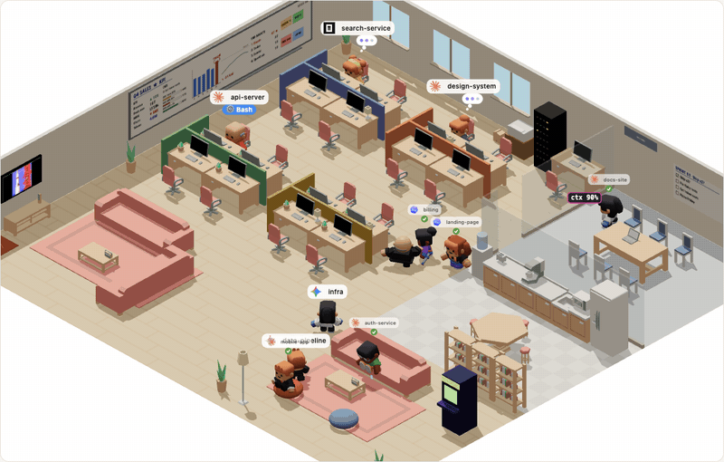
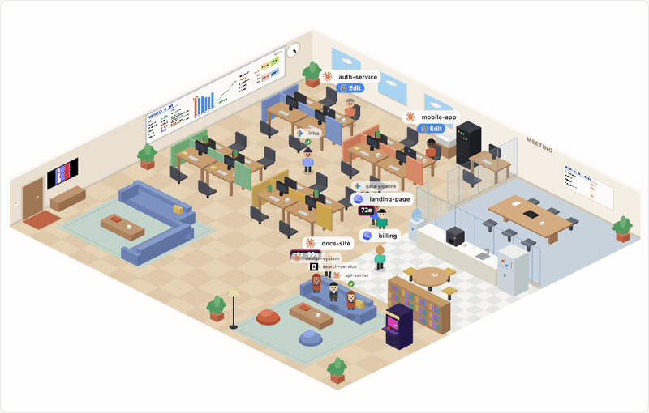
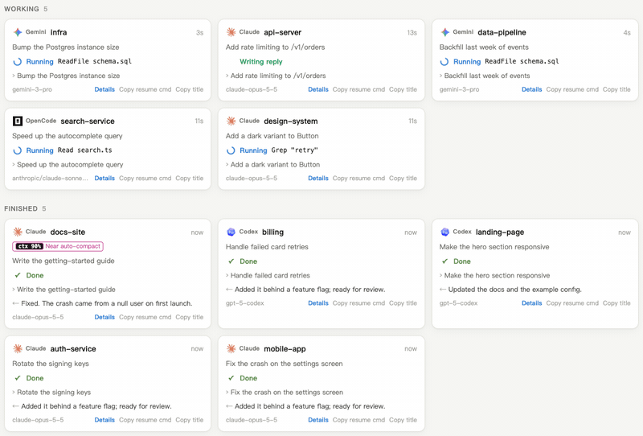

# 🪑 whatsmyagentdoing

**即時看到你機器上每一個 Claude Code、Codex、Gemini CLI 與 OpenCode agent 正在做什麼——在一間小小的辦公室裡。** 裝成 skill 輸入 `/myoffice`，或直接執行建好的單檔 Go 執行檔；兩者跑的是同一支 Go 程式。



| Medium（2D） | 清單 |
|---|---|
|  |  |

<sub>以 `--demo`（虛構團隊）錄製，畫面中沒有任何真實 session。</sub>

## 倉庫結構

| 路徑 | 內容 |
|---|---|
| [`skills/myoffice/`](skills/myoffice/) | skill 本體：`SKILL.md`、網頁與 3D 模型的真源、建好後放進 `bin/` 的 Go 執行檔（不進版控）。可被 ai-global 安裝。 |
| [`go-app/`](go-app/) | Go 後端原始碼：skill 呼叫的執行檔從這裡建出，網頁與模型內嵌在執行檔裡，不依賴本倉庫其他目錄。 |
| [`scripts/`](scripts/) | `build.sh` 重建執行檔、`installSkill.sh` 把它複製進 skill、`start.sh` 兩者做完再重啟儀表板。 |
| [`docs/`](docs/) | 示範動畫、資安檢視報告、施工筆記。 |
| [`jerry-report/`](jerry-report/) | 原 Node 版 skill 的系統分析（歷史文件）；現行 Go 版的在 [`go-app/jerry-report/`](go-app/jerry-report/)。 |

## 安裝 skill

**用 [ai-global](https://github.com/lazyjerry/ai-global) 一次裝給所有 AI 工具：**

```bash
ai-global add-skill lazyjerry/whatsmyagentdoing
```

它會找到 `skills/myoffice/`，裝進 `~/.ai-global/v-skills/` 並以 symlink 同步給 Claude Code、Codex 等工具；之後用 `ai-global update-skills` 更新，`ai-global remove-skill lazyjerry/whatsmyagentdoing` 移除。第一次輸入 `/myoffice` 時，agent 會檢查 Go、clone 本倉庫建出執行檔並放進 skill（沒有 Go 會先請你安裝）。

**或自己動手：** skill 不在倉庫根目錄，所以 clone 一份再把 `skills/myoffice/` 連進各工具的 skills 目錄。

```bash
git clone --depth 1 https://github.com/lazyjerry/whatsmyagentdoing ~/.whatsmyagentdoing/src

# Claude Code
ln -s ~/.whatsmyagentdoing/src/skills/myoffice ~/.claude/skills/myoffice
# Codex
ln -s ~/.whatsmyagentdoing/src/skills/myoffice ~/.codex/skills/myoffice

# 建執行檔並放進 skill（需要 Go 1.22 以上；跳過也行，第一次 /myoffice 時 agent 會補做）
~/.whatsmyagentdoing/src/scripts/build.sh
~/.whatsmyagentdoing/src/scripts/installSkill.sh
```

**或請你的 agent 幫你裝。** 把這段貼進 Claude Code 或 Codex：

> Install the myoffice skill from https://github.com/lazyjerry/whatsmyagentdoing: clone it with `git clone --depth 1` into `~/.whatsmyagentdoing/src`, then symlink `~/.whatsmyagentdoing/src/skills/myoffice` to `~/.claude/skills/myoffice` (for Codex: `~/.codex/skills/myoffice`), check that `go version` is 1.22 or newer (if Go is missing, tell me how to install it and stop), run `~/.whatsmyagentdoing/src/scripts/build.sh` and `~/.whatsmyagentdoing/src/scripts/installSkill.sh`, then tell me to start a new session and type /myoffice.

接著輸入 **`/myoffice`**（或直接問「我的 agent 在做什麼？」）。辦公室會在瀏覽器裡開啟。要更新就說 `/myoffice update`（會 `git pull` 並重新 `go build`），或在頁面上按「檢查更新」；ai-global 安裝的用 `ai-global update-skills`，再輸入一次 `/myoffice` 重建執行檔。

建置需要 Go 1.22 以上，執行時不需要 Node.js。不想用 skill？直接執行 `go-app/whatsmyagentdoing` 也行。

## Go 版啟動

Go 版把網頁、3D 模型、場景目錄與版本號都用 `go:embed` 包進單一執行檔，建好後可以複製到任何地方執行，不需要 Node.js，也不需要這個 clone。以下節錄自 [go-app/README.md](go-app/README.md)，完整的旗標、更新流程與環境變數請看那份：

> ### 建置
>
> ```bash
> cd <clone>
> scripts/build.sh            # 同步 static/ 再 go build，產物在 go-app/whatsmyagentdoing
> scripts/installSkill.sh     # 複製到 skills/myoffice/bin/，SKILL.md 呼叫的就是這份
> scripts/start.sh            # 上面兩步做完再（重新）啟動儀表板；執行檔內嵌前端，改完一定要重啟才看得到
> ```
>
> `scripts/build.sh` 找不到 `go` 會印出安裝方式並以非零結束。`static/` 是內嵌副本，真源在 `skills/myoffice/`；前端有改動就重跑建置。
>
> ### 啟動
>
> ```bash
> ./whatsmyagentdoing
> ```
>
> 會在 `127.0.0.1:4545` 架起儀表板並開啟瀏覽器；印出的那一行就是網址。已在執行時，同一道指令只會重新開瀏覽器分頁。連接埠被別的程式占住時，自動往後找最多 10 個埠。
>
> ### 重啟
>
> ```bash
> ./whatsmyagentdoing --stop
> ./whatsmyagentdoing
> ```

skill 呼叫的就是這個執行檔（`scripts/installSkill.sh` 複製到 `skills/myoffice/bin/`），旗標完全相同（見下方「選項」）。

## 它長什麼樣

開啟的是一間等角視角的**辦公室**。正在工作的 agent 坐在隔間座位上：思考時冒出思考泡泡、執行工具時打字且螢幕上有程式碼捲動、需要你介入時會站起來揮手。最近剛完工的幾個 agent 會留在辦公室裡下班閒晃：到茶水間喝咖啡、喝水，坐沙發、懶骨頭，逛書架，在會議室白板前塗寫，打街機、打桌球或手足球（兩個人都有空時），進電話亭，或找張空桌小睡。其他人都回家了。窗景跟著你的本地時間變化（Medium 模式還有一隻辦公室貓）。滑鼠移到任何人身上就能看到它正在處理什麼。

兩種畫風：**Medium** 是手繪風 2D canvas（零依賴）。**High（3D）** 用即時光影渲染同一間辦公室，採用 [Kenney](https://kenney.nl) 的 CC0 *Mini Characters*（含走路／坐下／互動動畫）與 *Furniture Kit*；拖曳旋轉、捲動縮放。3D bundle（three.js，gzip 後約 180 KB）與模型（約 1.3 MB，meshopt 壓縮）只在選擇 High 時才載入。

**場景（3D）：** 辦公室內建；其他場景是可下載的小型場景包（Pirate Cove、Café、Space Station、Castle 各 100–160 KB），只在你從場景按鈕點選、執行 `--scene pirate`、或請 agent 幫你切換時才會抓取。場景包只有資料（一份 manifest 加上 Kenney CC0 模型），安裝到 `~/.whatsmyagentdoing/scenes` 前會先比對釘住的 SHA-256。skill 版與 Go 版共用這個目錄。

偏好純卡片？切到**清單**檢視。不論哪種檢視，每個 session 都是即時更新：

| 狀態 | 意義 |
|---|---|
| 💭 思考中 | 正在推理，或在讀工具結果 |
| ⏳ 執行中 | 有工具呼叫正在跑——會顯示是哪個（`Bash: npm test`、`Edit app.ts`、`github · create_pr`） |
| ✍️ 撰寫回覆 | 已開始回答，但這一輪還沒結束 |
| 🟠 等你回應 | 問了你問題／需要你核准 |
| ✅ 完成 | 這一輪結束，附上最後的回覆 |
| ■ 中斷／❗ 錯誤／– 閒置 | |

介面支援 English、繁體中文、简体中文、日本語、한국어、Español、Français、Deutsch 與 Português。預設跟著你寫 prompt 的語言（沒有就跟瀏覽器語言）；可從 🌐 選單手動指定。

清單檢視中，session 分成 **需要你 → 工作中 → 已完成** 三組，附目前這一輪的即時計時器、resume 指令的複製按鈕（`claude --resume …` / `codex resume …`）、agent 完工時的瀏覽器通知（可選），以及 Claude / Codex / subagent 篩選器。分頁標題會顯示有多少個 agent 在工作。

**Agent 徽章：** 2D 與 3D 中，每個 agent（含 subagent）名字旁都有透明底的 Claude、Codex、Gemini、OpenCode 官方 logo。相同圖示也出現在圖例、清單卡片與篩選器。到 **設定 → Agent 徽章** 可隱藏辦公室標記與圖例，設定會保存。圖示隨套件附帶於本機，圖片載入失敗時以縮寫字母替代。詳見[圖示來源與授權](skills/myoffice/assets/agents/README.md)。

工具列固定顯示檢視、2D/3D 與彈出視窗控制項。場景選擇、agent 篩選、顯示選項、通知與語言則收在**設定**裡。

**彈出視窗：** 支援 [Document Picture-in-Picture API](https://developer.chrome.com/docs/web-platform/document-picture-in-picture) 的瀏覽器可以把辦公室或清單開成可互動、永遠置頂的視窗。精簡清單只顯示 **需要你** 與 **工作中**。瀏覽器儲存可用時，檢視、畫質、場景、篩選、語言與徽章設定會與主分頁同步。關閉彈出視窗會還原主檢視，且只有主分頁會送通知。

當 Document PiP 不可用時，辦公室檢視的 **彈出** 會改為啟動本機的唯讀影片預覽（2D 或 3D 辦公室）。用它的影片 PiP 按鈕，或瀏覽器自己的影片控制項／右鍵選單（例如 Firefox）把它浮起來。用完請停止預覽。不需要螢幕分享權限，也不會上傳任何影片。背景動畫可能因瀏覽器節流而降低幀率；這個 fallback 不支援清單卡片，也不能點選 agent。

支援 Claude Code（CLI、桌面版、IDE）、Codex（CLI、桌面版、IDE）、Gemini CLI、Google Antigravity（`agy` CLI 與 IDE）與 OpenCode（TUI 與 `opencode run`）——只要會把 session 紀錄寫到磁碟的工具都行。Antigravity 的對話本體是未公開的二進位格式，這裡讀的是它旁邊的 SQLite 摘要庫（標題、第一句提示、工作區、狀態、時間），所以看不到回覆內容，CLI 執行中也只會在寫入摘要時更新。 OpenCode 把 session、訊息與工具呼叫都寫進一個 SQLite 資料庫，狀態與回覆都讀得到，但權限詢問不會落地，等你核准的工具會一直顯示「執行中」。

## 選項

skill 的 `skills/myoffice/bin/whatsmyagentdoing` 與直接建出的 `go-app/whatsmyagentdoing` 是同一支程式：

```
-p, --port <n>    連接埠（預設 4545；被佔用時取下一個可用的）
--hours <n>       只顯示最近 n 小時內有活動的 session（預設 24）
--no-open         不開啟瀏覽器
--private         隱藏 prompt、回覆與標題——只顯示狀態（螢幕分享安全）
--json            輸出一份 JSON 快照後結束
--demo            顯示虛構團隊而非你的 session（截圖、試玩用）
--stop            停止正在執行的 dashboard（或說 /myoffice stop）
--update          更新到最新版並重啟（或說 /myoffice update）
--scenes          列出 3D 場景，含已安裝與可下載的
--scene <id>      視需要下載場景，並以該場景開啟辦公室
```

執行中再跑一次只會重新開啟分頁。

**更新：** 頁面右下角有 **檢查更新** 按鈕，滑鼠移上去顯示目前版本號，旁邊的時鐘是主機目前時間（由 `sw.js` 這個 service worker 對 `/api/time` 校準，所有分頁共用同一個時間差）；只有按下按鈕時才會抓一次本 repo main 分支的 `skills/myoffice/package.json`，不會自動檢查，有新版時改顯示 **Update** 按鈕。要改成自動（頁面載入與每半小時、CLI 啟動時都檢查），把 `go-app/config.go` 的 `AutoUpdateCheck` 改成 `true`；設定 `WMAD_NO_UPDATE_CHECK=1` 則兩種模式都不檢查。按下按鈕——或執行 `--update`、或說 `/myoffice update`——會在 clone 執行 `git pull`、重新同步 `static/` 並重新 `go build`（需要 Go），只在執行檔還放在 clone 的 `go-app/` 或 `skills/myoffice/bin/` 裡時可用。

## 運作原理

不需要 hook、不需要設定、不需要 API key。這些工具本來就會在工作時把每則訊息與工具呼叫 append 到 JSONL 檔：

- Claude Code：`~/.claude/projects/<project>/<session>.jsonl`（＋ `subagents/`）
- Codex：`~/.codex/sessions/YYYY/MM/DD/rollout-*.jsonl`
- Gemini CLI：`~/.gemini/tmp/<project>/chats/session-*.jsonl`（專案路徑取自 `~/.gemini/projects.json`）
- Google Antigravity：`~/.gemini/antigravity/conversation_summaries.db`（SQLite，透過系統的 `sqlite3` 指令唯讀查詢；沒有 `sqlite3` 就略過這個來源）
- OpenCode：`~/.local/share/opencode/opencode.db`（SQLite，`XDG_DATA_HOME` 可改位置；同樣透過 `sqlite3` 唯讀查詢，沒有就略過）

`whatsmyagentdoing` 以唯讀方式 tail 這些檔案，把最新事件轉成狀態，再透過 Server-Sent Events 推到頁面。檔案位置不同的話，設定 `CLAUDE_CONFIG_DIR` / `CODEX_HOME` / `GEMINI_CLI_HOME` 即可。

**隱私：** 沒有任何東西離開你的機器。伺服器只綁定 `127.0.0.1`，並拒絕非 localhost 的請求。沒有執行期依賴——後端只用 Go 標準函式庫（`go-app/`），沒有第三方套件。（`skills/myoffice/web/office3d.js` 是 3D 原始碼；`npm run build` 會把它與 three.js 打包成 `public/office3d.js`。）

## 限制

- Log 是以完成的區塊為單位寫入，不是逐 token，所以「撰寫回覆」代表一個回覆區塊已落地且這一輪還沒結束——不是即時的按鍵串流。
- Claude Code 與 OpenCode 不會記錄權限提示，所以等待你核准的工具會一直顯示「執行中」直到你回應（Codex 與 Gemini CLI 會記錄，因此會顯示「等你回應」）。
- Gemini CLI 把思考過程與回覆一起寫入，所以從你的 prompt 到它第一次工具呼叫或回覆之間，只會顯示「思考中」。
- Log 格式不是公開 API。若更新改了格式，狀態判讀可能退化——請開 issue 回報。

## 開發檢查

前端的開發檢查在 `skills/myoffice/` 內執行，需要 Node.js 20 以上（只有開發需要，dashboard 本身不需要 Node.js）。先 `npm install`，再以 `npm run build` 重建已提交的 3D bundle；重建後跑 `scripts/build.sh && scripts/installSkill.sh` 讓執行檔的內嵌副本跟上。若有安裝 Google Chrome，`npm run test:ui` 會啟動 `bin/whatsmyagentdoing --demo` 對虛構 session 執行瀏覽器回歸檢查。用 `WMAD_HEADED=1 npm run test:ui` 可看到測試視窗，或設定 `WMAD_SCREENSHOTS` 為輸出資料夾以保存截圖。這些檢查使用 Chrome；Firefox 與 Safari 的原生影片控制項仍需手動測試。

Go 版的檢查見 [go-app/README.md](go-app/README.md) 的「開發」一節。

## 授權

MIT，見 [LICENSE](LICENSE)。本倉庫 fork 自 [Charonyuu/whatsmyagentdoing](https://github.com/Charonyuu/whatsmyagentdoing)，原作者 cheoyu；Go 後端等後續改寫由 LazyJerry 維護，LICENSE 內兩者的版權聲明並列。

授權檔隨每種散佈形式附帶：`skills/myoffice/LICENSE` 跟著 skill 安裝；Go 執行檔內嵌同一份，啟動後開 `http://127.0.0.1:4545/LICENSE` 可讀。

第三方內容：

- **three.js**（MIT，Copyright Three.js Authors）：3D 畫面使用，授權聲明保留在 `public/office3d.js` 尾端。
- **Kenney** 模型（CC0）：`skills/myoffice/assets/kenney/` 與各場景包，見目錄內的授權檔。CC0 不要求署名，仍感謝 [Kenney](https://kenney.nl)。
- **Agent logo**：Claude、Codex、Gemini、OpenCode 的官方圖示為各自所有者的商標，本專案未獲其背書，MIT 授權不及於商標；來源見[圖示來源與授權](skills/myoffice/assets/agents/README.md)。
