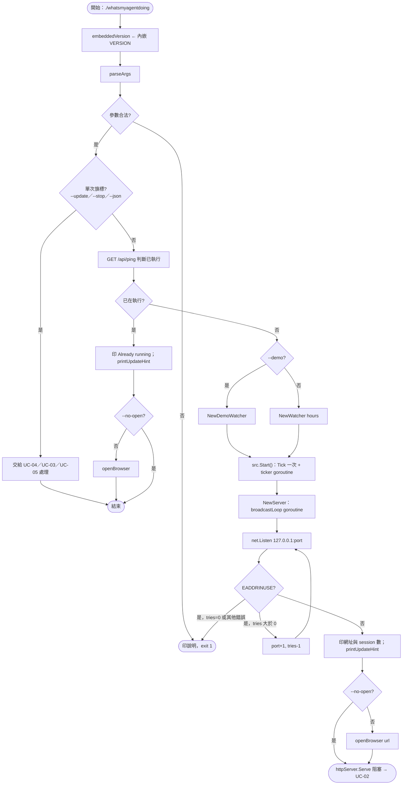
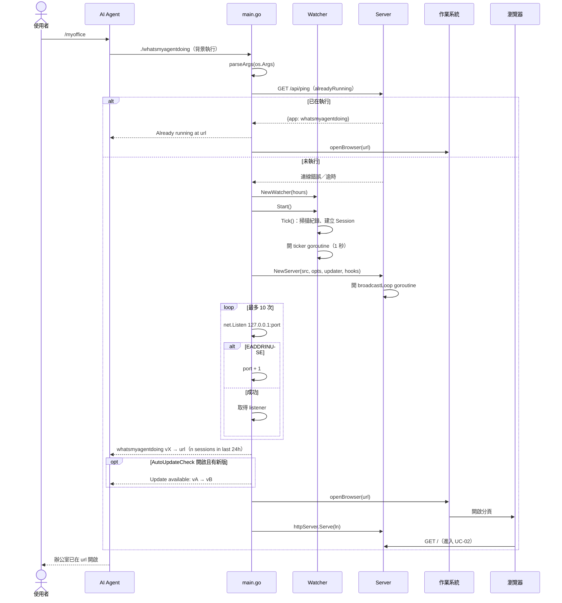

# UC-01 啟動儀表板

| 項目 | 內容 |
|---|---|
| 主要參與者 | 使用者（直接執行）或 AI Agent（skill 改指向 Go 執行檔時代為執行） |
| 次要參與者 | 作業系統（開啟瀏覽器）、GitHub（`AutoUpdateCheck` 開啟時的版本提示） |
| 前置條件 | 已建置出執行檔（UC-09）；執行時不需 Node.js、不需 Go 工具鏈、不需 clone |
| 觸發 | `./whatsmyagentdoing [options]` |
| 後置條件 | 伺服器在 `127.0.0.1:<port>` 監聽，瀏覽器分頁開啟；或已在執行時只重開分頁 |
| 相關程式 | `main.go`（`parseArgs`、`alreadyRunning`、`openBrowser`、`isAddrInUse`、`main`）、`watcher.go`（`NewWatcher`、`Start`）、`server.go`（`NewServer`）、`embed.go`（`embeddedVersion`） |

## 主要流程

1. 套件初始化時 `embed.go` 讀內嵌 `VERSION` 得到 `embeddedVersion`；`main()` 建 `Updater`，以它的 `LocalVersion()` 當版本字串。
2. `parseArgs` 解析參數（port、hours、no-open、private、json、demo、stop、update）；數值不合法或選項未知則印說明並以 1 離開；`-h`／`-v` 印完以 0 離開。
3. 單次旗標先判斷 `--update`（UC-04）；命中就處理後 return。
4. 再判斷 `--stop`（UC-03）；命中就處理後 return。
5. 再判斷 `--json`（UC-05）；命中就處理後 return。
6. 對 `127.0.0.1:<port>/api/ping` 發 GET（逾時 0.8 秒），回應含 `whatsmyagentdoing` 就是已在執行。
7. 未執行：依 `--demo` 建 `DemoWatcher` 或 `Watcher(hours)`，型別為 `Source` 介面；`Start()` 先同步跑一次 `Tick()`（立即掃描紀錄），再開 ticker goroutine。
8. `NewServer(src, opts, updater, onShutdown, onRestart)`：建立 client 集合並啟動 `broadcastLoop` goroutine。
9. `net.Listen("tcp", "127.0.0.1:<port>")`：失敗且為 EADDRINUSE 則 port+1 重試，最多 10 次；其他錯誤印出並以 1 離開。
10. 印 `whatsmyagentdoing v<ver> → http://localhost:<port>  (<n> session(s) in the last <h>h, Ctrl+C to stop)`；demo 時印 `demo team`。`AutoUpdateCheck` 開啟時再強制檢查一次新版並印「Update available」（UC-04）。
11. 若未指定 `--no-open`，以 `open`／`xdg-open`／`cmd /c start` 開瀏覽器。
12. `httpServer.Serve(ln)` 阻塞；瀏覽器載入 `/`，進入 UC-02。

## 替代流程

- **A1 已在執行**：步驟 6 命中 → 印「Already running at …」、`printUpdateHint`、未 `--no-open` 則重開瀏覽器分頁後 return；不另起伺服器。
- **A2 `--demo`**：步驟 7 改建 `DemoWatcher`（UC-06）。
- **A3 `--private`**：`Options.Privacy = true`，快照遮蔽 prompt、reply、title（UC-08）。
- **A4 連接埠連續 10 個都被占**：步驟 9 印錯誤並以 1 離開。
- **A5 `--demo` 與 `--json` 並用**：步驟 5 先命中 `--json`，仍讀真實紀錄，`--demo` 無效（與 Node 版相同）。
- **A6 `Serve` 回傳非 `ErrServerClosed` 的錯誤**：印錯誤以 1 離開。

## 流程圖

## 循序圖

## 備註

- `alreadyRunning` 只探測 `--port` 指定的那一個連接埠；若先前的儀表板因 4545 被占而落到 4546，再次執行會因 4545、4546 皆占用而開到 4547，形成第二個實例。`--stop` 會掃 port 到 port+10 全部停掉。與 Node 版行為一致。
- `isAddrInUse` 除了 `errors.Is(err, syscall.EADDRINUSE)`，也比對錯誤訊息「address already in use」與 Windows 的「Only one usage of each socket address」。
- `onShutdown`／`onRestart` 兩個閉包在 `NewServer` 之前宣告，但引用的 `app` 與 `httpServer` 變數在之後才賦值；兩者只會在伺服器已經在跑時被呼叫，所以不會拿到 nil。
- 版本號在套件初始化時就定了，整個行程不變；這是 UC-04 更新後要重啟才會看到新版號的原因。
