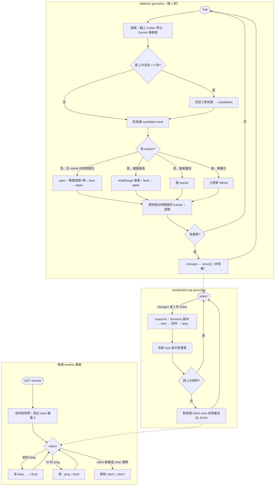
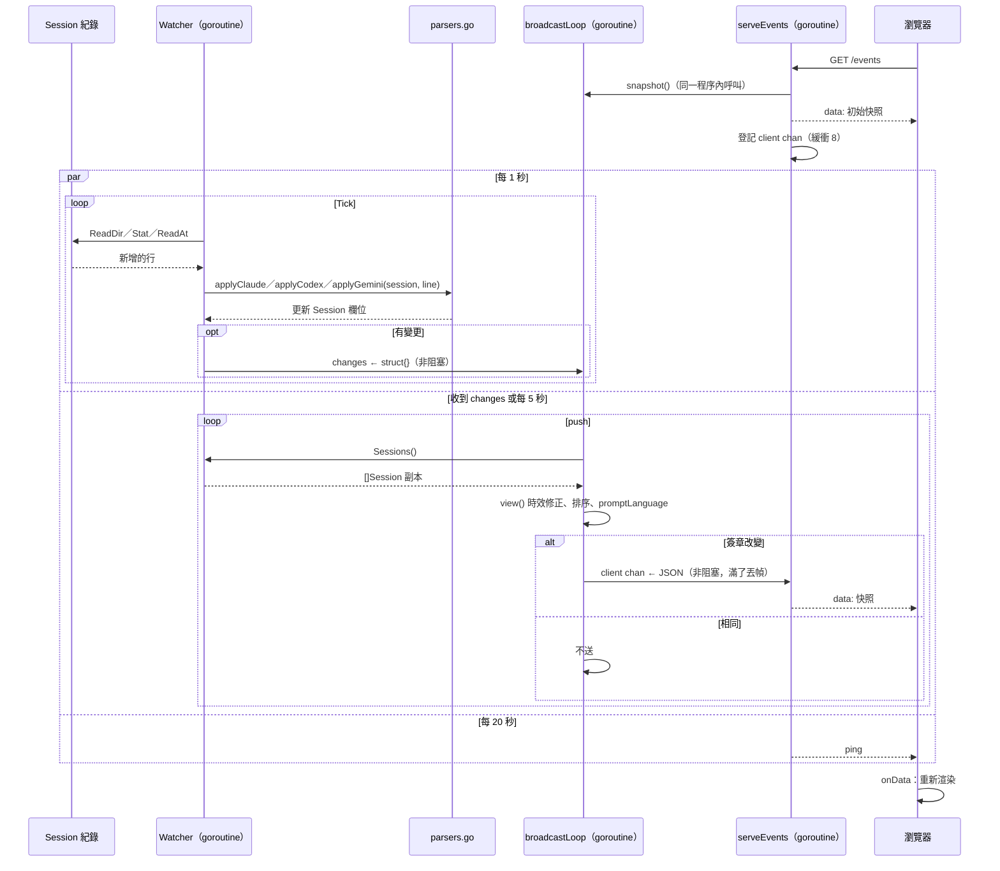

# UC-02 即時監看 agent 狀態

| 項目 | 內容 |
|---|---|
| 主要參與者 | 使用者（看儀表板） |
| 次要參與者 | Session 紀錄（Claude Code、Codex、Gemini CLI 寫在磁碟上的 JSONL）、瀏覽器 |
| 前置條件 | 伺服器已啟動（UC-01）且非 demo |
| 觸發 | 瀏覽器載入 `/` 後自動連 `/events` |
| 後置條件 | 畫面持續反映每個 agent 的狀態、工具、prompt 與回覆；紀錄有變化時數秒內更新 |
| 相關程式 | `watcher.go`（`Tick`、`track`、`open`、`feed`、`Sessions`）、`parsers.go`（三個 apply 函式、`clean`）、`server.go`（`broadcastLoop`、`push`、`snapshot`、`view`、`serveEvents`）、`lang.go` |

## 主要流程

三條 goroutine 以 channel 串起來：Watcher 讀紀錄、broadcastLoop 算快照、每個 SSE 連線各自送出。

### 讀紀錄（Watcher ticker goroutine，每 1 秒）

1. `Tick()` 取鎖；`loadCodexIndex`、`loadGeminiProjects` 比對 mtime，變了才重讀（Codex 索引只讀最後 2 MB；Gemini 把 `projects.json` 的 slug 與 `sha256(path)` 都對回專案路徑）。
2. 距上次走訪超過 5 秒：重新走訪三家目錄得到 `candidates`（Codex 只走時間窗內的日期目錄）；否則沿用上次的清單。
3. 對每個 candidate 呼叫 `track`：
   - 在 `failed` 且未到重試時間 → 跳過
   - 沒有 tracker 且 mtime 在時間窗內 → `open`：建 `Session`，子代理填 `ParentID`、`Subagent`；檔案不超過 896 KB 整檔讀，否則讀頭 128 KB（取 cwd、title、model）加尾 768 KB（取目前狀態，丟掉第一行殘缺）；Gemini 舊版 `.json` 整份解析並標 `whole`
   - 已有 tracker 且檔案變長 → `readRange(offset, size)` 讀增量
   - 檔案變短 → 丟掉 tracker，下一輪重開
   - `whole` 且 mtime 變了 → 整檔重讀
   - 讀取失敗 → 記入 `failed`，60 秒後重試，刪掉 tracker
4. `feed` 把 `partial` 加新內容依 `\n` 切行，最後一段留作下次的 `partial`；每行 `json.Unmarshal` 成 `any`，交給該 agent 的 apply 函式更新 `*Session`（規則見 structure.md 第 8 節）。
5. 移除 `LastEventAt`（或 mtime）早於時間窗的 tracker。
6. 放鎖；任一步有變更就對 `changes`（緩衝 1）做非阻塞送出。

### 算快照（broadcastLoop goroutine）

7. `select` 收到 `changes` 或 5 秒 ticker 到期，呼叫 `push(false)`。
8. `snapshot()`：`src.Sessions()` 取得 struct 副本（補 Gemini cwd／mtime、Codex 名稱）；每筆 `view()` 做時效修正與隱私；依 `LastEventAt` 降冪；`promptLanguage` 猜語言。
9. `json.Marshal` 後把開頭的 `{"now":…,` 換成 `{` 當簽章；與上次相同就不送。
10. 不同則更新 `last`，對每個 client channel 非阻塞送出整份 JSON；塞滿（8 幀）的 client 丟掉這一幀。

### 送出（每個 `/events` 連線一條 goroutine）

11. 連線時立刻送一次快照，再建 `chan string`（緩衝 8）登記到 `clients`。
12. 迴圈 `select`：收到 body 就寫 `data: …\n\n` 並 flush；20 秒沒事寫 `: ping\n\n`；client 斷線（`r.Context().Done()`）或 channel 被關（伺服器關閉）就離開並從 `clients` 移除。
13. 瀏覽器 `EventSource` 收到 `onData`，更新畫面（前端邏輯見上層 UC-02）。

## 替代流程

- **A1 讀不到某個紀錄檔**（權限、讀取中被刪）：`track` 回錯誤，該檔記入 `failed`、tracker 移除，其餘照常；60 秒後重試。伺服器不會因此中止。
- **A2 紀錄沒有新內容但狀態該變**（例如 typing 靜默超過 45 秒）：5 秒 ticker 觸發 `push`，`view()` 的時效判定讓簽章改變，照常推送。
- **A3 多個 tick 連續有變更**：`changes` 緩衝只有 1，多次送出合併成一次通知；broadcastLoop 一次 `push` 就拿到最新狀態。
- **A4 某個 client 很慢**：它的 channel 塞滿後丟幀，其他 client 不受影響；它之後收到的是更新的快照，不會落後太久。
- **A5 瀏覽器斷線**：`r.Context().Done()` 觸發，handler 從 `clients` 移除並關閉 channel；`EventSource` 自動重連會重新走步驟 11。
- **A6 伺服器關閉**（UC-03、UC-04）：`closeClients` 關掉所有 channel，handler 收到 `!ok` 就 return，`httpServer.Shutdown` 得以完成。
- **A7 檔案被整個改寫變短**：丟掉 tracker，下一輪以新檔重開；session 狀態重建。

## 流程圖

## 循序圖

## 備註

- Watcher 不用 fsnotify 而用輪詢，理由寫在 `watcher.go` 檔頭：三個平台行為一致，幾百個檔案的 stat 迴圈很便宜。
- `Sessions()` 回傳的是值的切片，但在複製前會直接改寫 tracker 內 `*Session` 的 `Cwd`、`LastEventAt`、`Title`（Gemini、Codex 的補值）。這些補值是冪等的，而且在鎖內進行，不會造成 race。
- `track` 在「檔案變短」分支刪掉 tracker 後仍對同一個 `t.session.Mtime` 賦值；那個 session 已不在 map 內，下一輪重開會建新的，所以無害。
- `failed` 的項目在重試成功後不會被刪，但時間已過，`w.failed[c.file] > now` 不成立，之後每輪照常處理。
- 大檔只讀頭尾，中段的事件不會被套用；「頭」提供 cwd、title、model，「尾」提供現在的狀態，這是刻意的取捨（與 Node 版相同）。
