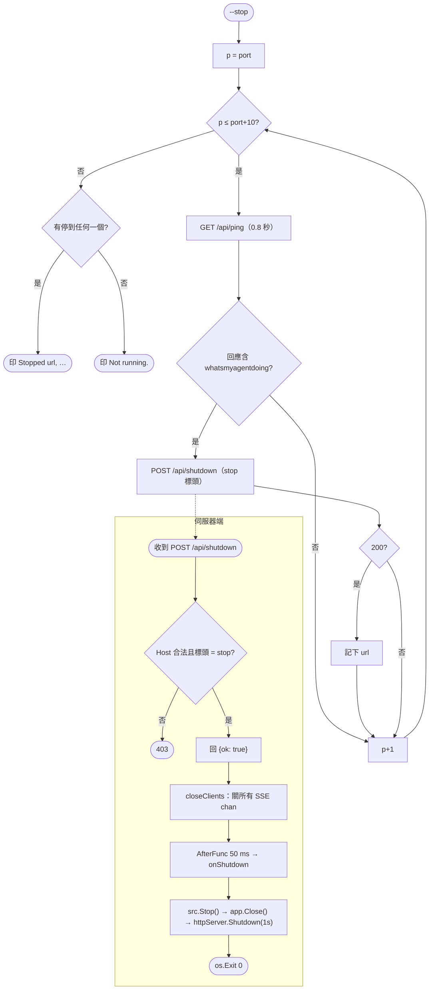
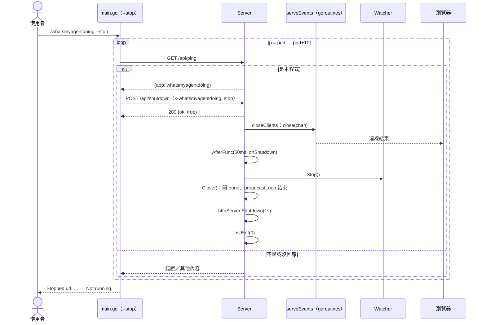

# UC-03 停止儀表板

| 項目 | 內容 |
|---|---|
| 主要參與者 | 使用者（終端機）或 AI Agent（`/myoffice stop`） |
| 次要參與者 | 執行中的伺服器行程 |
| 前置條件 | 有一個或多個儀表板在 `--port` 起算的 11 個連接埠上執行 |
| 觸發 | `./whatsmyagentdoing --stop [-p n]`、終端機 Ctrl+C |
| 後置條件 | 伺服器行程結束，SSE 連線關閉，瀏覽器頁面顯示斷線 |
| 相關程式 | `main.go`（`--stop` 分支、`alreadyRunning`、`stopAt`、`onShutdown` 閉包）、`server.go`（`/api/shutdown`、`closeClients`、`Close`） |

## 主要流程

1. 使用者執行 `--stop`。`parseArgs` 後進入 `o.Stop` 分支（在 `--scene` 安裝之後、`--json` 之前）。
2. 對 `p = port … port+10` 逐一 `alreadyRunning(p)`：GET `/api/ping`（逾時 0.8 秒），回應含 `whatsmyagentdoing` 才算。
3. 命中的連接埠呼叫 `stopAt(p)`：POST `/api/shutdown`，帶標頭 `x-whatsmyagentdoing: stop`，逾時 1.5 秒；狀態 200 視為成功。
4. 伺服器端 `ServeHTTP`：Host 白名單通過、標頭等於 `stop` 且 `shutdown` 鉤子存在 → 回 `{ok: true}`；`closeClients()` 關掉所有 SSE channel；`time.AfterFunc(50ms, onShutdown)`。
5. `onShutdown`（`main.go`）：`src.Stop()`（關 Watcher 的 `stop` channel，ticker goroutine 結束）→ `app.Close()`（關 `done`，broadcastLoop 結束；再次 `closeClients`）→ `httpServer.Shutdown`（1 秒）→ `os.Exit(0)`。
6. CLI 收集成功的網址，印 `Stopped http://localhost:4545, …`；沒有命中則印 `Not running.`。

## 替代流程

- **A1 Ctrl+C**：Go 預設的 SIGINT 處理直接結束行程，不經 `onShutdown`；作業系統回收 listener 與連線。程式沒有註冊 signal handler。
- **A2 缺標頭或錯誤標頭**：`/api/shutdown` 回 403，不關閉。
- **A3 Host 非 loopback**：403。
- **A4 連接埠上是別的程式**：`/api/ping` 回應不含識別字串，`alreadyRunning` 回 false，略過。
- **A5 `--update` 之後的停止**：UC-04 的 CLI 路徑用同一組 `alreadyRunning` 加 `stopAt` 停掉舊實例。

## 流程圖

## 循序圖

## 備註

- `--stop` 掃 11 個連接埠，所以就算先前因退讓開在 4547 也能停掉；相對地 UC-01 的 `alreadyRunning` 只看一個埠。
- `closeClients` 在 handler 與 `Close()` 各呼叫一次；兩處都先查 map 再 `close`，SSE handler 的 defer 也先查 map，避免 double close。
- Shutdown 的 1 秒逾時：SSE 連線已被 channel 關閉打斷，一般請求很短，`Shutdown` 幾乎立刻回來；逾時只是保險。
- 回應先寫出再 50 ms 後關閉，是為了讓 CLI 收得到 200；Node 版同樣先回應再 `setTimeout`。
