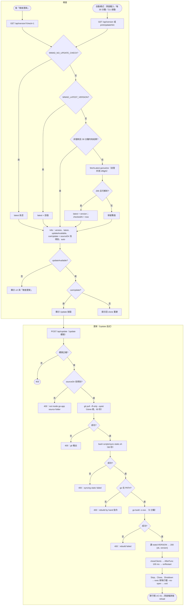
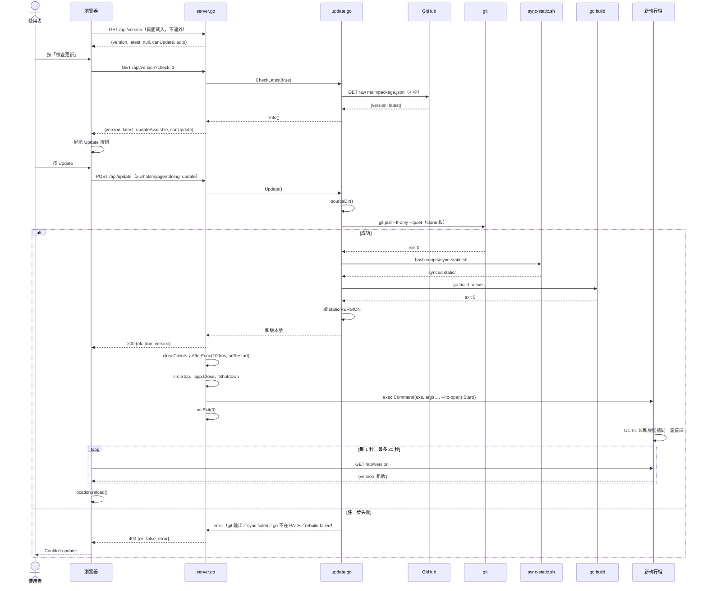
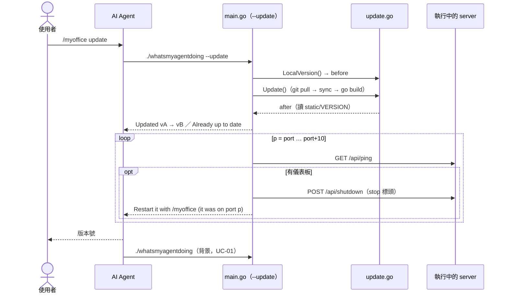

# UC-04 檢查新版並更新

| 項目 | 內容 |
|---|---|
| 主要參與者 | 使用者（頁面按鈕）或 AI Agent（`--update`） |
| 次要參與者 | GitHub（raw `package.json`、git remote）、工具鏈（`git`、`bash`、`go`） |
| 前置條件 | 檢查：未設 `WMAD_NO_UPDATE_CHECK`。更新：執行檔還在 clone 的 `go-app/` 裡（或 `WMAD_SRC` 指過去），`go` 在 PATH 上，clone 可 fast-forward |
| 觸發 | 頁面「檢查更新」按鈕、Update 按鈕、`--update`；`AutoUpdateCheck` 開啟時另加頁面載入、每 30 分鐘、CLI 啟動 |
| 後置條件 | clone 為最新版、`static/` 已同步、執行檔已重建；頁面路徑會以新執行檔重啟，CLI 路徑停掉舊實例 |
| 相關程式 | `update.go`（`Updater`、`CheckLatest`、`Info`、`Update`）、`util.go`（`sourceDir`）、`config.go`（`LatestURL`、`AutoUpdateCheck`）、`server.go`（`/api/version`、`/api/update`）、`main.go`（`--update`、`printUpdateHint`、`onRestart`）、`scripts/sync-static.sh` |

## 主要流程

### 檢查

1. 頁面載入 GET `/api/version`；`AutoUpdateCheck` 關閉（預設）時只回已知資訊，不連外。使用者按「檢查更新」才 GET `/api/version?check=1`。
2. `CheckLatest(force)`：`WMAD_NO_UPDATE_CHECK` 設定 → 回空；`WMAD_LATEST_VERSION` 設定 → 直接採用；非強制且 30 分鐘內有結果 → 用快取；否則若沒有在飛的抓取就開一條 goroutine `fetchLatest`（GET `LatestURL`，逾時 4 秒、上限 64 KB、解析 `version`），所有同時呼叫者等同一個 `inflight` channel。
3. `Info()`：`{version: embeddedVersion, latest, updateAvailable: newer(latest, version), canUpdate: sourceDir() != "", auto: AutoUpdateCheck}`。`newer` 逐段比較三節數字。
4. 前端依結果顯示 `v0.3.0`、「檢查更新」、「已是最新版」、「Update to vX」或「用 git pull 更新」（canUpdate 為 false 時）。

### 從頁面更新

5. 使用者按 Update；POST `/api/update`，帶標頭 `x-whatsmyagentdoing: update`。
6. `Updater.Update()`：
   - `sourceDir()` 找不到 → 回錯誤「not inside its go-app/ source folder…」
   - 在 clone 根（`src` 的上一層）執行 `git pull --ff-only --quiet`，逾時 60 秒；失敗以輸出為錯誤訊息
   - 在 `src` 執行 `bash scripts/sync-static.sh`，逾時 60 秒
   - `exec.LookPath("go")` 找不到 → 回錯誤並附手動指令 `cd <src> && go build -o <exe> .`
   - 在 `src` 執行 `go build -o <exe> .`（`exe` 為解過 symlink 的 `os.Executable()`），逾時 5 分鐘
   - 讀 `src/static/VERSION` 回傳新版本號（目前行程內嵌的仍是舊的）
7. 回 `{ok: true, version}`；`closeClients()`；`time.AfterFunc(100ms, onRestart)`。
8. `onRestart`：`src.Stop()`、`app.Close()`、`httpServer.Shutdown`；以 `os.Executable()` 加原參數（去掉 `--no-open` 與 `--scene*`，再加 `--no-open`）`exec.Command(...).Start()`；`os.Exit(0)`。
9. 新執行檔啟動（UC-01），`embeddedVersion` 為新版；頁面每秒 GET `/api/version`，版本變了或超過 20 秒就 reload。

### 從 CLI 更新

10. `./whatsmyagentdoing --update`：記下 `before = LocalVersion()`，呼叫 `Update()`，印「Updated vA → vB」或「Already up to date (vX)」。
11. 對 `port … port+10` 偵測執行中的儀表板並 `stopAt`，印「Restart it with /myoffice (it was on port p)」。
12. AI Agent 回報版本，再依 UC-01 重新啟動。

## 替代流程

- **A1 關閉檢查**：`WMAD_NO_UPDATE_CHECK` 設定時 `CheckLatest` 回空，`latest` 為 null，頁面顯示「檢查失敗」。
- **A2 網路不通／非 200／JSON 壞掉**：`fetchLatest` 回空，`latest` 與 `checkedAt` 保留上次的值。
- **A3 執行檔不在原始碼目錄**（複製到別處）：`canUpdate = false`，頁面不顯示 Update 鈕；硬打 `/api/update` 回 400 與錯誤訊息；CLI `--update` 印錯誤以 1 離開。
- **A4 `git pull` 失敗**（非 fast-forward、無網路）：回 400，訊息為 git 輸出；不同步、不重建。
- **A5 同步腳本失敗**（真源缺檔、`package.json` 讀不到版本）：回「sources updated, but syncing static/ failed」；clone 已是新版但執行檔未變。
- **A6 `go` 不在 PATH**：回「sources updated, but `go` is not on PATH; rebuild by hand: …」。
- **A7 建置失敗**：回「sources updated, but rebuild failed」；舊執行檔仍在，不重啟。
- **A8 Windows**：無法覆寫執行中的 exe，`go build -o` 會失敗 → A7。README 要求先 `--stop` 再 `--update`。
- **A9 自動模式**：`AutoUpdateCheck = true` 時不帶 `check` 的 GET 也會 `CheckLatest(false)`（走 30 分鐘快取）；`printUpdateHint` 在 CLI 啟動與「已在執行」時強制檢查並印「Update available」。
- **A10 測試**：`WMAD_LATEST_VERSION` 假造最新版本。

## 流程圖

## 循序圖

### CLI 路徑

## 備註

- 只讀 GitHub 上的版本字串，不下載任何執行檔；更新本身是 `git pull --ff-only`，有本機 commit 會失敗。不從 Release 下載 binary 是 ADR-0002 的決定，理由是避免程式自己下載並執行二進位檔。
- `sourceDir()` 的順序：`WMAD_SRC` → 執行檔所在目錄（解 symlink）→ 工作目錄；條件是同時有 `go.mod`、`main.go` 且上一層有 `.git`。所以 `go build -o whatsmyagentdoing .` 留在 `go-app/` 的執行檔可以更新，複製走的不能。
- `Update()` 回傳的版本讀磁碟上的 `static/VERSION`，不是 `embeddedVersion`；行程內嵌的版本要到重啟才會變，這也是 CLI 路徑印「Updated vA → vB」卻需要重啟的原因。
- 三個外部指令都用 `exec.CommandContext` 加逾時與 `CombinedOutput`；錯誤訊息直接把輸出帶給前端顯示。
