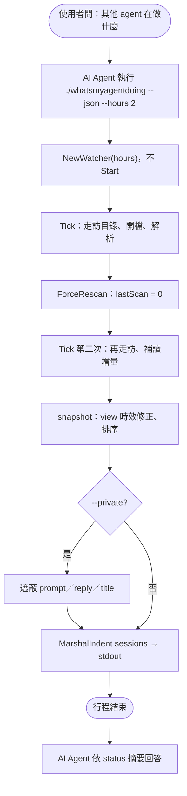
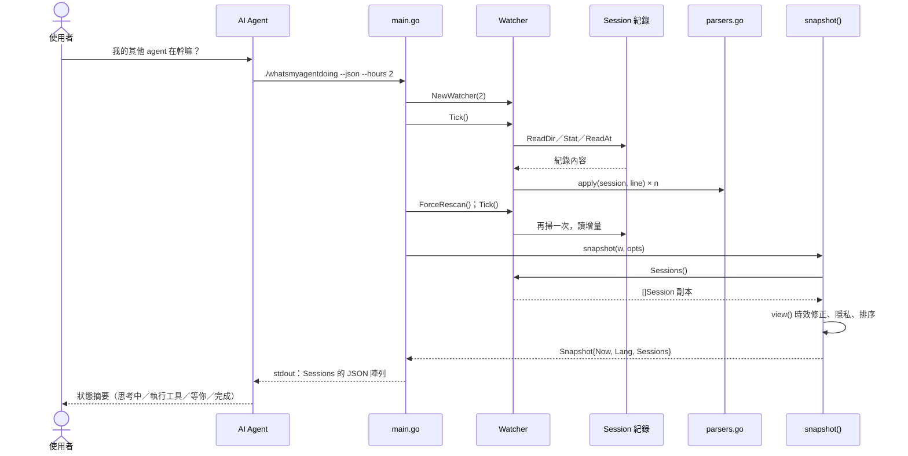

# UC-05 取得 JSON 快照

| 項目 | 內容 |
|---|---|
| 主要參與者 | AI Agent（在對話中回答「其他 agent 在做什麼」） |
| 次要參與者 | 使用者（提問者）、Session 紀錄 |
| 前置條件 | 有執行檔；不需要儀表板在執行 |
| 觸發 | 使用者在對話中詢問其他 agent 的狀態；`./whatsmyagentdoing --json [--hours n] [--private]` |
| 後置條件 | stdout 印出一次性的 session 陣列（JSON），行程結束；不開瀏覽器、不啟伺服器 |
| 相關程式 | `main.go`（`o.JSON` 分支）、`watcher.go`（`NewWatcher`、`Tick`、`ForceRescan`）、`server.go`（`snapshot`、`view`） |

## 主要流程

1. 使用者問「我的其他 agent 在幹嘛」。AI Agent 執行 `./whatsmyagentdoing --json --hours 2`。
2. `main()` 進入 `o.JSON` 分支：`NewWatcher(hours)`，**不**呼叫 `Start()`（不開 ticker goroutine）。
3. 手動 `Tick()` 一次：走訪目錄、開啟時間窗內的紀錄、解析。
4. `ForceRescan()` 把 `lastScan` 歸零再 `Tick()` 一次，確保第一輪建立的 tracker 都已讀到最新內容。
5. `snapshot(w, o).Sessions`：每個 session 經 `view()` 做時效修正（規則與 UC-02 相同）與隱私處理、依 `LastEventAt` 降冪。
6. `json.MarshalIndent(…, "", "  ")` 印到 stdout，行程自然結束（沒有 goroutine 殘留）。
7. AI Agent 讀 JSON，依 `status` 摘要給使用者。

## 替代流程

- **A1 `--private`**：快照同樣遮蔽 prompt、reply、title（UC-08）。
- **A2 時間窗內無 session**：印 `[]`（`sessions` 以 `make([]View, 0)` 建立，不會是 `null`）。
- **A3 某紀錄讀取失敗**：該檔略過，其餘照常。
- **A4 `--demo` 與 `--json` 並用**：程式先判斷 `o.JSON`，仍讀真實紀錄；`--demo` 在此路徑無效。

## 流程圖

## 循序圖

## 備註

- 只印 `Sessions`，不印 `now` 與 `lang`，與 Node 版輸出一致；`View` 的指標欄位讓缺值序列化成 `null`。
- 這是兩版對照檢查的入口：各跑 `--json --hours 72`，以 `key` 配對後逐欄比對（見 structure.md 第 14 節的差異）。
- 不開 ticker 的原因是行程要自然結束；`Watcher` 沒有 `Start()` 就沒有背景 goroutine，`main` return 即退出。
