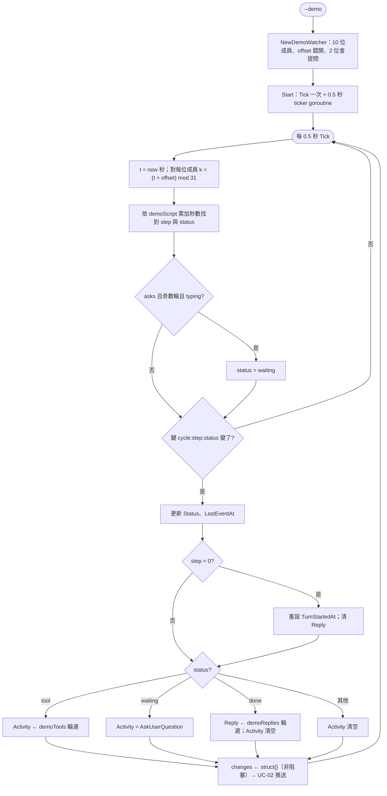
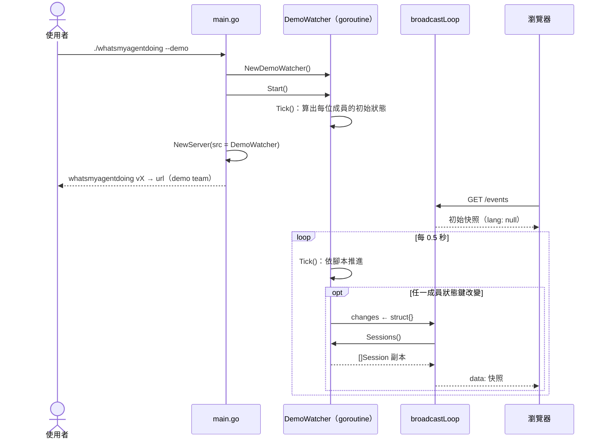

# UC-06 Demo 模式

| 項目 | 內容 |
|---|---|
| 主要參與者 | 使用者（看示範、截圖、在沒有 session 的機器上試 UI） |
| 次要參與者 | 瀏覽器 |
| 前置條件 | 有執行檔 |
| 觸發 | `./whatsmyagentdoing --demo` |
| 後置條件 | 儀表板顯示 10 個虛構 session 依固定腳本循環狀態；不讀任何真實紀錄；快照不附 `lang` |
| 相關程式 | `demo.go`（`DemoWatcher`、`demoTeam`、`demoScript`、`demoTools`、`demoReplies`）、`main.go`（`o.Demo` 分支）、`server.go`（`snapshot` 的 demo 判斷） |

## 主要流程

1. `main()` 在建立資料來源時依 `o.Demo` 選 `NewDemoWatcher()`，型別為 `Source` 介面，之後的 `NewServer`、SSE、API 完全不知道差別。
2. `NewDemoWatcher`：依 `demoTeam`（10 位，agent、專案名、prompt）建 `demoSession`，`Cwd = /home/dev/<project>`、`Title = Prompt = 任務句`、`Model` 依 agent 固定、`StartedAt` 依序往前推 10 分鐘；`offset = (i × 7.3) mod 37` 讓成員錯開；第 3 位與第 7 位 `asks = true`。
3. `Start()`：先 `Tick()` 一次，再開 0.5 秒 ticker goroutine。
4. 每次 `Tick()`：以牆鐘秒數加 `offset` 對一輪長度（31 秒）取模，落在 `demoScript` 的哪一步就是現在的狀態：thinking 3 秒 → tool 4 秒 → thinking 2 秒 → tool 3 秒 → typing 3 秒 → done 16 秒。
5. `asks` 成員在奇數輪的 typing 階段改為 waiting，`Activity = AskUserQuestion`。
6. 以 `cycle:step:status` 當鍵，鍵沒變就跳過；變了才更新：step 0 時重設 `TurnStartedAt`、清 `Reply`；tool 時從該 agent 的 `demoTools` 依 `(cycle×3 + step + offset)` 輪選一句；done 時從 `demoReplies` 輪選一句；`LastEventAt = now`。
7. 有任何成員變了就對 `changes` 非阻塞送出；之後與 UC-02 相同：broadcastLoop 算快照、推 SSE。
8. `snapshot()` 看到 `opts.Demo` 為 true，不呼叫 `promptLanguage`，`lang` 為 null；前端改用瀏覽器語言。
9. CLI 啟動訊息印 `demo team` 而非 session 數。

## 替代流程

- **A1 `--demo` 加 `--json`**：`--json` 先命中，仍讀真實紀錄（UC-05 A4）。
- **A2 `--demo` 加 `--private`**：`view()` 照樣遮蔽 prompt、reply、title，只剩狀態與專案名。
- **A3 已有儀表板在執行**：`alreadyRunning` 命中只重開分頁，不會換成 demo；要看 demo 得先 `--stop`。

## 流程圖

## 循序圖

## 備註

- `DemoWatcher` 與 `Watcher` 只共用 `Source` 介面（`Sessions`、`Changes`、`Start`、`Stop`），沒有共用實作；`Tick()` 公開是為了與 Watcher 對稱，`--json` 路徑不會用到它。
- 狀態完全由牆鐘推導，不累積內部計數，所以兩個 demo 行程同時啟動會顯示相同畫面；重啟後也接得上同一時間點。
- `TurnStartedAt` 只在成員被看到處於 step 0 時才設定；剛啟動時處於其他步驟的成員會是 0（前端顯示為 null），要等下一輪開始才有值。
- 10 位成員的 `offset` 以 7.3 乘以序號再對 37 取模，與一輪 31 秒互質，長時間看不會同步。
- Node 版的 Playwright 測試以 DemoWatcher 當資料來源；Go 版沒有對應的 UI 測試，但 demo 行為一致，`npm run test:ui` 若改指到 Go 執行檔也能跑。
