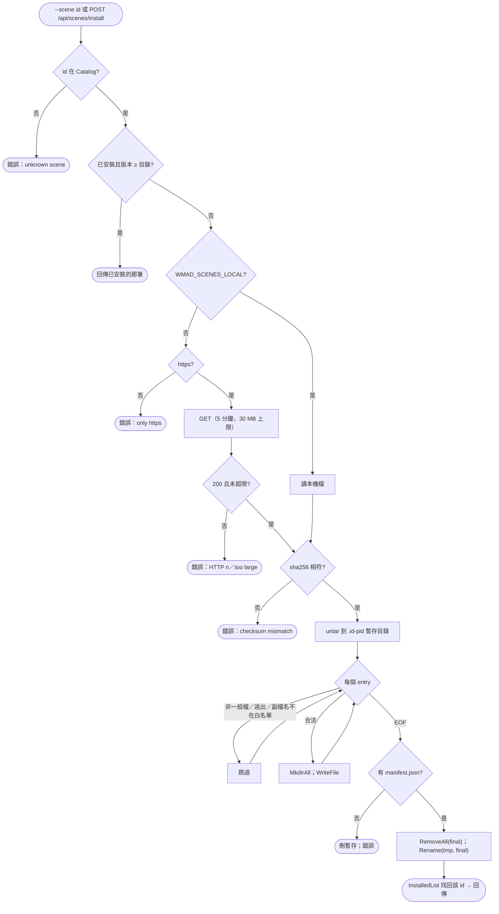
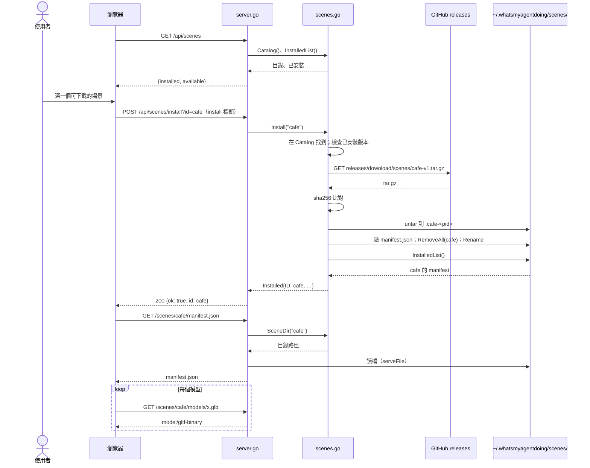

# UC-07 管理 3D 場景

| 項目 | 內容 |
|---|---|
| 主要參與者 | 使用者（High 3D 的場景選單、CLI）或 AI Agent（`/myoffice scene <id>`） |
| 次要參與者 | GitHub（releases 的場景包）、使用者資料目錄 `~/.whatsmyagentdoing/scenes/` |
| 前置條件 | 列出與移除不需要網路；安裝需要能連 GitHub（或 `WMAD_SCENES_LOCAL`） |
| 觸發 | 頁面場景選單、`--scenes`、`--scene <id>`、`--remove-scene <id>`；頁面 POST `/api/scenes/install` |
| 後置條件 | 場景包解在 `~/.whatsmyagentdoing/scenes/<id>/`，頁面透過 `/scenes/<id>/**` 載入 manifest 與模型；或場景目錄被移除 |
| 相關程式 | `scenes.go`（`Catalog`、`InstalledList`、`SceneDir`、`download`、`untar`、`versionAtLeast`、`Install`、`Remove`、`sceneName`）、`config.go`（`sceneReleaseURL`）、`server.go`（`/api/scenes`、`/api/scenes/install`、`/scenes/<id>/**`、`serveFile`）、`main.go`（三個旗標）、`static/scenes.json` |

## 主要流程

### 列出

1. `Catalog()`：從內嵌 `scenes.json` 讀 `scenes` 陣列，每筆補 `URL = RepoURL/releases/download/scenes/<file>`。
2. `InstalledList()`：掃 `~/.whatsmyagentdoing/scenes/` 下名稱符合 `^[a-z0-9-]+$` 且有 `manifest.json` 的目錄，讀 manifest 的 `name`、`version`、`credits`、`icon`。
3. `/api/scenes` 回 `{installed, available}`；已安裝的從 available 排除；icon 缺省時先找目錄中的同 id，再退回 🗺️。CLI `--scenes` 印同樣兩組，內建 `office` 永遠在第一行，可下載的附 KB 大小。

### 安裝

4. 頁面 POST `/api/scenes/install?id=<id>`，標頭 `x-whatsmyagentdoing: install`；或 CLI `--scene <id>`（非 `office`）。
5. `Install(id)`：在目錄中找不到 → 錯誤「unknown scene」。
6. 已安裝且 `versionAtLeast(have.Version, entry.Version)` → 直接回傳已安裝的那筆（數字比較；非數字退回字串比較）。
7. `download(entry.URL)`：`WMAD_SCENES_LOCAL` 設定時改讀本機 `<dir>/<file>`；否則要求 `https://`、`User-Agent: whatsmyagentdoing`、逾時 5 分鐘、非 200 報錯、`LimitReader` 到 30 MB + 1，超過即「scene pack too large」。
8. SHA-256 與 `scenes.json` 的 `sha256` 比對，不符 → 「checksum mismatch」。
9. `untar` 到暫存目錄 `~/.whatsmyagentdoing/scenes/.<id>-<pid>`：只收 `TypeReg`；`path.Clean` 後擋 `.`、`..` 開頭、絕對路徑；副檔名白名單 `.json`、`.glb`、`.png`、`.txt`；寫入前再驗目的路徑以暫存目錄為前綴；單檔也限 30 MB。
10. 暫存目錄沒有 `manifest.json` → 刪掉並報錯。
11. `os.RemoveAll(final)` 後 `os.Rename(tmp, final)`；再掃 `InstalledList()` 找出該 id 回傳。
12. 頁面收到 `{ok: true, id}` 後切換場景，瀏覽器載入 `/scenes/<id>/manifest.json` 與 `/scenes/<id>/models/*.glb`。

### 服務場景檔

13. `/scenes/<id>/<rest>`：`SceneDir(id)` 先驗 id 格式再找目錄，沒有 → 404。
14. `serveFile(dir, rest)`：`filepath.Clean` 後要求以 `dir + 分隔符` 為前綴、副檔名在 `mimeTypes`（`.js`、`.glb`、`.png`、`.json`）、是一般檔；回 `Cache-Control: no-cache`。

### 移除

15. `--remove-scene <id>`：`Remove(id)` 驗 id 格式、目錄存在則 `os.RemoveAll`；印「Removed」或「isn't a downloaded scene」。

## 替代流程

- **A1 `--scene office`**：不安裝，直接以內建辦公室開啟。
- **A2 `--scene <id>` 已安裝**：步驟 6 命中，印「Scene <id> is ready.」；未安裝則印「Downloaded scene <id>.」。
- **A3 安裝失敗**：CLI 印錯誤以 1 離開；頁面收到 400 `{ok: false, error}`。
- **A4 目錄中有新版本**：`versionAtLeast` 為 false，重新下載並覆蓋。
- **A5 缺標頭**：`/api/scenes/install` 回 403。
- **A6 場景包含 `.txt`**（例如授權檔）：會被解開，但 `serveFile` 的 `mimeTypes` 沒有 `.txt`，透過 HTTP 要不到（404）。
- **A7 tar 內有 symlink、目錄項、`../` 路徑或其他副檔名**：靜默跳過，不報錯。
- **A8 本機測試**：`WMAD_SCENES_LOCAL=<dir>` 讀 `<dir>/<file>`，仍做 SHA-256 比對。

## 流程圖

## 循序圖

## 備註

- 內建辦公室的模型走 `/assets/kenney/**`，從內嵌檔案系統服務；下載的場景包走 `/scenes/<id>/**`，從磁碟服務。兩者的路徑穿越檢查方式不同（`fs.ValidPath` 對 `filepath` 前綴），但結果一致。
- 場景包只含資料（manifest、glb、png），安裝從不執行程式碼，這是 ADR-0002 不從 Release 下載執行檔的對照立場。
- `Scenes` 是空 struct，所有狀態都在磁碟與內嵌檔案系統；`dirs()` 目前只回使用者目錄一項，Node 版的「倉庫內建場景目錄」這一層已拿掉（ADR-0004）。
- 暫存目錄以 `.` 開頭，所以 `InstalledList` 的 `^[a-z0-9-]+$` 檢查不會把安裝中的目錄列進來。
