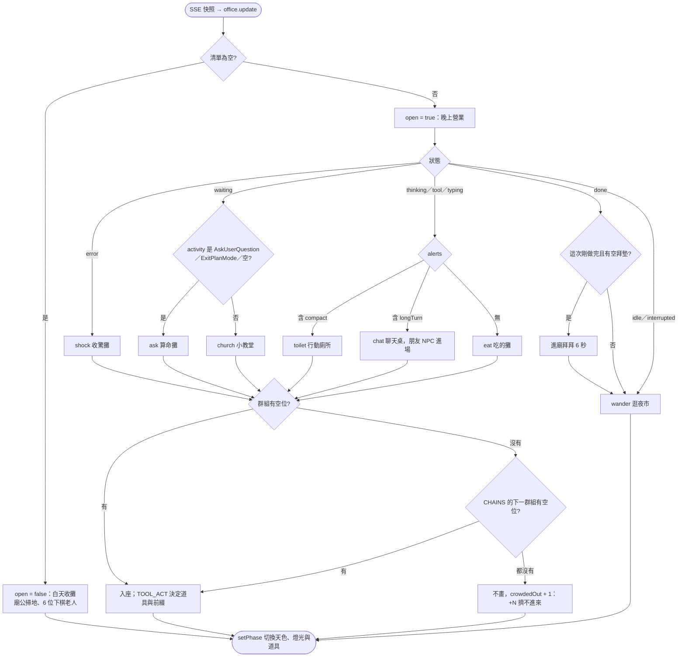
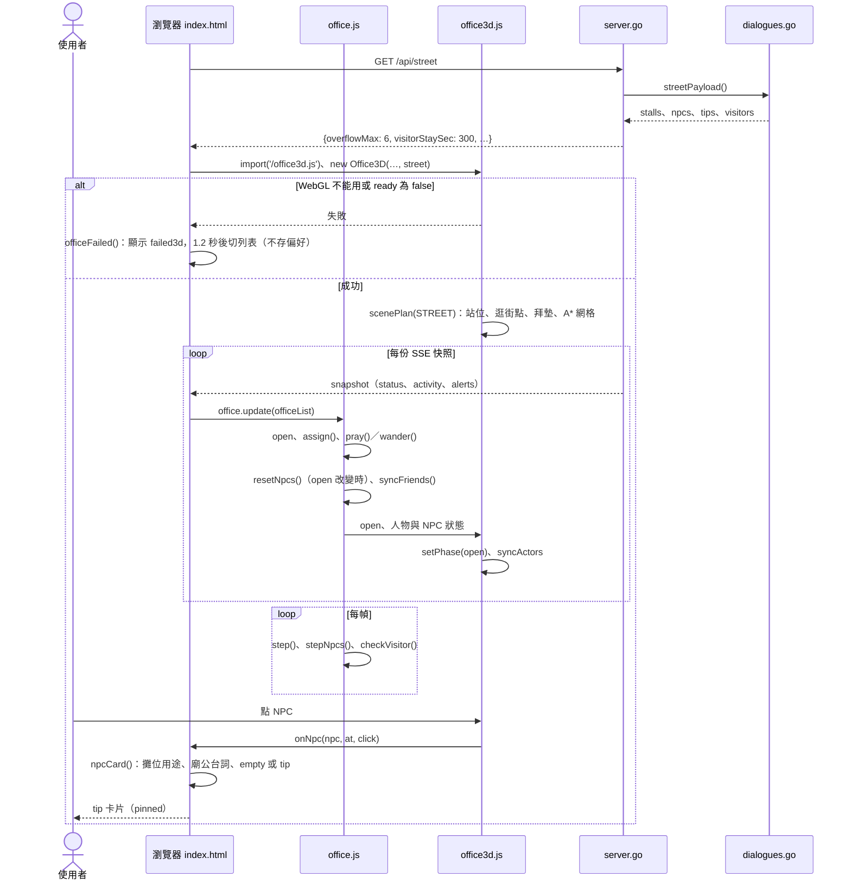

# UC-07 夜市場景

| 項目 | 內容 |
|---|---|
| 主要參與者 | 使用者（在「辦公室」檢視看 agent、點 NPC） |
| 次要參與者 | 瀏覽器（`office.js` 模擬、`office3d.js` 繪製）、UC-02 推來的快照 |
| 前置條件 | 儀表板已啟動（UC-01）；檢視為「辦公室」；瀏覽器能建立 WebGL |
| 觸發 | 頁面載入（抓一次 `/api/street`）；每份 SSE 快照（`office.update`）；點擊 NPC；電腦時鐘走到整點或半點 |
| 後置條件 | 每位 agent 依狀態群組坐進對應攤位，或拜拜、逛街；清單為空時夜市收攤；NPC 卡片顯示在 `#tip` |
| 相關程式 | `dialogues.go`（`Stall`、`NPC`、`Line`、`Visitor`、`stalls`、`npcs`、`tips`、`visitors`、`streetPayload`）、`config.go`（`StreetOverflowMax`、`StreetVisitorStay`）、`server.go`（`/api/street`）；前端在 `skills/myoffice/`，以內嵌副本 `static/public/` 送出：`web/street.js`（`STREET`）、`web/office3d.js`（`Office3D`、`scenePlan`、`setPhase`）、`public/office.js`（`Office`、`groupOf`、`CHAINS`、`TOOL_ACT`、`toolAct`、`assign`、`pray`、`wander`、`resetNpcs`、`syncFriends`、`checkVisitor`）、`public/index.html`（`makeOffice`、`officeFailed`、`onNpc`、`npcCard`） |

## 主要流程

### 載入場景

1. 頁面載入時 `fetch('/api/street')` 一次（`streetReady`）。伺服器以 `streetPayload()` 回 `{overflowMax, visitorStaySec, stalls, npcs, tips, visitors}`：`overflowMax` 為 `StreetOverflowMax`（6），`visitorStaySec` 為 `StreetVisitorStay` 的秒數（300）。文字只寫 `zh-TW` 與 `en`，前端取 `text[lang] || text.en`。
2. `makeOffice()`：顯示 `loading3d`，動態 `import('/office3d.js')`，等 `streetReady` 後 `new Office3D(officeEl, {…, street})`。
3. `/office3d.js` 是 esbuild 把 `web/office3d.js` 連同 `web/street.js` 打成的單一 bundle。`buildPlan()` 一律 `scenePlan(STREET)`，產生站位（`desks`，帶 `group`、`stall`、`table`、`cabin`）、逛街點（`pois`）、拜墊（`shrines`）、A* 網格（`Grid`）與拱門入口（`door`）。版面：成功廟在左上，夜市走道往右下延伸到拱門「成功形象夜市」。
4. 第一份快照到達後，`render()` 呼叫 `office.update(officeList)`；之後每份 SSE 快照都重算。`officeList` 是經 agent、平台、狀態 chip 篩選後的清單。

### 營業與收攤

5. `update()` 先設 `open = sessions.length > 0`：清單上有任何一位（含閒置）就是晚上營業，清單為空就是白天收攤。跟電腦時鐘無關。
6. `open` 改變時 `resetNpcs()` 重建 NPC，`Office3D` 的 `setPhase(open)` 切換天色、燈光，以及只在其中一個階段顯示的道具（`props[].phase`）。
   - 營業：夜空，攤車燈泡、招牌、頭頂燈泡串、廟的 LED 圓招與跑馬燈全亮。NPC 有各攤老闆／店員（小教堂是神父）、每個吃的攤一桌 NPC 食客、廟公、拜拜阿嬤、2 位路人。
   - 收攤：白天天色，燈熄，攤車蓋上藍白帆布。只剩沿走道掃地的廟公，以及榕樹下 3 張棋桌的 6 位下棋老人。

### 工作中的 agent：依狀態群組分攤

7. `update()` 把 `thinking`、`tool`、`typing`、`waiting`、`error` 的人交給 `assign()`，依 `startedAt` 由早到晚分配站位。
8. `groupOf(s)` 由上往下，第一個符合的就是這個人的群組：

| 條件 | 群組 | 地點 | 位數 |
|---|---|---|---|
| `error` | `shock` | 廟埕旁的收驚攤 | 3 |
| `waiting`，`activity` 是 `AskUserQuestion`、`ExitPlanMode`、`Asking you a question`（Codex）或空 | `ask` | 算命攤：2 張板凳加 2 個排隊位 | 4 |
| `waiting`，其他 | `church` | 小教堂：3 排長凳各 2 位，加 2 個站位 | 8 |
| `alerts` 含 `compact` | `toilet` | 行動廁所：2 間加 5 個排隊位 | 7 |
| `alerts` 含 `longTurn` | `chat` | 飲料攤聊天桌：3 桌，每桌 1 位 agent | 3 |
| 其他（思考中、執行中、回覆中） | `eat` | 滷肉飯、蚵仔煎、臭豆腐、牛肉麵，每攤一桌 2 位，分配時各攤輪流 | 8 |

9. 群組坐滿就沿 `CHAINS` 往下找：`eat` → `overflow`（攤外站著，再蹲路邊；`street.js` 備 12 位，只開放前 `overflowMax` 位）→ `claw`（夾娃娃店 8 台）。`toilet`、`chat` 滿了先退回 `eat`；`ask` 滿了先去 `church`；`shock`、`church` 滿了直接進 `overflow`。全部坐滿的人不畫，人數記在 `crowdedOut`，拱門旁顯示「+N 擠不進來」。
10. 已經坐在本群組的人不動；群組變了（例如 `eat` → `toilet`）才重新分配，人以 `AGENT_SPEED`（5 格／秒）走過去。坐在備援群組的人，前面的群組空出位子就往前補。
11. 子 agent 要分到 `eat` 時，先找父 session（`parentId` 對上 `sessionId` 或 `id`）那一攤的空位。
12. 聊天桌：`syncFriends()` 依 key 的 hash 生 1–2 位朋友 NPC，從拱門走進來坐同一桌。整桌共用 `tableMood()`：聊天 → 笑 → 哭，每 8 秒換一次，偶爾站起來打架 3 秒。警告消失、agent 離桌後，朋友走回拱門消失。

### 工具只換動作，不換位子

13. `toolAct(s)`：`tool` 狀態拿整串 `activity` 依序比對 `TOOL_ACT` 的開頭樣式，決定手上道具、動畫與泡泡前的符號底塊；`thinking`、`typing` 查 `STATUS_ACT`。細狀態怎麼變，站位都不變。

| 狀態／工具 | 道具 | 前綴 |
|---|---|---|
| `thinking` | 無（托腮） | `…` |
| `typing` | 筆電 | `“”` |
| `Bash`、`shell`、`exec_command` | 筆電，終端機畫面 | `>_` |
| `Edit`、`Write`、`MultiEdit`、`NotebookEdit`、`apply_patch` | 筆電，程式碼畫面 | `+-` |
| `Read` | 一疊文件 | `≡` |
| `Grep`、`Glob`、`LS` | 放大鏡 | `.*` |
| `WebFetch`、`WebSearch` | 手機，瀏覽器畫面 | `://` |
| `Task`、`Agent` | 手機貼在耳邊 | `@` |
| `TodoWrite`、`update_plan` | 寫字板 | `✎` |
| `mcp__` 開頭 | 平板 | `⇄` |
| 其他 | 筆電 | `*` |

### 做完、閒置與離場

14. 不在工作中的人依 `lastEventAt` 降冪，前 `MAX_WANDERERS`（7）位上街，其餘只算數，拱門旁顯示「+N 已下班」。
15. `done` 且這次還沒拜過（`!p.prayed`）：`pray()` 找一個空拜墊（廟裡共 6 個），走過去拜 6 秒（`PRAY_MS`），之後設 `prayed = true` 轉逛街。回到工作中會重設 `prayed`，下次做完再拜一次。
16. `idle`、`interrupted` 與拜完的人由 `wander()` 依權重挑逛街點：民俗療法按摩床 3 張（閒置權重 4，其他 0.6）、大腸包小腸、射氣球、撈金魚、彈珠台（兩台成對，有人在玩時權重 7）、夾娃娃店另外 2 台機台。
17. 從清單消失的人走回拱門後移除。

### 點 NPC

18. `office3d.js` 的 `hit` 把 NPC 放在 agent 前面；點到時呼叫 `onNpc(npc, at, click)`，`npcCard()` 決定內容後填進 `#tip`，`pinned` 與 Escape 的行為跟 agent 卡片相同。再點同一位就換下一句或下一則 tip。

| 點誰 | 卡片內容 |
|---|---|
| 攤販老闆／店員、神父（有 `stall`） | `stalls` 裡那一攤的 `keeper`、`name`、`purpose`：說明什麼狀態或警告的 agent 會來 |
| 廟公 | 營業時依序顯示 `npcs` 裡 `keeper` 的四句（成功廟、「+N 已下班」、「+N 擠不進來」、去問攤販）；收攤時顯示 i18n 的 `empty` |
| 下棋老人（只在收攤時） | i18n 的 `empty` |
| 拜拜阿嬤、路人、NPC 食客 | 隨機一則 `tips` |
| 半點訪客 | 名字、類別、介紹，再附一則隨機 tip |
| 聊天桌的朋友 | 不進 `hit`，點了沒反應 |

### 半點訪客

19. `stepNpcs()` 每幀呼叫 `checkVisitor(now)`：進入新的整點或半點時段、且距時段開始不到 `visitorStaySec`，依 `slot = (時 × 2 + 是否過半) % 12` 從 `visitors` 取一位。神明（`kind: deity`）從廟門走出來，妖怪（`kind: yokai`）從拱門走進來，以 1.2 格／秒在攤前停留，時段開始滿 `visitorStaySec` 後走回進場點消失。營業與收攤都會出現；頁面在時段中途才打開，也會補生同一位，只待剩下的時間。這是整個場景唯一看電腦時鐘的地方。

## 替代流程

- **A1 清單為空**（包括被篩選掉）：收攤畫面照常顯示，辦公室檢視不顯示 `.empty` 文字；要看「沒有 session」的說明就點廟公或下棋老人。列表檢視的空狀態不變。
- **A2 群組坐滿**：依步驟 9 的 `CHAINS` 往下找。
- **A3 全部坐滿**：沒分到站位的工作中 agent 不畫，拱門旁顯示「+N 擠不進來」。依預設值，一般工作中的 agent 要超過 8 + 6 + 8 = 22 位才會出現。
- **A4 拜墊全滿**：`pray()` 直接設 `prayed = true`，略過拜拜去逛街。
- **A5 第一份快照**：所有人直接放到位置，不從拱門走進來；已經是 `done` 的人視為拜過，不會整群衝去廟裡。
- **A6 3D 建不起來**：`import('/office3d.js')` 丟錯、或 `Office3D` 的 `ready` 為 false（例如 `WebGLRenderer` 建立失敗）→ `officeFailed()` 顯示 `failed3d`（「無法載入 3D 夜市，改用列表。」），1.2 秒後切到列表檢視。這次切換不寫進偏好，重新整理會再試 3D。
- **A7 `/api/street` 失敗**：錯誤被吞掉，`street` 維持空清單。場景照常運作，`overflowMax` 退回 6，`visitorStaySec` 視為 0（不出訪客），NPC 卡片沒有文字。
- **A8 調整 `config.go`**：`StreetOverflowMax = 0` 時路邊不開放，`eat` 滿了直接進 `claw`；`StreetVisitorStay = 0` 時關閉半點訪客。改完要重建執行檔。
- **A9 其他語系**：`dialogues.go` 只有 `zh-TW` 與 `en`，其他語系的 NPC 卡片顯示英文。

## 流程圖

## 循序圖

## 備註

- 後端只提供資料：群組、站位、動畫、營業與收攤都在前端決定。Go 版參與的只有 `/api/street` 與快照裡的 `status`、`activity`、`alerts`，以及內嵌送出的 `/office.js`、`/office3d.js`、`/assets/**`。
- 前後端以 ID 對應：`street.js` 每個 `vendors[].stall` 都要在 `stalls` 找得到。`dialogues_test.go` 驗每句都有兩種語言、各清單 ID 不重複、`visitors` 剛好 12 位且 `slot` 0–11 各一、`kind` 只有 `deity`／`yokai`；`TestApiStreet` 另外釘死 15 個攤位 ID 與順序。
- `dialogues.go` 的內容下一階段要改成 TODO 清單，所以 ID 不改。
- `activity` 是後端產生的顯示字串，不一定以工具名開頭（MCP 是 `server · tool`、Agent／Task 是 `Subagent: …`、TodoWrite 是 `Updating todo list`、Codex 與 Gemini 的指令是 `Shell: …`、Codex 的檔案修改是 `Editing …`），所以 `TOOL_ACT` 的樣式直接比對這些字串的開頭。後端改了 `describeClaudeTool`／`describeCodexCall`／`describeGeminiTool` 的輸出格式時，要一起改 `TOOL_ACT`；`tests/ui.cjs` 有一組真實字串的斷言會抓到。
- Agent 與 NPC 的區分：agent 的頭放大 1.5 倍（`AGENT_HEAD_SCALE`）、腳下有狀態色光環、有名牌；一般 NPC 都沒有。半點訪客全身放大 1.3 倍（`VISITOR_SCALE`），頭上有金色（神明）或紫色（妖怪）名牌。Agent 走路 5 格／秒，NPC 2.1 格／秒，訪客 1.2 格／秒。
- 這個場景取代了舊的可下載場景包、內建 3D 辦公室與 2D 繪圖：`scenes.go`、`/scenes/<id>/**`、`/api/scenes`、`/api/scenes/install`、`--scenes`／`--scene`／`--remove-scene`、`WMAD_SCENES_LOCAL`，以及偏好與網址參數的 `quality`、`scene` 都已移除。使用者機器上的 `~/.whatsmyagentdoing/scenes/` 不再使用，也不自動刪，可以手動刪掉。決策見 [ADR-0007](../../docs/adr/0007-single-built-in-night-market-scene.md)。
