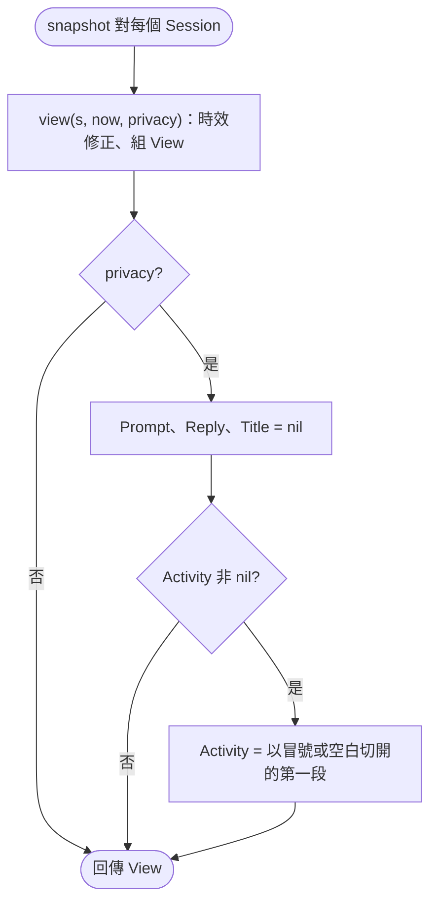
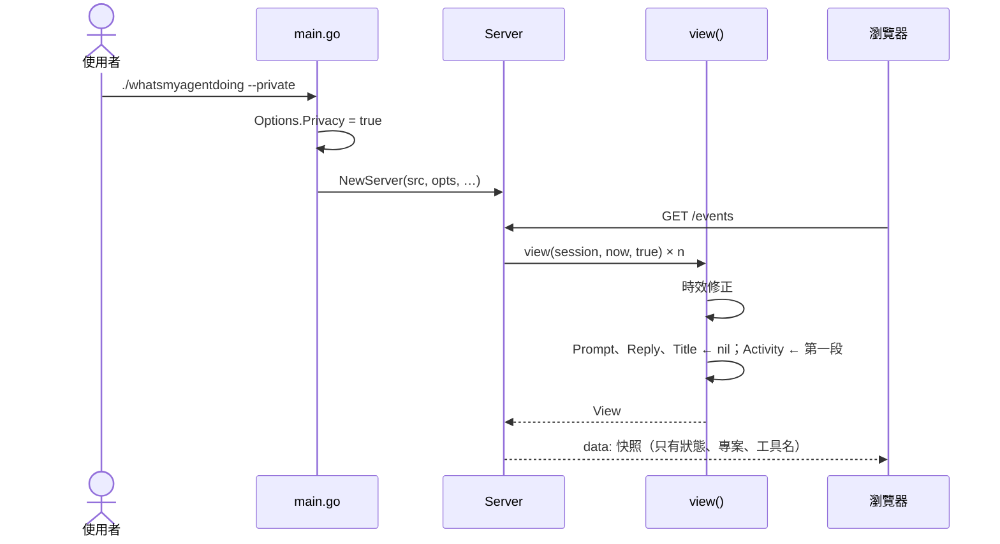

# UC-08 隱私模式

| 項目 | 內容 |
|---|---|
| 主要參與者 | 使用者（分享螢幕、錄影、在公開場合開儀表板） |
| 次要參與者 | 瀏覽器、AI Agent（`--json --private`） |
| 前置條件 | 無 |
| 觸發 | `./whatsmyagentdoing --private`，可與 `--json`、`--demo` 並用 |
| 後置條件 | 所有輸出（SSE、`/api/sessions`、`--json`）的 prompt、reply、title 為 null，activity 只剩工具名；狀態、專案名、時間戳照常 |
| 相關程式 | `main.go`（`--private` → `Options.Privacy`）、`server.go`（`view()` 的 privacy 分支、`reActivityHead`） |

## 主要流程

1. `parseArgs` 看到 `--private` 設 `Options.Privacy = true`；`Options` 隨 `NewServer` 進入 `Server.opts`，也傳給 `--json` 路徑的 `snapshot`。
2. 每次 `snapshot()` 對每個 session 呼叫 `view(s, now, opts.Privacy)`。
3. `view()` 先照常算時效狀態、組 `View`。
4. `privacy` 為 true 時：`Prompt`、`Reply`、`Title` 設為 nil；`Activity` 若非 nil，以第一個冒號或空白切開只留前段（`Bash: npm test` → `Bash`；`Edit routes.ts` → `Edit`；`github · create_pull_request` → `github`）。
5. 其餘欄位（`key`、`agent`、`id`、`cwd`、`project`、`model`、`status`、`error`、時間戳）不動。
6. 前端拿到 null 就不渲染對應區塊；清單與辦公室只剩狀態與專案名。

## 替代流程

- **A1 與 `--json` 並用**：UC-05 的輸出同樣遮蔽。
- **A2 與 `--demo` 並用**：虛構 session 一樣被遮蔽。
- **A3 `promptLanguage`**：語言猜測用的是 `src.Sessions()` 的原始 prompt，不受隱私影響，`lang` 仍會回傳；只有 prompt 內容不送出。
- **A4 `error` 欄位**：不在遮蔽範圍，API 錯誤訊息照常輸出（與 Node 版相同）。

## 流程圖

## 循序圖

## 備註

- 遮蔽在伺服器端做，瀏覽器收不到原文；不是前端 CSS 隱藏。
- `reActivityHead` 是 `[:\s]`，`Split(…, 2)[0]` 取第一段；Node 版是 `split(/[:\s]/)[0]`，結果相同。
- Codex 的 `Needs your approval`、Gemini 的 `Shell: …` 都會只剩第一個字（`Needs`、`Shell`）。
