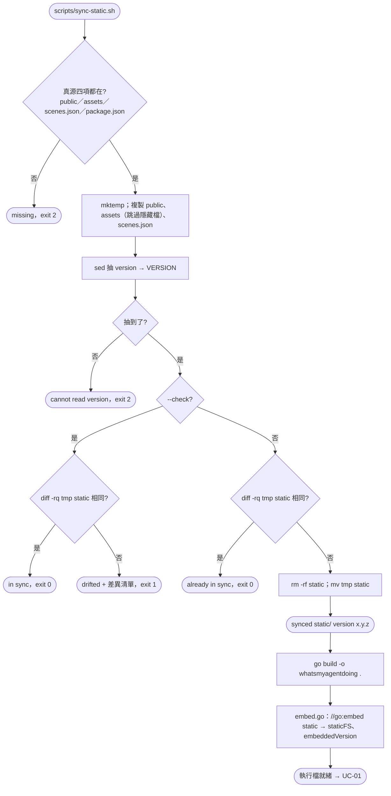
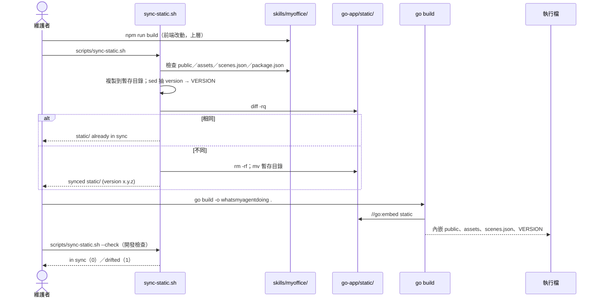

# UC-09 建置與同步內嵌資源

| 項目 | 內容 |
|---|---|
| 主要參與者 | 維護者 |
| 次要參與者 | `skills/myoffice/`（前端真源）、Go 工具鏈、`--update`（UC-04 以程式呼叫同一條路） |
| 前置條件 | clone 完整（`skills/myoffice/` 有 `public/`、`assets/`、`scenes.json`、`package.json`）；Go 1.22 以上 |
| 觸發 | 前端改動後（`npm run build` 重打 3D bundle、改 `index.html`、改 `scenes.json`、升版）；初次建置；開發檢查 |
| 後置條件 | `static/` 與真源一致，`static/VERSION` 為目前版本；執行檔 `whatsmyagentdoing` 內嵌最新資源 |
| 相關程式 | `scripts/sync-static.sh`、`embed.go`、`go.mod`、`.gitignore`（根目錄） |

## 主要流程

### 同步

1. 維護者在 `go-app/` 執行 `scripts/sync-static.sh`。
2. 腳本解析路徑：`here` 為 `go-app/`，`root` 為 `../skills/myoffice`，`dst` 為 `static/`。
3. 檢查真源的四個項目都存在，缺任一個以 2 離開。
4. 建暫存目錄，把 `public/` 與 `assets/` 下非 `.` 開頭的檔案逐一複製（保留子目錄），複製 `scenes.json`。
5. 以 sed 從 `package.json` 抽出 `"version": "x.y.z"` 的值寫成 `VERSION`；抽不到以 2 離開。
6. `diff -rq` 暫存目錄與 `static/`：相同印「already in sync」結束；不同則 `rm -rf static/` 再把暫存目錄 `mv` 過去，印「synced static/ (version x.y.z)」。

### 建置

7. `go build -o whatsmyagentdoing .`：`embed.go` 的 `//go:embed static` 把整棵 `static/` 收進執行檔；`staticFS` 以 `fs.Sub` 去前綴；`embeddedVersion` 在初始化時讀 `VERSION`。
8. 產物 `whatsmyagentdoing`（與 `.exe`）在根目錄 `.gitignore` 內，不進版控；`static/` 進版控，讓 `go build` 能離線重現。

### 開發檢查

9. `scripts/sync-static.sh --check`：只比對不改寫，一致印「static/ is in sync」以 0 結束；漂移印差異清單以 1 結束。
10. `gofmt -l .` 應無輸出；`go vet ./...` 應乾淨；再 `go build`。

## 替代流程

- **A1 真源缺檔**：步驟 3 印 `missing <path>` 以 2 離開，不動 `static/`。
- **A2 `package.json` 沒有 version**：步驟 5 以 2 離開。
- **A3 `--check` 漂移**：以 1 離開並列出 `diff -rq` 的差異；維護者再跑一次不帶 `--check` 的同步。
- **A4 忘記同步就 `go build`**：建置成功但執行檔帶舊 bundle；頁面看起來沒更新。`--check` 是抓這件事的手段。
- **A5 由 `--update` 呼叫**：`Update()` 以 `bash <src>/scripts/sync-static.sh` 執行同一支腳本，逾時 60 秒，失敗訊息回給前端（UC-04 A5）。
- **A6 隱藏檔**：`.DS_Store` 之類被 `find ! -name '.*'` 排除；`go:embed` 本來就會跳過 `.` 與 `_` 開頭的檔案，排除是為了不讓它們進版控。

## 流程圖

## 循序圖

## 備註

- `static/` 是內嵌副本不是真源，不要直接編輯；要改前端去 `skills/myoffice/`。這是 ADR-0004 的決定，接受倉庫多 2.2 MB 重複內容換取單一執行檔。
- 版本號的單一來源仍是 `skills/myoffice/package.json`；Go 端不另存版本常數，也不解析 JSON，只讀 sed 抽出的一行。
- `go.mod` 沒有 `require`，`go build` 不需要網路；`go vet` 目前乾淨。
- 測試以 `go test ./...` 執行：`*_test.go` 涵蓋各檔的單元測試，`functional_test.go` 另以 `httptest` 走 SSE 與 API，並在非 `-short` 模式下 `go build` 一份執行檔跑 CLI 旗標、啟動、退讓與 `--stop`。兩版 `--json` 對照仍是確認與 Node 版一致的手段。
