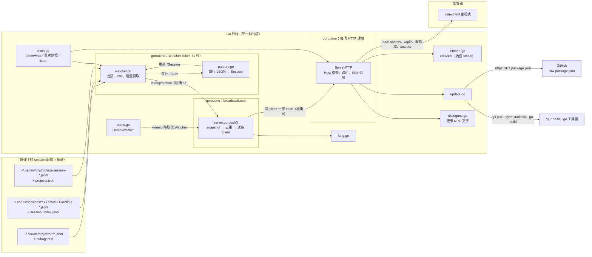
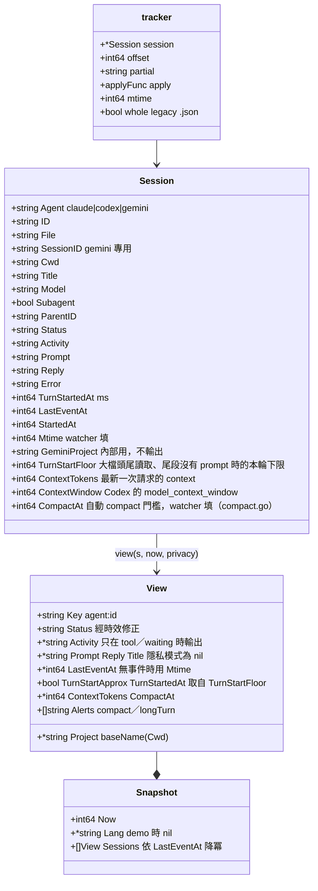
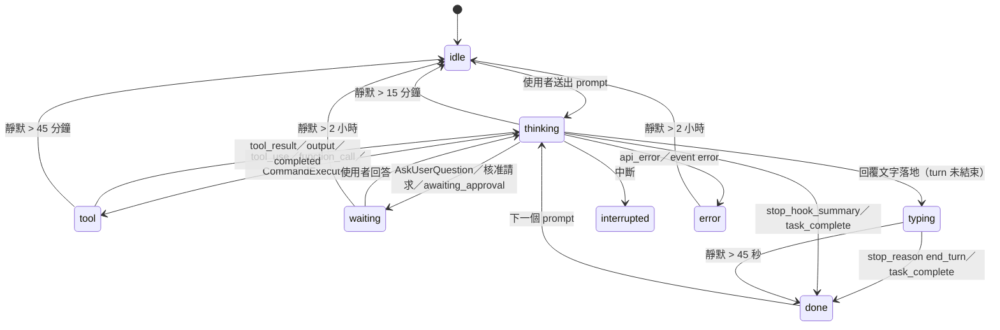
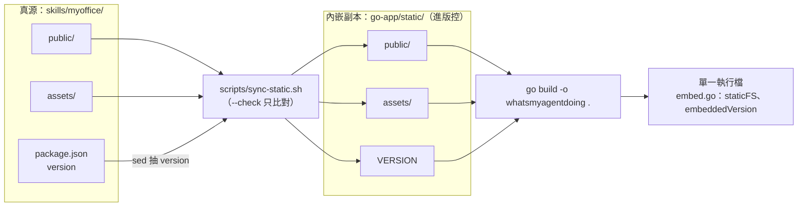

# 系統結構（Go 版）

## 1. 專案定位

`go-app/` 是 Node 版後端（`bin/cli.js` 加 `src/`）的 Go 平移版：同一組旗標、同一組 HTTP 端點、同一份 SSE（Server-Sent Events）輸出、同一個預設連接埠。只用 Go 標準函式庫，沒有第三方依賴。

與 Node 版最大的差別是散佈形式：網頁、3D 模型與版本號全部以 `go:embed` 包進單一執行檔，執行時不讀倉庫裡的任何檔案，複製到任何地方都能跑。代價是倉庫多一份 2.2 MB 的靜態檔副本，前端改動後要多一步同步再重建（見第 11 節）。

Go 版不是 skill 的預設後端。`SKILL.md` 仍呼叫 Node 版，要讓 agent 改用 Go 版得手動把 skill 裡的指令換成執行檔路徑。

## 2. 目錄結構

```
go-app/
├── main.go            CLI 進入點：parseArgs、單次旗標分派、已執行偵測、監聽與連接埠退讓、onShutdown／onRestart
├── config.go          對外 host 與可調常數：Repo、Branch、AutoUpdateCheck、LatestURL、時間設定、警告門檻、夜市設定
├── embed.go           //go:embed static；staticFS（fs.Sub）與 embeddedVersion（讀 VERSION）
├── watcher.go         找出近期 session 檔並持續讀取增量（1 秒 tick）；Source 介面；三家目錄走訪
├── parsers.go         Session 結構；三種 agent 的紀錄 → Session；clean()／stripPairedTags()
├── server.go          HTTP 路由、Options、View／Snapshot、view() 時效修正、SSE 廣播、靜態檔服務
├── lang.go            從 prompt 猜 UI 語言（CJK 計數、Latin 停用詞投票）
├── update.go          Updater：版本檢查（GitHub raw）、Info()、Update()（git pull → sync → go build）
├── dialogues.go       夜市場景的 NPC 文字（攤位用途、廟公台詞、使用 tips、半點訪客）與 /api/street 的內容
├── demo.go            DemoWatcher：10 個虛構 session 依固定腳本循環（與 Watcher 同介面）
├── util.go            urlHost、fileExists、dirExists、sourceDir（找 --update 用的原始碼目錄）
├── *_test.go          單元測試（每個檔一份）、testhelpers_test.go（fixture）、functional_test.go（HTTP／SSE／CLI 功能測試）
├── go.mod             module whatsmyagentdoing，go 1.22，無 require
├── scripts/sync-static.sh   把 skills/myoffice/ 的 public、assets、版本號同步成 static/
├── static/            內嵌副本（進版控，不要手改）
│   ├── VERSION        只有版本號一行，sed 自 package.json 抽出
│   ├── public/        index.html、office.js、office3d.js（含 street.js 的夜市場景）、popout.js、i18n.js
│   └── assets/        agents/*.png、kenney/**/*.glb
├── README.md          需求、建置、旗標、更新、環境變數、已知差異
└── whatsmyagentdoing  建置產物（.gitignore）
```

使用者端資料目錄：無。舊版下載場景包用的 `~/.whatsmyagentdoing/scenes/` 已不再讀寫，也不會自動刪除，可以手動刪掉。

## 3. 執行時架構



## 4. 模組職責

| 檔案 | 職責 | 關鍵對外介面 |
|---|---|---|
| `main.go` | 解析參數；單次旗標（`--update`、`--stop`、`--json`）各自處理後 return；`alreadyRunning` 探測 `/api/ping`；建立 `Source`（Watcher 或 DemoWatcher）與 `Server`；`net.Listen` 失敗且為 EADDRINUSE 則 port+1，最多 10 次；印網址與 session 數；開瀏覽器；`onShutdown`／`onRestart` 閉包 | `main()`、`parseArgs`、`openBrowser`、`alreadyRunning`、`stopAt`、`printUpdateHint`、`isAddrInUse` |
| `config.go` | 所有會連出去的位址：`Repo`、`Branch`、`LatestURL`；`AutoUpdateCheck` 開關（預設 false）；夜市設定 `StreetOverflowMax`、`StreetVisitorStay`（經 `/api/street` 帶給前端） | 常數 |
| `embed.go` | `//go:embed static` 收錄整棵樹；`staticFS` 以 `fs.Sub` 去掉 `static/` 前綴；`embeddedVersion` 在套件初始化時讀 `VERSION`，缺檔或空白回 `0.0.0` | `staticFS`、`embeddedVersion` |
| `watcher.go` | `Tick()`：載入 Codex 索引與 Gemini 專案表（mtime 變才讀）；每 5 秒重新走訪三家目錄，其餘 tick 只 stat 已知檔；新檔整檔讀或「頭 128 KB + 尾 768 KB」；檔案變長讀增量、變短丟掉 tracker；讀失敗記入 `failed` 一分鐘後重試；超出時間窗的 tracker 移除；有變更就對 `changes` 做非阻塞送出。`Sessions()` 回傳 struct 副本並補 Gemini 的 cwd／mtime 與 Codex 的 thread 名稱 | `Source` 介面、`NewWatcher`、`Start`／`Stop`／`Tick`／`ForceRescan`／`Sessions`／`Count`、`describeDirs` |
| `parsers.go` | `Session` 結構；`applyClaude`／`applyCodex`／`applyGemini`／`applyGeminiDocument` 把一筆紀錄套到 session；`clean()` 去注入區塊與 Markdown 雜訊並以 rune 截斷；`describe*Tool` 產生 activity 字串；`baseName` 同時認 `/` 與 `\` | `newSession`、四個 apply 函式、`clean`、`short`、`baseName`、`truncate` |
| `server.go` | `Options`、`View`、`Snapshot`；`view()` 以時鐘修正狀態並套隱私；`snapshot()` 排序、附語言猜測；`Server` 持 client 集合與上次簽章；`broadcastLoop` 收 `Changes()` 或 5 秒 tick 就 `push()`；`push()` 去掉 `now` 欄位比對、不同才送；`ServeHTTP` 做 Host 白名單與路由；`serveEmbedded`（內嵌檔）；`/api/street` 回 `streetPayload()`；`serveEvents` 每 client 一條緩衝 channel、20 秒 ping | `NewServer`、`Server.Close`、`snapshot`、`view`、`promptLanguage` |
| `lang.go` | `guessLanguage(texts, minWeight)`：CJK 字元乘 4 與 Latin 字元比大小，再分 ja／ko／zh-CN／zh-TW；Latin 以五種語言的停用詞投票，至少 3 票否則 en。`guessFromPrompts`：每個不同 prompt 一票（前 80 rune 去重），至少 2 票才採信 | `guessLanguage`、`guessFromPrompts`、`supportedLangs` |
| `update.go` | `Updater`：`LocalVersion()` 回 `embeddedVersion`；`CheckLatest(force)` 抓 GitHub raw `package.json`（逾時 4 秒、上限 64 KB、30 分鐘快取、並發共用一次抓取）；`Info()` 回 `{version, latest, updateAvailable, canUpdate, auto}`；`CanUpdate()` 看 `sourceDir()` 是否找得到；`Update()`：`git pull --ff-only` → `bash scripts/sync-static.sh` → `go build -o <exe> .`，回傳同步後 `static/VERSION` | `NewUpdater`、`LocalVersion`、`CheckLatest`、`Info`、`CanUpdate`、`Update` |
| `dialogues.go` | 夜市場景（UC-07）的 NPC 文字，只寫 `zh-TW` 與 `en`：`stalls`（15 攤，老闆／店員被點時說明攤位用途）、`npcs`（廟公、拜拜阿嬤、路人、食客、下棋老人）、`tips`（系統使用提示）、`visitors`（12 位半點訪客，`slot` 0–11）；`streetPayload()` 組成 `/api/street` 的回應。ID 固定，前端以 ID 對應攤位，下一階段改成 TODO 清單 | `Stall`、`NPC`、`Line`、`Visitor`、`Text`、`streetPayload` |
| `demo.go` | `DemoWatcher`：10 個虛構 session，每 0.5 秒 `Tick()` 依 `demoScript`（thinking 3 s → tool 4 s → thinking 2 s → tool 3 s → typing 3 s → done 16 s）循環；兩位成員每隔一輪在 typing 階段改為 waiting；只有狀態鍵變了才更新並通知 | `NewDemoWatcher`、`Source` 介面 |
| `util.go` | `sourceDir()`：依 `WMAD_SRC` → 執行檔所在目錄（解 symlink）→ 工作目錄，找同時有 `go.mod`、`main.go` 且上一層有 `.git` 的目錄 | `sourceDir`、`urlHost`、`fileExists`、`dirExists` |

## 5. 並行模型

Node 版是單執行緒加事件迴圈，Go 版有多個 goroutine 同時跑，所以多了鎖與 channel 的約定。

| goroutine | 來源 | 做什麼 |
|---|---|---|
| main | `main()` | `httpServer.Serve(ln)`，阻塞到 `Shutdown` |
| Watcher ticker | `Watcher.Start()` | 每 1 秒 `Tick()`；收到 `stop` 關閉就結束 |
| broadcastLoop | `NewServer()` | `select` 等 `src.Changes()`、5 秒 ticker、`done` |
| 每個 HTTP 連線 | `net/http` | `ServeHTTP`；`/events` 的連線會停在 `serveEvents` 的迴圈直到 client 斷線或伺服器關閉 |
| fetchLatest | `Updater.CheckLatest` | 一次只有一條在飛，其他呼叫者等同一個 `inflight` channel 關閉 |
| Demo ticker | `DemoWatcher.Start()` | 每 0.5 秒 `Tick()` |
| AfterFunc | `/api/shutdown`、`/api/update` | 50 ms／100 ms 後執行 `onShutdown`／`onRestart`，讓 HTTP 回應先送出 |

| 共享狀態 | 保護 | 約定 |
|---|---|---|
| `Watcher.trackers`、`candidates`、`failed`、`codexNames`、`geminiProjects`、`lastScan` | `Watcher.mu` | `Tick()` 整段持鎖；`Sessions()` 持鎖複製出 `[]Session` 值，handler 拿到的是副本，之後不再碰鎖 |
| `Server.clients`、`Server.last` | `Server.mu` | `push()` 持鎖比對簽章與送出；`serveEvents` 加入與移除 client 都持鎖；關閉 channel 前先查 map 還有沒有，避免 double close |
| `Updater.latest`、`checkedAt`、`inflight` | `Updater.mu` | 等待 `inflight` 時不持鎖 |
| `DemoWatcher.list` | `DemoWatcher.mu` | 同 Watcher |

| channel | 緩衝 | 送出方式 | 用途 |
|---|---|---|---|
| `Watcher.changes`／`DemoWatcher.changes` | 1 | `select` 加 `default`，塞滿就略過 | 多次 tick 的變更合併成一次通知 |
| 每個 SSE client 的 `chan string` | 8 | `select` 加 `default`，塞滿就丟掉這一幀 | 慢的 client 不會拖住其他人 |
| `Watcher.stop`、`DemoWatcher.stop`、`Server.done` | 0 | `close`，`Stop()`／`Close()` 先 `select` 查是否已關 | 可重複呼叫的停止訊號 |

關閉順序（`onShutdown`）：`src.Stop()` → `app.Close()`（關 `done`、關掉所有 client channel）→ `httpServer.Shutdown`（1 秒）→ `os.Exit(0)`。SSE handler 收到 channel 關閉就 return，所以 `Shutdown` 不會被長連線卡住。

## 6. 資料來源

| Agent | 路徑 | 覆寫環境變數 | 補充資料 |
|---|---|---|---|
| Claude Code | `~/.claude/projects/<project>/<session>.jsonl`、`<project>/<session>/subagents/*.jsonl` | `CLAUDE_CONFIG_DIR` | 子代理由目錄位置判定，`parentID` 為上層目錄名 |
| Codex | `~/.codex/sessions/YYYY/MM/DD/rollout-*.jsonl` | `CODEX_HOME` | `session_index.jsonl` 提供 thread 名稱（只讀最後 2 MB）；檔名中的 UUID 作為 id |
| Gemini CLI | `~/.gemini/tmp/<project>/chats/session-*.jsonl`（舊版 `.json`）、`chats/<parent>/<id>.jsonl`；另掃 `~/.cache/.gemini` | `GEMINI_CLI_HOME` | `projects.json` 把 tmp 目錄名（slug 或 sha256(path)）對回專案路徑 |

時間窗：`--hours`（預設 24）。Codex 只走訪時間窗內（再往前一天）的日期目錄；其他兩家靠檔案 mtime 過濾。

## 7. Session 資料模型

Go 以空字串與 0 代表 JavaScript 的 `null`；對外輸出時 `View` 用指標欄位，`nil` 序列化成 `null`，與 Node 版 JSON 形狀一致。



`Watcher.Sessions()` 在複製時補三件事：Gemini 的 `Cwd` 由 `geminiProjects` 對回（找不到就用 tmp 目錄名）、Gemini 的 `LastEventAt` 取檔案 mtime（因為它整則重寫訊息但保留原時間戳）、Codex 的 `Title` 由 `codexNames` 補上。

最後每筆再由 `compactLimits.at()` 填 `CompactAt`：Claude 為 `settings.json` 的 `modelSettings.<model>.autoCompactWindow`（沒設用 `ClaudeDefaultWindow`，context 已超過其門檻改用 `ClaudeLargeWindow`）減 `ClaudeCompactReserve`；Codex 為 `config.toml` 頂層的 `model_auto_compact_token_limit`，沒設用 `ContextWindow × CodexCompactRatio`；其他來源為 0。兩個設定檔的 mtime 變了，`Tick()` 才重讀。

大檔（超過 `headBytes + tailBytes`）只讀頭尾時，讀完頭段會清掉 `TurnStartedAt`（頭段的 prompt 屬於舊的 turn）；尾段也沒有 prompt，就把尾段第一筆紀錄的時間存進 `TurnStartFloor`。

## 8. 狀態定義、解析規則與時效判定

### 狀態

| 狀態 | 意義 |
|---|---|
| thinking | 推理中，或正在讀工具結果 |
| tool | 工具呼叫進行中，`Activity` 說明是哪個工具 |
| typing | 已開始寫回覆、turn 未結束 |
| waiting | 需要使用者（提問或核准） |
| done | turn 結束 |
| interrupted | 被中斷 |
| error | 錯誤，`Error` 有訊息 |
| idle | 初始值，或由時效判定降級 |

`set(s, status)` 只改狀態並在非 error 時清掉 `Error`；`setA(s, status, activity)` 另外覆寫 `Activity`（空字串即清除）。

### Claude Code（`applyClaude`）

每行先 `stamp()` 時間戳（更新 `LastEventAt`，首次填 `StartedAt`），有 `cwd` 就更新。

| 紀錄 | 效果 |
|---|---|
| `type=custom-title` | `Title = customTitle` |
| `type=agent-name` | `Title` 為空時 `= agentName` |
| `type=system`、`subtype=stop_hook_summary` | done |
| `type=system`、`subtype=api_error` | error；`Error` 取 `error.formatted` 或 `error.message` |
| `type=user`、`isMeta` | 略過 |
| `type=user`、content 含 `tool_result` | thinking（工具完成或使用者回答了問題） |
| `type=user`、文字以 `[Request interrupted` 開頭 | interrupted |
| `type=user`、文字含 `<local-command-stdout>` 或 `<local-command-caveat>` | 略過 |
| `type=user`、其他文字 | `Prompt` 取 `<command-name>` 內容或 `clean(text, 220)`；`<task-notification>` 開頭的不更新 prompt；`isSidechain` 且無標題時 `Title = clean(text, 80)`；清 `Reply`；`TurnStartedAt = ts`；thinking |
| `type=assistant`、`message.model` | `Model`（排除 `<synthetic>`） |
| content `thinking`／`redacted_thinking` | thinking |
| content `text` | `Reply = clean(text, 220)`；`stop_reason` 為 `end_turn`／`stop_sequence` → done，否則 typing |
| content `tool_use` | tool；`AskUserQuestion`／`ExitPlanMode` → waiting；`Activity = describeClaudeTool` |
| `isApiErrorMessage` | error；`Error = Reply` |
| `type=user`、`isCompactSummary` | 略過（compact 後的摘要不是新 prompt，本輪繼續） |
| `type=system`、`subtype=compact_boundary` | `ContextTokens = compactMetadata.postTokens` |
| `type=assistant`、`message.usage`（非 `isSidechain`） | `ContextTokens = input + cache_creation_input + cache_read_input`（總和為 0 不更新） |

`describeClaudeTool`：`mcp__server__tool` → `server · tool`；Bash → `Bash: ` 加 description 或 command（90 字）；Read／Edit／Write／MultiEdit／NotebookEdit → 工具名加檔名；Grep／Glob → 工具名加 pattern（60 字）；WebFetch → host；WebSearch → query；Agent／Task → `Subagent: ` 加 description；Skill → `Skill ` 加名稱；TodoWrite → `Updating todo list`；其他回工具名。

### Codex（`applyCodex`）

| 紀錄 | 效果 |
|---|---|
| `session_meta` | `Cwd`；`source.subagent`、`parent_thread_id`、`thread_source` 非 user → `Subagent` |
| `turn_context` | `Model`、`Cwd` |
| `event_msg/task_started` | `TurnStartedAt`、清 `Reply`、thinking |
| `event_msg/task_complete` | `Reply = last_agent_message`；done |
| `event_msg/turn_aborted` | interrupted |
| `event_msg/error` | error |
| `event_msg/user_message` | `Prompt`；thinking |
| `event_msg/agent_message` | `Reply`；typing |
| `event_msg/exec_approval_request`、`apply_patch_approval_request`、`request_user_input` | waiting，`Activity = Needs your approval` |
| `item_started`／`item_completed` 的 `UserMessage` | `Prompt` |
| … `AgentMessage` | `Reply`；typing |
| … `Reasoning` | thinking |
| … `CommandExecution` | started → tool、completed → thinking；`Shell: ` 加最後一個指令片段 |
| … `McpToolCall` | `server · tool` |
| … `FileChange` | `Editing a, b`（檔名排序後取 basename） |
| … `Extension` | `kind query` |
| `response_item/reasoning` | thinking |
| `response_item/function_call`、`custom_tool_call`、`local_shell_call`、`web_search_call` | tool；名稱以 `request_user_input` 開頭 → waiting；`describeCodexCall` 解析 `arguments`／`input`／`action` |
| `response_item/function_call_output`、`custom_tool_call_output` | thinking |
| `response_item/message`、`role=assistant` | `Reply`；typing |
| `event_msg/token_count` | `ContextTokens = info.last_token_usage.input_tokens`；`ContextWindow = info.model_context_window` |
| `compacted` | `ContextTokens = 0`，等下一筆 `token_count`（compact 不會開新的 `task_started`） |

`describeCodexCall`：`request_user_input*` → `Asking you a question`；物件參數有 `cmd`／`command` → `Shell: …`；有 `query` → 名稱加 query；字串參數以 regex 抓 `cmd: "…"` 或 `tools.xxx(` 的工具名。

### Gemini CLI（`applyGemini`）

| 紀錄 | 效果 |
|---|---|
| `$set` 物件，或沒有 `type` 但有 `sessionId` 的 metadata 行 | `SessionID`；`kind=subagent` → `Subagent`；`directories[0]` → `Cwd`（為空時）；`summary` → `Title`；`startTime` → stamp；遞迴套用 `messages` |
| `$patch`、`$rewindTo`、沒有 `type` | 略過 |
| `type=user` | `Prompt`（`displayContent` 優先；以 `/` 開頭只留指令名）；清 `Reply`；`TurnStartedAt`；thinking |
| `type=gemini` | `Model`；`toolCalls` 中有 `awaiting_approval` → waiting；有 `validating`／`scheduled`／`executing` → tool（取最後一個）；有 calls 但無文字 → thinking；有文字 → `Reply`、typing；否則 thinking |
| `type=error` | error |
| `type=info`／`warning` 含 cancel 或 interrupt | interrupted |

舊版單一 `.json` 文件：`applyGeminiDocument` 包成 `$set` 走同一條路；watcher 標記 `whole=true`，mtime 一變就整檔重讀。

### 文字清理（`clean`）

1. 有 `## My request:` 就只取其後（Codex 把真正的 prompt 放在注入區塊之後）
2. 去掉 `<system-reminder>`、`<command-message>`、`<command-args>` 整段
3. `stripPairedTags`：成對標籤整段超過 300 rune 就整段丟掉，否則只去標籤留文字（取代 JavaScript 的 backreference regex，見第 14 節）
4. 去 Markdown 圖片、連結只留文字、去 `**`／`__`／反引號／行首 `#`
5. 壓空白、trim、以 rune 截斷到上限並補 `…`

### 時效判定（`view()`）

紀錄只在區塊結束時寫入，所以 `view()` 用時鐘補足。`quiet` 為現在減去 `LastEventAt`（無事件時用 `Mtime`）。



`view()` 另外做：`Key = agent:id`；`Project = baseName(Cwd)`；`Activity` 只在 tool／waiting 時輸出；隱私模式清掉 `Prompt`、`Reply`、`Title`，`Activity` 只留第一個以冒號或空白切開的字（UC-08）。

警告標記（`Alerts`，跟狀態分開）：`ContextTokens ≥ CompactWarnRatio × CompactAt` → `compact`（不分狀態）；時效修正後仍是 thinking／tool／typing，且 `now − TurnStartedAt > LongTurnAfter` → `longTurn`。`TurnStartedAt` 為 0 時改用 `TurnStartFloor`，並設 `TurnStartApprox`（前端計時前加「≥」）。

## 9. 語言猜測（`lang.go`）

`snapshot()` 在非 demo 時附 `lang`，前端拿來當 UI 預設語言。

1. `promptLanguage`：取非子代理、有 prompt、不以 `/` 開頭的 session，依 `LastEventAt` 降冪取前 60 筆的 prompt
2. `guessFromPrompts`：每個不同 prompt（trim 後前 80 rune 去重）各自 `guessLanguage([p], 6)` 投一票；最高票至少 2 票才回傳，平手時先出現的語言勝出（以 `order` 切片保序）
3. `guessLanguage`：統計 han、kana、hangul、latin；`cjk*4 + latin < minWeight` 回空；`cjk*4 > latin` 時 kana 佔 cjk 超過 10% → ja，hangul 超過 30% → ko，簡體特徵字多於繁體 → zh-CN，否則 zh-TW；否則對 en／es／fr／de／pt 的停用詞計票，固定順序掃描、嚴格大於才換人，最高票至少 3 票，否則 en

## 10. HTTP API

伺服器只監聽 `127.0.0.1`；所有請求先把 `Host` 去掉連接埠，不是 `localhost`／`127.0.0.1`／`[::1]` 就 403。端點與 Node 版一致。

| 方法 | 路徑 | 用途 | 守門 | 快取 |
|---|---|---|---|---|
| GET | `/`、`/office.js`、`/office3d.js`、`/i18n.js`、`/popout.js` | 內嵌 `static/public/` 的頁面與腳本 | — | `no-store` |
| GET | `/assets/**` | 內嵌 `static/assets/`（副檔名白名單 `.js`、`.glb`、`.png`；逃出掛載點或結尾斜線回 404） | — | `no-cache` |
| GET | `/events` | SSE：連線即送一次快照，之後有變更才推；每 20 秒 `: ping` | — | `no-store` |
| GET | `/api/sessions` | 一次性快照（JSON） | — | — |
| GET | `/api/ping` | 身分確認 `{app: "whatsmyagentdoing"}`，CLI 用來判斷是否已在執行 | — | — |
| GET | `/api/street` | 夜市場景的設定與 NPC 文字 `{overflowMax, visitorStaySec, stalls, npcs, tips, visitors}`，頁面載入時抓一次（UC-07） | — | — |
| GET | `/api/version` | `{version, latest, updateAvailable, canUpdate, auto}`；帶 `?check=1` 才連 GitHub（`AutoUpdateCheck` 開啟時不帶也抓，30 分鐘快取） | — | `no-store` |
| POST | `/api/update` | `git pull` → 同步 → `go build`，成功後關閉 SSE 並 100 ms 後重啟 | 標頭 `x-whatsmyagentdoing: update` | — |
| POST | `/api/shutdown` | 回 `{ok: true}`，關閉 SSE，50 ms 後 `onShutdown` | 標頭 `x-whatsmyagentdoing: stop` | — |

自訂標頭的作用：跨站網頁無法在不觸發 CORS preflight 的情況下加上自訂標頭，而伺服器從不回應 preflight，所以兩個有副作用的端點不會被其他網站觸發。

## 11. 內嵌資源與建置管線



- `static/` 是內嵌副本，不是真源；只透過 `scripts/sync-static.sh` 改動。腳本把真源複製到暫存目錄（跳過 `.` 開頭的隱藏檔）、用 sed 抽 `version` 寫成 `VERSION`，再與 `static/` 做 `diff -rq`：相同就不動，不同就整個換掉
- `--check` 只比對，有漂移以非零結束，給開發檢查與 CI 用
- 版本號只有 Go 端讀純文字 `VERSION`，不解析 `package.json`；`embeddedVersion` 在套件初始化時決定，整個行程生命週期不變。所以 `Update()` 要回報新版本時改讀磁碟上同步後的 `static/VERSION`
- 前端改動的正確順序：`npm run build`（上層）→ `scripts/sync-static.sh` → `go build`。忘記同步，執行檔帶的就是舊 bundle
- 夜市場景的定義 `web/street.js` 不單獨同步：`npm run build` 以 esbuild 把它跟 `web/office3d.js` 打成 `public/office3d.js`，再隨 `public/` 進 `static/`。可下載場景包的目錄 `scenes.json` 已刪除

## 12. 安全邊界

- 綁定 loopback；Host 白名單擋 DNS rebinding
- 不送任何 `Access-Control-*` 標頭，跨站無法讀 `/api/sessions` 與 `/events`
- 有副作用的 POST 端點要求自訂標頭
- 內嵌檔：`path.Clean` 後要求仍以掛載點（`public/`、`assets/`）為前綴、`fs.ValidPath`、非目錄、副檔名白名單；結尾斜線與空路徑回 404
- 外部程序只有四處：開瀏覽器（`open`／`xdg-open`／`cmd /c start`）、重啟自身（`os.Executable()` 加原參數）、`git pull --ff-only --quiet`、`bash scripts/sync-static.sh` 與 `go build`。全部是固定參數陣列，不受請求內容控制；`go` 以 `exec.LookPath` 找
- 執行時不寫任何倉庫檔案；唯一會寫的是 `--update` 時的 clone 與執行檔本身

## 13. 環境變數

| 變數 | 用途 |
|---|---|
| `CLAUDE_CONFIG_DIR`、`CODEX_HOME`、`GEMINI_CLI_HOME` | 覆寫三種 agent 的資料目錄，與 Node 版相同 |
| `WMAD_SRC` | 指定 `go-app/` 原始碼目錄給 `--update` 用；未設定時看執行檔所在層與工作目錄 |
| `WMAD_NO_UPDATE_CHECK` | 設定後 `CheckLatest` 直接回空，完全不連 GitHub |
| `WMAD_LATEST_VERSION` | 測試用：假裝最新版本 |
| （非環境變數）`config.go` 的 `AutoUpdateCheck` | `true` 時自動檢查新版（頁面載入、每 30 分鐘、CLI 啟動）；預設 `false` 只手動 |
| （非環境變數）`config.go` 的 `StreetOverflowMax`、`StreetVisitorStay` | 夜市路邊位上限（預設 6，0 表示不開放）、半點訪客停留時間（預設 5 分鐘，0 表示關閉）；經 `/api/street` 帶給前端，改完要重建 |

Node 版的 `WMAD_ROOT` 已隨 ADR-0004 移除；`WMAD_HEADED`、`WMAD_SCREENSHOTS` 是 Playwright 測試用，Go 版不涉及。

## 14. 與 Node 版的刻意差異

依 `docs/adr/0003` 與 `go-app/README.md`；對照 154 個真實 session 的 `--json` 輸出，只有這些差異。

| 項目 | Node 版 | Go 版 | 原因 |
|---|---|---|---|
| 文字截斷計長 | UTF-16 code unit（emoji 算 2） | rune（emoji 算 1） | 不會把 surrogate pair 切半 |
| 成對標籤清除 | 一條帶 backreference 的 regex | 手寫掃描 `stripPairedTags` | RE2 不支援 backreference |
| `FileChange` 檔名順序 | JSON 物件插入順序 | 排序後輸出 | Go map 無序，排序讓 SSE 去重簽章穩定 |
| 語言平手處理 | `Object.entries` 插入順序 | 固定順序掃描、嚴格大於才換人 | 結果相同 |
| `basename` | 只認目前平台分隔符 | 同時認 `/` 與 `\` | Windows 寫出的 log 在 macOS 上也能取到檔名 |
| 版本來源 | 讀 `package.json` | 讀內嵌 `VERSION` | 不解析 JSON，同步時用 sed 抽出 |
| `--update` 內容 | `git pull` | `git pull` 加同步加 `go build` | 執行檔不會跟著原始碼變 |
| `canUpdate` 判定 | 往上找 `.git` | `sourceDir()` 找 `go.mod`、`main.go` 且上層有 `.git` | 複製到別處的執行檔要能運作但不更新 |
| 開瀏覽器、重啟 | detached session | 不設 detached | 對立即返回的 `open`／`xdg-open` 沒有差別 |
| 讀取紀錄 | 單執行緒 | goroutine 加 mutex，`Sessions()` 回傳副本 | handler 與 tick 在不同 goroutine |

## 15. 建置與檢查

```bash
cd <clone>/go-app
scripts/sync-static.sh --check   # 內嵌副本是否與真源一致
gofmt -l .                       # 應無輸出
go vet ./...
go test ./...                    # 單元 + 功能測試；-short 跳過建置執行檔的 CLI 測試
go build -o whatsmyagentdoing .
```

- 需求：Go 1.22 以上；執行時不需 Node.js，也不需要 clone
- 測試只用標準函式庫 `testing`：`parsers`／`lang`／`watcher`／`server`／`dialogues`／`update`／`demo`／`main` 各有單元測試，`functional_test.go` 以 `httptest` 走真實 listener（含 SSE 推送、shutdown 鉤子），非 `-short` 時另 `go build` 一份執行檔驗 `--json`、`--stop`、啟動橫幅、Already running、連接埠退讓。Watcher 測試以 package 變數改指暫存目錄，不碰真實 log；全部不連網（`WMAD_NO_UPDATE_CHECK=1`）
- 與 Node 版的一致性仍靠兩版各跑 `--json --hours 72`，以 `key` 配對後逐欄比對
- 前端打包（`npm run build`）與瀏覽器測試（`npm run test:ui`）在 `skills/myoffice/` 用 Node 跑

## 16. 關鍵常數

| 常數 | 值 | 位置 |
|---|---|---|
| 預設連接埠、退讓次數 | 4545、10 | `main.go` |
| 預設時間窗 | 24 小時 | `main.go` |
| `/api/ping` 探測逾時、`/api/shutdown` 逾時 | 0.8 秒、1.5 秒 | `main.go` |
| Watcher tick、重新走訪、讀失敗重試 | 1 秒、5 秒、60 秒 | `watcher.go` |
| 大檔讀取：頭、尾 | 128 KB、768 KB | `watcher.go` |
| Codex 索引只讀尾端 | 2 MB | `watcher.go` |
| broadcast 重算、SSE ping、client 緩衝 | 5 秒、20 秒、8 幀 | `server.go` |
| 時效：typing→done、thinking→idle、tool→idle、waiting／error→idle | 45 秒、15 分、45 分、2 小時 | `server.go` |
| 文字上限：prompt／reply、title、error、activity 指令 | 220、80、120、90 rune | `parsers.go` |
| 語言猜測：每則最低權重、採信票數、停用詞最低票 | 6、2、3 | `lang.go`、`server.go` |
| 版本檢查：逾時、回應上限、快取 | 4 秒、64 KB、30 分鐘 | `update.go` |
| 更新：`git pull`、同步、`go build` 逾時 | 60 秒、60 秒、5 分鐘 | `update.go` |
| 夜市：路邊位上限、半點訪客停留 | 6、5 分鐘 | `config.go` |
| Demo：tick、一輪長度 | 0.5 秒、31 秒 | `demo.go` |
