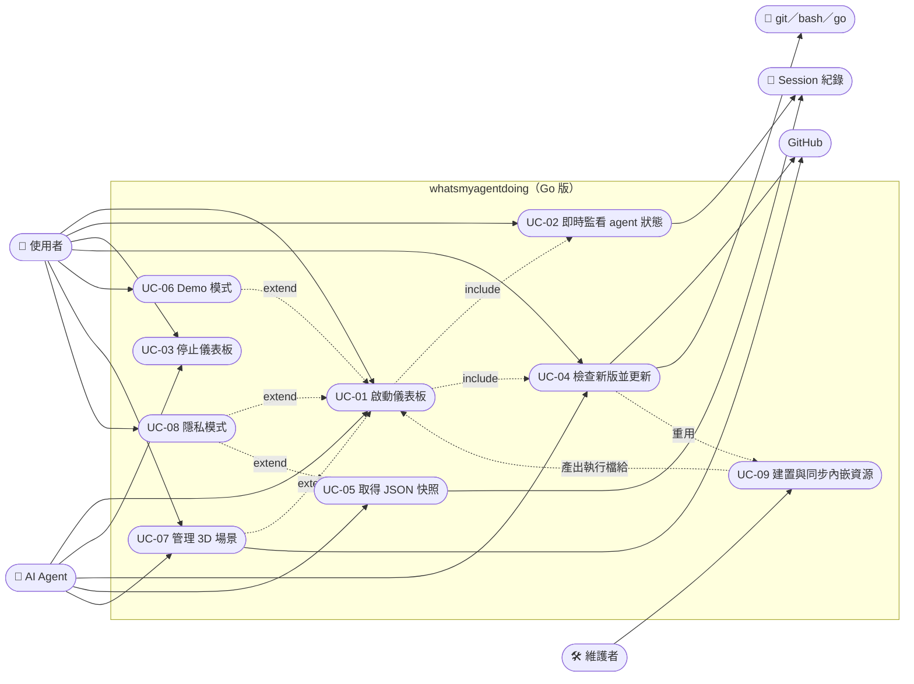

# Use case 總覽（Go 版）

## 參與者

| 參與者 | 說明 |
|---|---|
| 使用者 | 在同一台機器上使用 Claude Code／Codex／Gemini CLI 的開發者；在終端機執行 `./whatsmyagentdoing`，在瀏覽器看儀表板 |
| AI Agent | Claude Code 或 Codex 本身。skill 被改指向 Go 執行檔時，依 `SKILL.md` 代為執行；也會用 `--json` 在對話中回答「其他 agent 在做什麼」 |
| 維護者 | 本專案的開發者：同步內嵌資源、建置執行檔、檢查漂移 |
| 瀏覽器 | 執行前端；行為與 Node 版相同，不在本報告範圍 |
| Session 紀錄 | 三種 agent 寫在磁碟上的 JSONL；被動資料來源，只讀 |
| GitHub | 版本檢查讀 raw `package.json`；場景包從 releases 下載 |
| 工具鏈 | `git`、`bash`、`go`：`--update` 時由程式呼叫；只有執行檔還在 clone 的 `go-app/` 裡才用得到 |

## Use case 圖

## 總表

| ID | 名稱 | 主要參與者 | 觸發 | 進入點 | 檔案 |
|---|---|---|---|---|---|
| UC-01 | 啟動儀表板 | 使用者／AI Agent | `./whatsmyagentdoing [options]` | `main()` | [UC-01](UC-01-start-dashboard.md) |
| UC-02 | 即時監看 agent 狀態 | 使用者 | 頁面開啟後自動 | `Watcher.Tick` → `changes` → `broadcastLoop` → `push` → `serveEvents` | [UC-02](UC-02-live-monitoring.md) |
| UC-03 | 停止儀表板 | 使用者／AI Agent | `--stop`、Ctrl+C | `stopAt()` → `/api/shutdown` → `onShutdown` | [UC-03](UC-03-stop-dashboard.md) |
| UC-04 | 檢查新版並更新 | 使用者／AI Agent | 頁面「檢查更新」／Update 鈕、`--update` | `Updater`、`/api/version`、`/api/update`、`onRestart` | [UC-04](UC-04-check-and-update.md) |
| UC-05 | 取得 JSON 快照 | AI Agent | `--json` | `Watcher.Tick` 兩次 → `snapshot()` | [UC-05](UC-05-json-snapshot.md) |
| UC-06 | Demo 模式 | 使用者 | `--demo` | `DemoWatcher` | [UC-06](UC-06-demo-mode.md) |
| UC-07 | 管理 3D 場景 | 使用者／AI Agent | 場景選單、`--scenes`、`--scene`、`--remove-scene` | `Scenes`、`/api/scenes*`、`/scenes/<id>/**` | [UC-07](UC-07-manage-scenes.md) |
| UC-08 | 隱私模式 | 使用者 | `--private` | `view()` | [UC-08](UC-08-private-mode.md) |
| UC-09 | 建置與同步內嵌資源 | 維護者 | `scripts/sync-static.sh`、`go build` | `scripts/sync-static.sh`、`embed.go` | [UC-09](UC-09-build-and-sync.md) |

## 關係說明

- UC-01 啟動後必然進入 UC-02（頁面連 SSE）；`AutoUpdateCheck` 開啟時啟動也會做一次版本提示（UC-04 的檢查部分）
- UC-06、UC-08 是 UC-01 的旗標變體：換掉資料來源（`Source` 介面）或遮蔽內容（`view()`），其餘流程相同；UC-08 同樣作用於 UC-05 的輸出
- UC-07 的 `--scene` 旗標在 UC-01 之前先安裝場景，再帶 query 開啟網址
- UC-04 的更新路徑重用 UC-09 的同步腳本與 `go build`，差別是由程式呼叫而非維護者手動
- UC-09 產出的執行檔是 UC-01 的前提；維護者改了前端卻忘記同步，執行檔帶的仍是舊 bundle

## 由前端承擔的 use case

下列 use case 的邏輯全部在瀏覽器端，Go 版只是把同一份 `index.html` 與腳本從內嵌檔案系統送出去，行為與 Node 版完全相同。請直接看上層 jerry-report。

| 上層 | 名稱 | 伺服器端的參與 |
|---|---|---|
| [UC-07](../../jerry-report/UC-07-switch-view.md) | 切換視圖與畫質 | 服務 `/office.js`、`/office3d.js`、`/assets/**` |
| [UC-09](../../jerry-report/UC-09-popout.md) | 子母畫面 | 服務 `/popout.js`、`/?pip=1` 同一頁 |
| [UC-10](../../jerry-report/UC-10-language.md) | 選擇介面語言 | `snapshot().lang` 的猜測在 `lang.go`（structure.md 第 9 節） |
| [UC-11](../../jerry-report/UC-11-notifications.md) | 完成通知 | 無 |
| [UC-13](../../jerry-report/UC-13-copy-resume.md) | 複製 resume 指令 | `view()` 輸出的 `id`、`cwd`、`sessionId` |
| [UC-14](../../jerry-report/UC-14-preferences-sync.md) | 偏好設定同步 | 無 |
