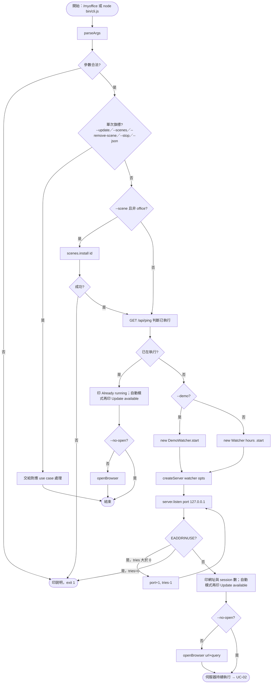
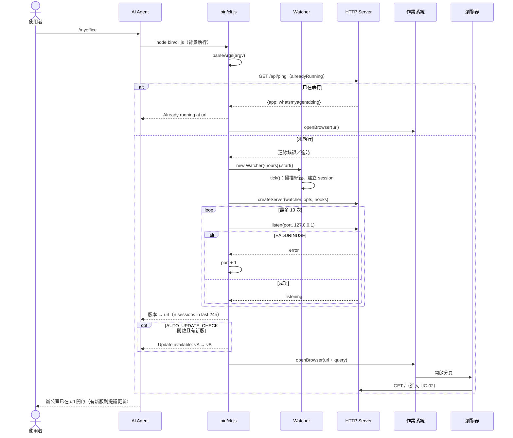

# UC-01 啟動儀表板

| 項目 | 內容 |
|---|---|
| 主要參與者 | 使用者（直接執行）或 AI Agent（依 `SKILL.md` 代為執行） |
| 次要參與者 | 作業系統（開啟瀏覽器）、GitHub（版本提示） |
| 前置條件 | Node.js 18+；專案已 clone 到 `~/.claude/skills/myoffice` 或任意位置 |
| 觸發 | `/myoffice`、「我的 agent 在幹嘛」、`node bin/cli.js [options]` |
| 後置條件 | 伺服器在 `127.0.0.1:<port>` 監聽，瀏覽器分頁開啟；或已在執行時只重開分頁 |
| 相關程式 | `bin/cli.js`（`parseArgs`、`alreadyRunning`、`openBrowser`、`listen`）、`src/watcher.js`、`src/server.js`、`src/update.js` |

## 主要流程

1. 使用者輸入 `/myoffice`。AI Agent 讀 `SKILL.md`，在背景執行 `node "<base>/bin/cli.js"`。
2. CLI 解析參數（port、hours、open、private、demo、scene 等）；數值不合法則印說明並以 1 離開。
3. CLI 對 `127.0.0.1:<port>/api/ping` 發 GET（逾時 0.8 秒），判斷是否已有儀表板。
4. 未執行：建立 `Watcher({hours})` 並 `start()`（第一次 `tick()` 立即掃描紀錄）。
5. 建立 HTTP 伺服器 `createServer(watcher, opts, {onShutdown, onRestart})`。
6. `listen(port, 10)`：綁 `127.0.0.1`；`EADDRINUSE` 則 port+1 重試，最多 10 次。
7. 監聽成功後印出網址與時間窗內的 session 數；`src/config.js` 的 `AUTO_UPDATE_CHECK` 開啟時再強制檢查一次新版，有新版印「Update available」提示（UC-04）。
8. 若未指定 `--no-open`，以 `open`／`xdg-open`／`cmd /c start` 開瀏覽器。
9. AI Agent 讀 stdout，告知使用者網址；若看到更新提示則提議更新（UC-04）。
10. 瀏覽器載入 `/`，進入 UC-02。

## 替代流程

- **A1 已在執行**：步驟 3 回應含 `whatsmyagentdoing` → 印「Already running at …」、印版本提示、重開瀏覽器分頁後結束；不另起伺服器。
- **A2 `--demo`**：步驟 4 改建 `DemoWatcher`（UC-06）。
- **A3 `--scene <id>`**：步驟 2 之後先 `scenes.install(id)`（UC-08），開啟網址附 `?view=office&quality=high&scene=<id>`；失敗印錯誤並以 1 離開。
- **A4 `--private`**：快照遮蔽 prompt、reply、title（UC-12）。
- **A5 連接埠連續 10 個都被占**：印錯誤並以 1 離開。
- **A6 找不到 `node`**：依 `SKILL.md`，agent 直接說明並停止。
- **A7 其他旗標**：`--stop`（UC-03）、`--update`（UC-04）、`--json`（UC-05）、`--scenes`／`--remove-scene`（UC-08）各自處理後結束，不啟動伺服器。

## 流程圖

## 循序圖

## 備註

- `alreadyRunning` 只探測 `--port` 指定的那一個連接埠；若先前的儀表板因 4545 被占而落到 4546，再次執行會因 4545、4546 皆占用而開到 4547，形成第二個實例。`--stop` 則會掃 port 到 port+10 全部停掉。
- `tests/ui.cjs` 不經 CLI，直接 `createServer(new DemoWatcher(), {demo:true})` 並 `listen(0)` 取隨機連接埠。
