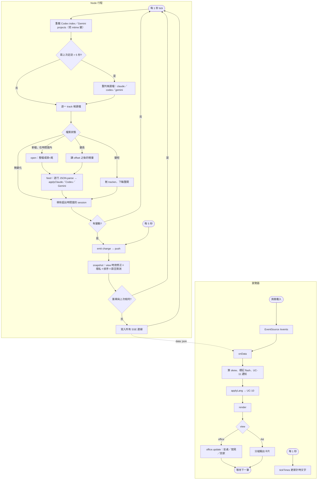
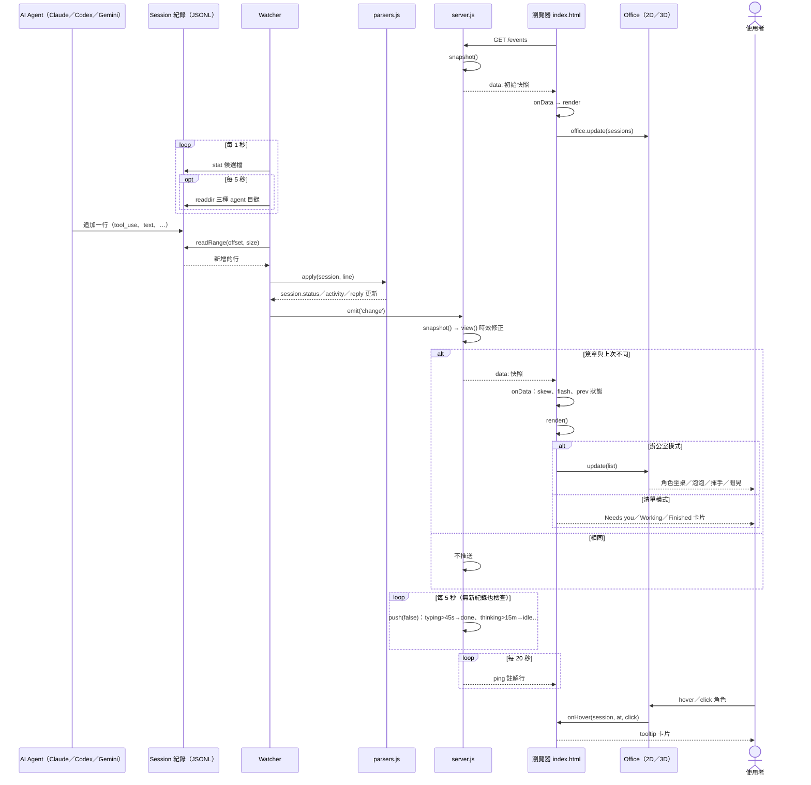

# UC-02 即時監看 agent 狀態

| 項目 | 內容 |
|---|---|
| 主要參與者 | 使用者 |
| 次要參與者 | Session 紀錄（被動）、AI Agent（寫紀錄的一方） |
| 前置條件 | UC-01 已啟動伺服器；瀏覽器已開啟頁面 |
| 觸發 | 頁面載入後自動連 SSE；之後任何 agent 寫入紀錄 |
| 後置條件 | 畫面上每個 session 的狀態、活動、prompt、回覆與計時器與磁碟紀錄一致（延遲約 1 秒） |
| 相關程式 | `src/watcher.js`、`src/parsers.js`、`src/server.js`（`view`、`snapshot`、`push`、`/events`）、`public/index.html`（`connect`、`onData`、`render`、`tickTimes`）、`public/office.js`、`web/office3d.js` |

## 主要流程

### 伺服器端（持續）

1. `Watcher.tick()` 每 1 秒執行：
   - 若 `session_index.jsonl`（Codex）或 `projects.json`（Gemini）mtime 變動，重新載入名稱／專案對照。
   - 距上次目錄走訪超過 5 秒：重新列出候選檔（Claude 專案目錄與 `subagents/`、Codex 時間窗內的日期目錄、Gemini `tmp/*/chats`）。
   - 對每個候選檔 `track()`：
     - 新檔且 mtime 在時間窗內 → `open()`：小檔整檔讀；大檔讀頭 128 KB（取 cwd、title、model）與尾 768 KB（取當前狀態）。
     - 已追蹤且變長 → 讀 `offset` 之後的增量。
     - 變短 → 刪除 tracker，下個 tick 重開。
   - `feed()` 逐行 `JSON.parse`，交給該 agent 的 `apply*`（parsers.js）更新 session 物件；壞行略過。
   - 移除 `lastEventAt` 早於時間窗的 session。
   - 有任何變動 → `emit('change')`。
2. Server 收到 `change` → `push(false)`：
   - `snapshot()`：對每個 session 做 `view()`（時效修正、隱私遮蔽），依 `lastEventAt` 降冪排序，附 `promptLanguage()` 猜測。
   - 序列化後去掉 `now` 欄位比對簽章；與上次相同就不推。
   - 寫 `data: <json>\n\n` 到所有 SSE 連線。
3. 另有兩個時鐘：每 5 秒 `push(false)`（讓 `view()` 的時效降級在沒有新紀錄時也能生效）、每 20 秒送 `: ping`。

### 瀏覽器端

4. `connect()` 建立 `EventSource('/events')`；伺服器連線即先送一份快照。
5. `onData(data)`：計算時鐘偏移 `skew`；對每個 session 比對上一輪狀態，從 Working 變成 done／waiting 的加入 `flash`（並視 UC-11 決定是否通知）；存入 `state.data`；`applyLang(chooseLang(data.lang))`（UC-10）；`render()`。
6. `render()`：
   - 依 agent 篩選、是否顯示子代理、是否顯示 idle 計算可見清單；更新頂部計數（Needs you／Working／Finished）與分頁標題 `(n!)`／`(n)`。
   - 辦公室模式：`office.update(list)`，工作中的 agent 坐桌（thinking 思考泡泡、tool 打字、waiting 站起揮手），最多 7 位下班者閒晃，其餘標示「回家」。hover／click 顯示 tooltip 卡片。
   - 清單模式：依 Needs you → Working → Finished →（Idle）分組輸出卡片；卡片含 agent 標誌、專案、計時、狀態、activity、prompt、reply、error、model、Copy 鈕。
7. `tickTimes()` 每 1 秒更新卡片與 tooltip 上的計時文字，不重繪整頁。

## 替代流程

- **A1 SSE 斷線**：`es.onerror` 讓連線指示器顯示「Disconnected — retrying…」；EventSource 自動重連，重連後伺服器再送完整快照。
- **A2 紀錄讀取失敗**（權限、讀到一半被刪）：該檔記入 `failed`，60 秒後重試；不影響其他 session，伺服器不崩潰。
- **A3 無 session**：畫面顯示「時間窗內沒有 session」提示。
- **A4 快照序列化失敗**：印 `snapshot failed`，略過本次推送。
- **A5 子代理**：Claude 由 `subagents/` 目錄、Codex 由 `session_meta` 的 `parent_thread_id`／`thread_source`、Gemini 由 `kind: subagent` 判定；預設隱藏，設定可開。

## 流程圖

## 循序圖

## 備註

- 「Writing reply」代表回覆區塊已落地但 turn 未結束，不是逐字串流。
- Claude Code 不記錄權限提示，等待核准的工具會顯示為 Running，直到使用者回應；Codex 與 Gemini 有記錄，顯示 Waiting for you。
- Gemini 會整則訊息重複追加，所以以檔案 mtime 作為最後活動時間。
