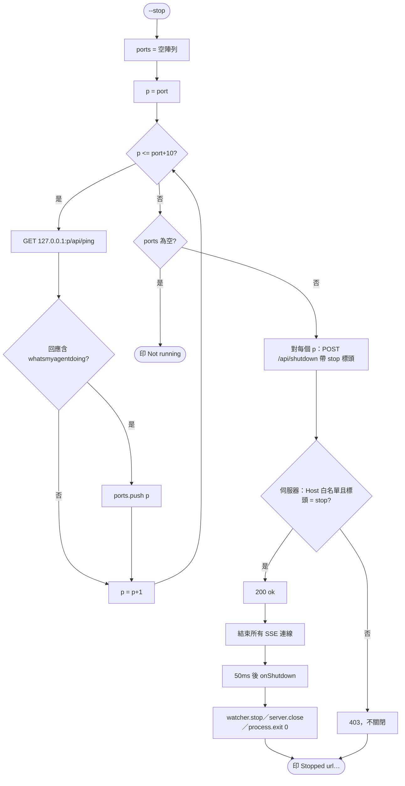
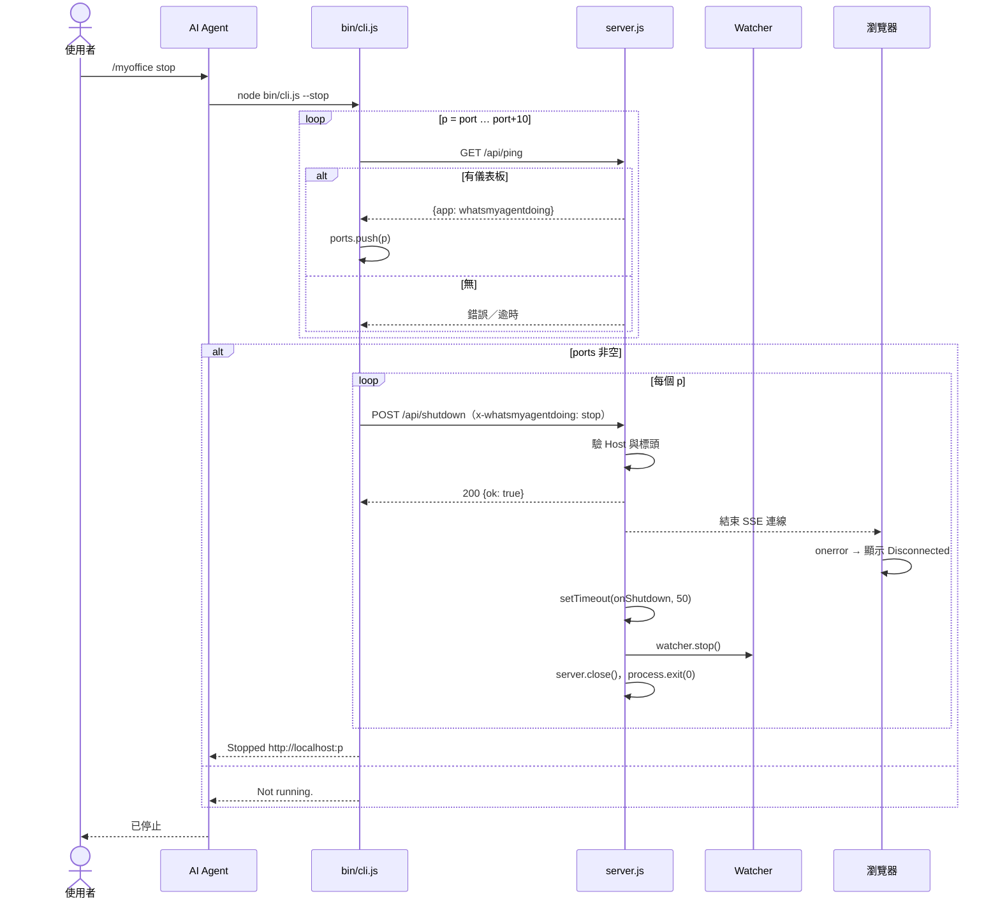

# UC-03 停止儀表板

| 項目 | 內容 |
|---|---|
| 主要參與者 | 使用者或 AI Agent |
| 前置條件 | 儀表板在 port 到 port+10 之間的某個連接埠執行中（或未執行） |
| 觸發 | `/myoffice stop`、「關掉辦公室」、`node bin/cli.js --stop`、終端機 Ctrl+C |
| 後置條件 | 伺服器行程結束；SSE 連線關閉；瀏覽器頁面顯示斷線 |
| 相關程式 | `bin/cli.js`（`alreadyRunning`、`stopAt`）、`src/server.js`（`/api/shutdown`）、`onShutdown` hook |

## 主要流程

1. 使用者輸入 `/myoffice stop`；AI Agent 執行 `node bin/cli.js --stop`（不在背景）。
2. CLI 對 port、port+1、…、port+10 逐一 GET `/api/ping`，收集回應含 `whatsmyagentdoing` 的連接埠。
3. 對每個命中的連接埠 POST `/api/shutdown`，帶標頭 `x-whatsmyagentdoing: stop`。
4. 伺服器檢查 Host 白名單與該標頭；通過後回 `{ok: true}`，結束所有 SSE 連線，50 ms 後呼叫 `onShutdown`。
5. `onShutdown`：`watcher.stop()`（清掉 interval）、`server.close()`、`process.exit(0)`。
6. CLI 印「Stopped http://localhost:<port>…」；AI Agent 告知已停止。

## 替代流程

- **A1 未執行**：步驟 2 無命中 → 印「Not running.」。
- **A2 標頭不符**：步驟 4 回 403；不關閉。這擋掉跨站網頁的 CSRF。
- **A3 多個實例**：步驟 2 可能命中多個連接埠（見 UC-01 備註），會全部停掉。
- **A4 Ctrl+C**：行程直接結束，不經 `/api/shutdown`；效果相同。
- **A5 `--update` 後的停止**：UC-04 的 CLI 路徑更新完成後也走步驟 2 到 5，讓舊程式碼的實例下線。

## 流程圖

## 循序圖

