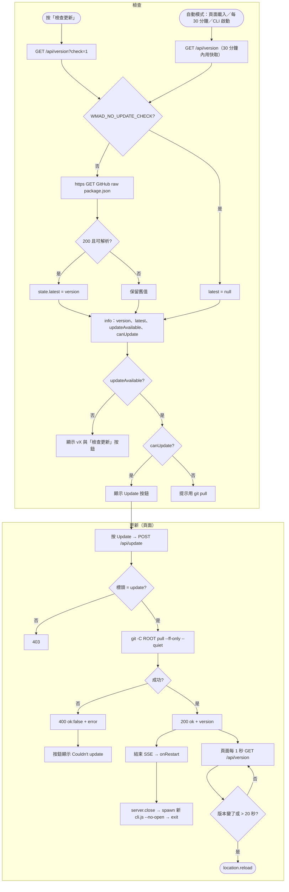
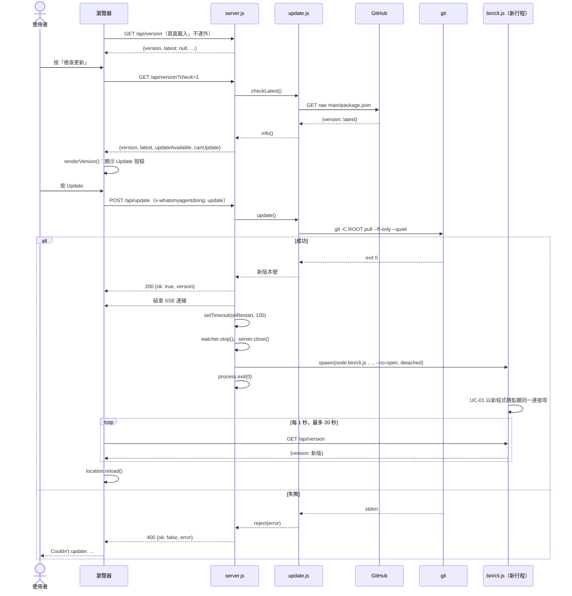
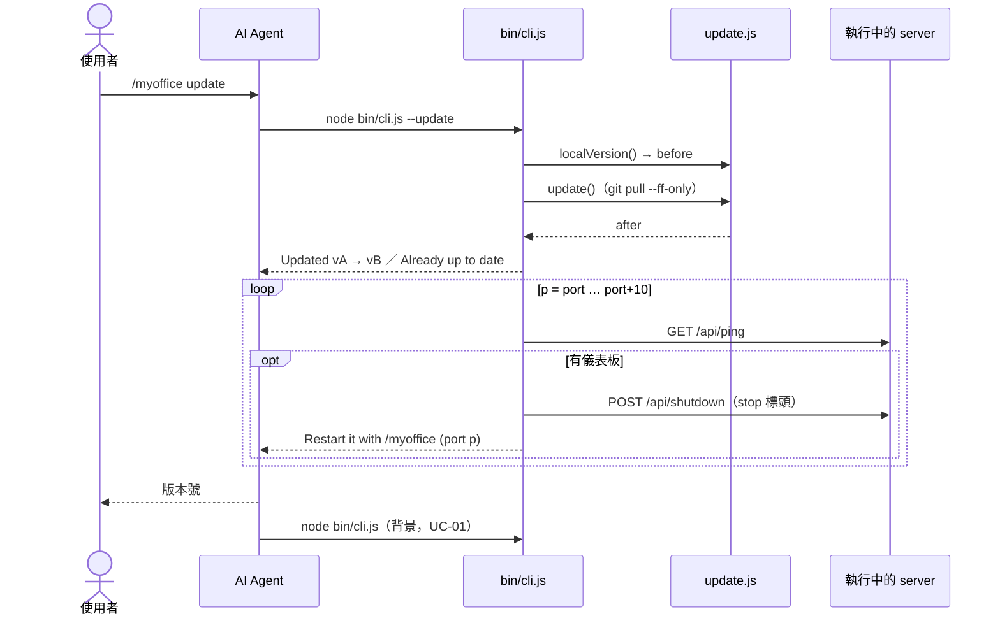

# UC-04 檢查新版並更新

| 項目 | 內容 |
|---|---|
| 主要參與者 | 使用者（頁面按鈕）或 AI Agent（`--update`） |
| 次要參與者 | GitHub（raw `package.json`、git remote） |
| 前置條件 | 檢查：未設 `WMAD_NO_UPDATE_CHECK`；自動檢查另需 `AUTO_UPDATE_CHECK = true`（預設 false）。更新：安裝目錄是 git clone（存在 `.git`），且可 fast-forward |
| 觸發 | 頁面「檢查更新」按鈕、Update 按鈕、`--update`、`/myoffice update`；`src/config.js` 的 `AUTO_UPDATE_CHECK` 開啟時另加頁面載入、每 30 分鐘、CLI 啟動 |
| 後置條件 | 本機程式碼為最新版；儀表板以新程式碼重新執行；頁面重新載入 |
| 相關程式 | `src/update.js`、`src/server.js`（`/api/version`、`/api/update`）、`bin/cli.js`（`--update`、`printUpdateHint`、`onRestart`）、`src/config.js`（`AUTO_UPDATE_CHECK`）、`public/index.html`（`loadVersion`、`renderVersion`） |

## 主要流程

### 檢查

1. 瀏覽器載入時 `loadVersion()` → GET `/api/version`；`AUTO_UPDATE_CHECK` 關閉（預設）時伺服器只回已知資訊，不連外，使用者按「檢查更新」才 GET `/api/version?check=1`。
2. 帶 `check=1` 時伺服器 `checkLatest(true)`：https GET GitHub raw 的 `package.json`（逾時 4 秒、上限 64 KB），取 `version`；同時多個請求共用同一次抓取。
3. 回 `{version, latest, updateAvailable, canUpdate, auto}`；`updateAvailable` 為語意版本比較，`canUpdate` 為是否存在 `.git`。
4. `renderVersion()`：右下角沒有新版資訊時顯示「檢查更新」按鈕，目前版本（`v0.4.0`）是按鈕 hover／focus 時的提示（`data-ver`），不另佔位置；按後無新版顯示「已是最新版」、抓不到顯示「檢查失敗」，4 秒後還原；有新版且可更新時顯示「⬆ Update to vX」按鈕與工具列右側的「New version」按鈕；有新版但不是 git clone 則提示「用 git pull 更新」。按鈕右邊是主機時鐘（`sw.js` 對 `/api/time` 校準）。

### 從頁面更新

5. 使用者按 Update；按鈕變「Updating…」並停用。
6. POST `/api/update`，帶標頭 `x-whatsmyagentdoing: update`。
7. 伺服器 `updater.update()`：`execFile('git', ['-C', ROOT, 'pull', '--ff-only', '--quiet'])`，逾時 60 秒；成功後讀新的本機版本。
8. 回 `{ok: true, version}`；結束所有 SSE 連線；100 ms 後 `onRestart`。
9. `onRestart`：`watcher.stop()`、`server.close()` 完成後 spawn 新的 `node bin/cli.js`（原參數去掉 `--no-open` 與 `--scene*`，再加 `--no-open`，detached），舊行程 `exit(0)`。
10. 瀏覽器顯示「Updated — reloading…」，每 1 秒 GET `/api/version`，版本變了或超過 20 秒就 `location.reload()`。

### 從 CLI 更新

11. AI Agent 執行 `node bin/cli.js --update`（不在背景）。
12. CLI 記下更新前版本，呼叫 `updater.update()`，印「Updated vA → vB」或「Already up to date」。
13. 對 port 到 port+10 偵測執行中的儀表板並 POST `/api/shutdown`，印「Restart it with /myoffice」。
14. AI Agent 回報版本號，再依 UC-01 重新啟動。

## 替代流程

- **A1 關閉檢查**：`WMAD_NO_UPDATE_CHECK` 設定時 `checkLatest` 回 null，按「檢查更新」顯示「檢查失敗」。
- **A2 網路不通／非 200**：`fetchLatest` 回 null，保留上次結果；無法判斷就不顯示按鈕。
- **A3 非 git clone**：`update()` reject「not a git clone … reinstall it with git clone」；頁面按鈕顯示「Couldn't update: …」4 秒後還原；CLI 印錯誤並以 1 離開。
- **A4 `git pull` 失敗**（非 fast-forward、衝突、無網路）：同 A3 的錯誤呈現，stderr 作為訊息。
- **A5 更新後新行程啟動失敗**：頁面等 20 秒後仍 reload；此時伺服器可能已不在，頁面顯示斷線。
- **A6 測試**：`WMAD_LATEST_VERSION` 可假造最新版本。
- **A7 自動模式**：`AUTO_UPDATE_CHECK = true` 時，不帶 `check` 的 GET `/api/version` 也會 `checkLatest()`（距上次成功抓取 30 分鐘內用快取）；頁面收到 `auto: true` 就每 30 分鐘再 `loadVersion()`；CLI 啟動與「已在執行」時 `printUpdateHint` 強制檢查並印「Update available: vA → vB」供 agent 提議更新（UC-01）。

## 流程圖

## 循序圖

### CLI 路徑

## 備註

- 只讀 GitHub 上的版本字串，不下載程式碼；更新本身是 `git pull --ff-only`，不會蓋掉本機修改（有本機 commit 時會失敗）。
- 頁面更新路徑由伺服器自己重啟；CLI 更新路徑只停掉舊實例，由 agent 重新啟動。
