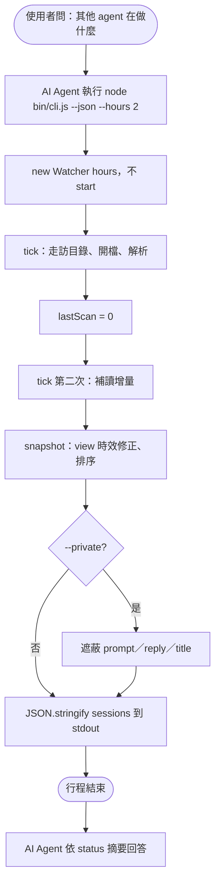
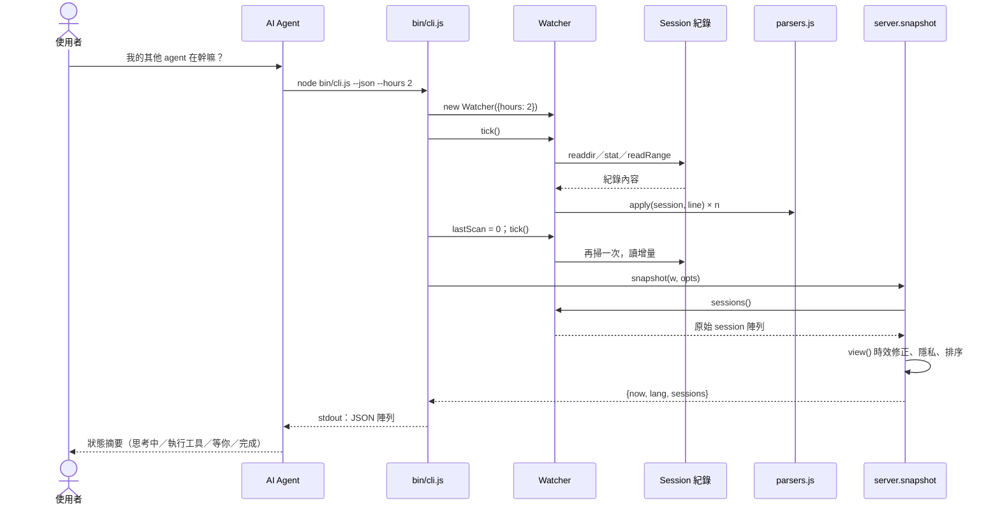

# UC-05 取得 JSON 快照

| 項目 | 內容 |
|---|---|
| 主要參與者 | AI Agent（在對話中回答「其他 agent 在做什麼」） |
| 次要參與者 | 使用者（提問者）、Session 紀錄 |
| 前置條件 | Node.js 18+；不需要儀表板在執行 |
| 觸發 | 使用者在對話中詢問其他 agent 的狀態；`node bin/cli.js --json [--hours n]` |
| 後置條件 | stdout 印出一次性的 session 陣列（JSON），行程結束；不開瀏覽器、不啟伺服器 |
| 相關程式 | `bin/cli.js`（`o.json` 分支）、`src/watcher.js`、`src/server.js`（`snapshot`） |

## 主要流程

1. 使用者問「我的其他 agent 在幹嘛」。AI Agent 依 `SKILL.md` 執行 `node bin/cli.js --json --hours 2`。
2. CLI 建立 `Watcher({hours})`，**不**呼叫 `start()`（不啟動 interval）。
3. 手動 `tick()` 一次：走訪目錄、開啟時間窗內的紀錄、解析。
4. 把 `lastScan` 歸零再 `tick()` 一次，確保第一輪建立的 tracker 都已讀到最新內容。
5. `snapshot(watcher, opts).sessions`：每個 session 經 `view()` 做時效修正（與 UC-02 相同規則）、依 `lastEventAt` 排序。
6. `JSON.stringify(…, null, 2)` 印到 stdout，行程自然結束。
7. AI Agent 讀 JSON，依 status 摘要給使用者（誰在想、誰在跑工具、誰在等、誰完成）。

## 替代流程

- **A1 `--private`**：快照同樣遮蔽 prompt、reply、title。
- **A2 時間窗內無 session**：印 `[]`。
- **A3 某紀錄讀取失敗**：該檔略過，其餘照常。
- **A4 `--demo` 與 `--json` 並用**：程式碼先判斷 `o.json`，仍讀真實紀錄；`--demo` 在此路徑無效。

## 流程圖

## 循序圖

