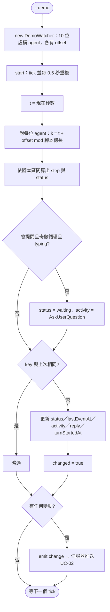
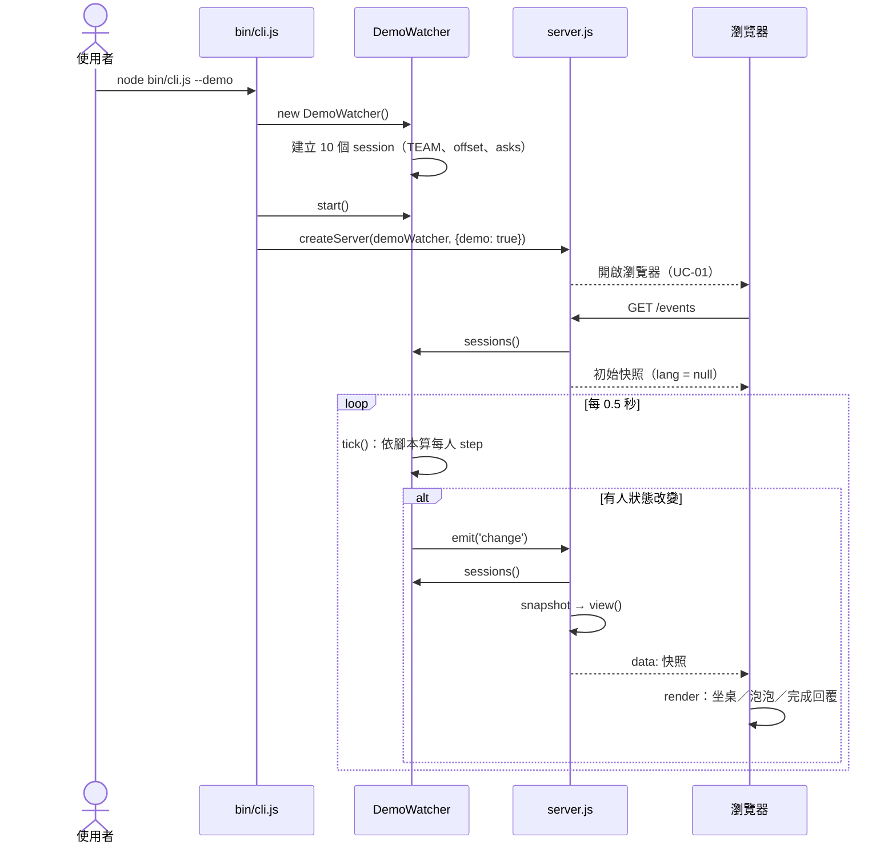

# UC-06 Demo 模式

| 項目 | 內容 |
|---|---|
| 主要參與者 | 使用者（截圖、試用、沒有 session 的機器） |
| 次要參與者 | 維護者（UI 測試以此為資料來源，見 UC-16） |
| 前置條件 | 無；不讀任何真實紀錄 |
| 觸發 | `node bin/cli.js --demo` |
| 後置條件 | 儀表板顯示 10 位虛構 agent 持續循環工作；README 的 GIF 即以此錄製 |
| 相關程式 | `src/demo.js`（`DemoWatcher`）、`bin/cli.js`、`src/server.js` |

## 主要流程

1. CLI 解析到 `--demo`，以 `new DemoWatcher().start()` 取代 `Watcher`；之後與 UC-01 相同建立伺服器。
2. `DemoWatcher` 建構時產生 10 個 session：agent（claude × 6、codex × 2、gemini × 2）、專案名、prompt、model；每人有不同的時間偏移 `offset`，第 3 與第 7 位會「提問」。
3. 每 0.5 秒 `tick()`：以目前秒數加偏移，對照固定腳本 `[thinking 3s, tool 4s, thinking 2s, tool 3s, typing 3s, done 16s]` 算出每人當前步驟。
4. 步驟改變時更新 `status`、`lastEventAt`、`activity`（tool 時從該 agent 的工具清單輪流取）、`reply`（done 時從四句回覆輪流取）、`turnStartedAt`（步驟 0 時）。
5. 有變動就 `emit('change')`，伺服器推送（UC-02）。
6. `snapshot()` 在 demo 模式下 `lang` 為 null，語言只看使用者選擇與瀏覽器（UC-10）。

## 替代流程

- **A1 會提問的 agent**：奇數循環的 typing 步驟改為 waiting，`activity` 為 `AskUserQuestion`，用來展示「Needs you」。
- **A2 與 `--private` 並用**：仍遮蔽文字。
- **A3 與 `--json` 並用**：`--json` 分支先執行且只用真實 Watcher，demo 無效。

## 流程圖

## 循序圖

