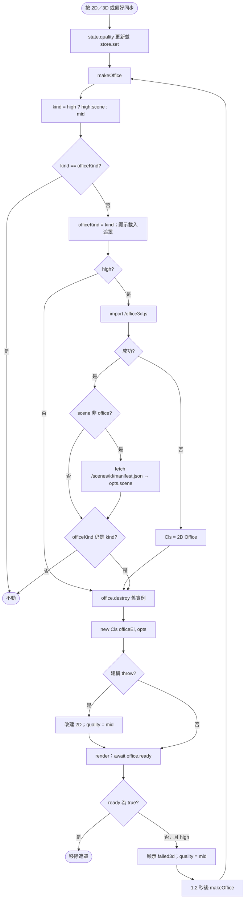
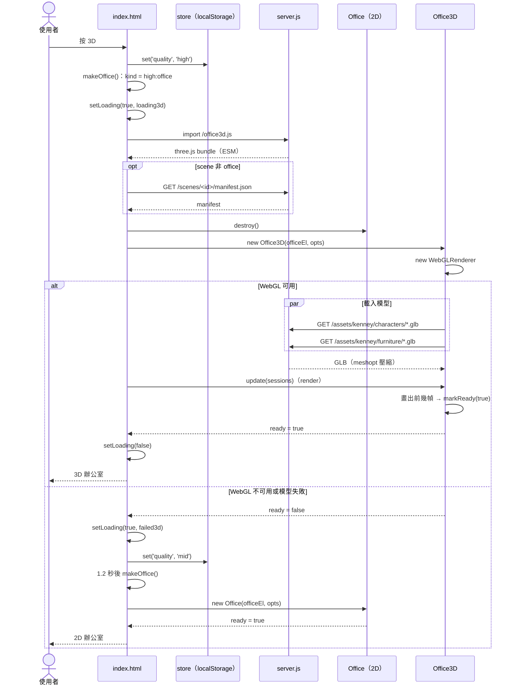

# UC-07 切換視圖與畫質

| 項目 | 內容 |
|---|---|
| 主要參與者 | 使用者 |
| 次要參與者 | 瀏覽器（WebGL、動態 import）、伺服器（提供 `/office3d.js`、`/assets/kenney/*.glb`） |
| 前置條件 | 頁面已載入（UC-02） |
| 觸發 | 工具列 Office／List、設定面板的 2D／3D 按鈕；URL `?view=&quality=`；偏好同步（UC-14） |
| 後置條件 | 畫面以選定的視圖與畫質呈現；偏好已存入 localStorage |
| 相關程式 | `public/index.html`（`viewSeg`、`qualSeg`、`render`、`makeOffice`、`setLoading`）、`public/office.js`、`web/office3d.js`、`src/server.js`（`/assets/`） |

## 主要流程

### 切換 Office／List

1. 使用者按 `viewSeg` 的按鈕；`state.view` 更新、`store.set('view')`、關閉 tooltip、`syncControls()`、`render()`。
2. `render()`：office 模式顯示 `#officeWrap` 並 `office.setVisible(true)`；list 模式隱藏辦公室，輸出分組卡片；只有 list 顯示「Idle」切換，只有 office 顯示畫質與 agent 標記選項。

### 切換 2D／3D

3. 使用者在設定面板按 `qualSeg`（只在辦公室檢視出現，預設 3D）；`state.quality` 更新並存檔，呼叫 `makeOffice()`。
4. `makeOffice()` 計算 `kind`：`mid` 或 `high:<scene>`（scene 只在已安裝時生效，否則 `office`）；與目前相同就不重建。
5. 顯示載入遮罩（「Loading 3D office…」或「Setting up the office…」）。
6. 3D：`await import('/office3d.js')` 取得 `Office3D`（three.js bundle 約 180 KB gzip，只在此時下載）；若 scene 非 office，再 `fetch('/scenes/<id>/manifest.json')`。
7. 銷毀舊的 office（`destroy()`），`new Cls(officeEl, opts)`。3D 建構時建立 `WebGLRenderer`，非同步載入 12 個角色與家具 GLB（`/assets/kenney/…`）。
8. `render()` 先把資料餵進去；`await office.ready`（2D：畫出 3 幀後 resolve true；3D：模型載完且畫出幀後 true，WebGL 或模型失敗則 false）。
9. 成功：移除載入遮罩。

## 替代流程

- **A1 3D 建構時 throw**：改用 2D `Office`，`quality` 回寫為 `mid`，`officeKind = 'mid'`。
- **A2 3D `ready` 為 false**（無 WebGL、模型檔缺失）：顯示「Couldn't load the 3D office — showing Medium instead.」，`quality` 設回 `mid`，1.2 秒後再 `makeOffice()` 建 2D。
- **A3 import 失敗**（bundle 404）：catch 後 `Cls = window.Office`，走 2D。
- **A4 切換中又切換**：`officeKind` 已被後來的呼叫改寫，先前的 `makeOffice` 在 import 後檢查 `officeKind !== kind` 直接 return，避免建出過時的 office。
- **A5 PiP 開啟中**：主頁的 `render()` 隱藏辦公室並顯示「儀表板正在子母畫面視窗中顯示」（UC-09）。
- **A6 來自 URL**：`?view=office&quality=high&scene=pirate`（`--scene` 開的網址）在載入時寫入偏好，再從網址移除。

## 流程圖

## 循序圖

## 備註

- 2D 與 3D 共用同一套席位、閒晃與狀態邏輯（`Office3D extends Office`），3D 只換渲染；泡泡與名牌仍由 2D 程式畫在 canvas overlay 上。
- 3D 視窗時間影響天色（`skyNow()`），2D 另有辦公室貓。
