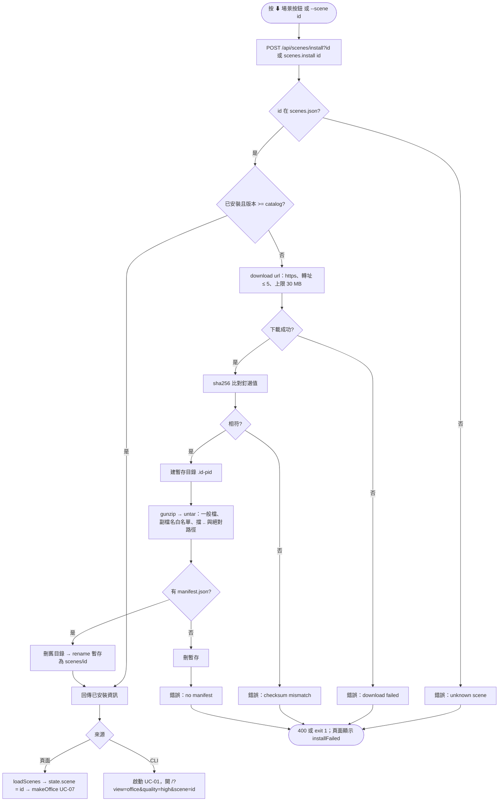
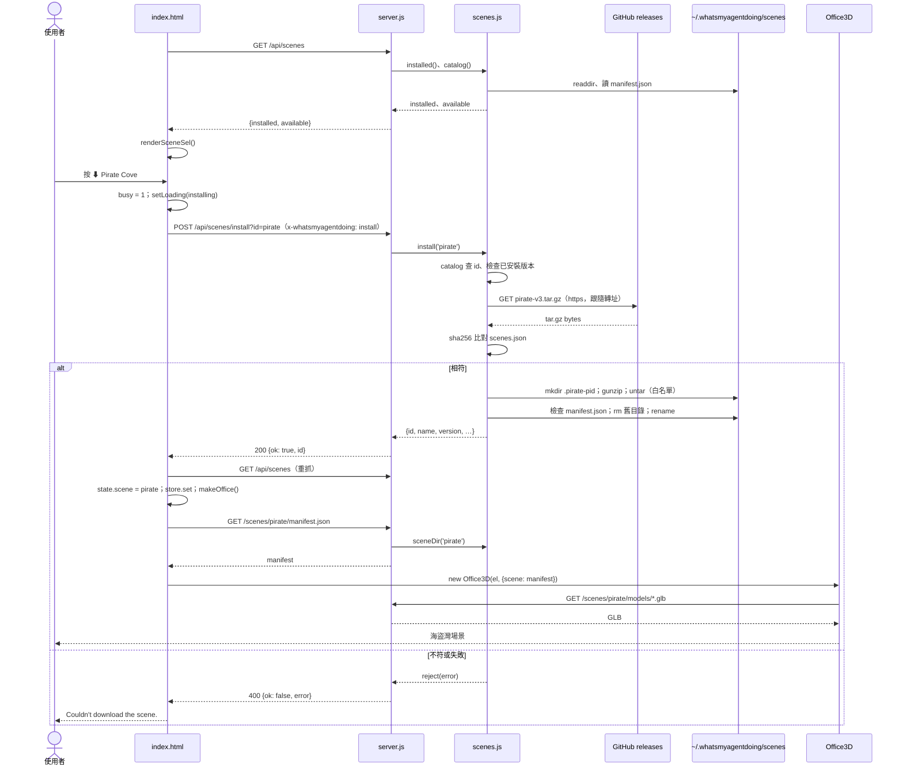

# UC-08 管理 3D 場景

| 項目 | 內容 |
|---|---|
| 主要參與者 | 使用者（場景按鈕）或 AI Agent（`--scenes`、`--scene`、`--remove-scene`） |
| 次要參與者 | GitHub releases（場景包來源）、檔案系統（`~/.whatsmyagentdoing/scenes/`） |
| 前置條件 | 已選 3D（UC-07）才會看到場景按鈕；下載需網路 |
| 觸發 | 使用者要換場景、提到 DLC、指名「海盜船」；按下載按鈕 |
| 後置條件 | 場景包以驗證過的內容安裝到使用者目錄；辦公室以該場景重建 |
| 相關程式 | `src/scenes.js`、`src/server.js`（`/api/scenes`、`/api/scenes/install`、`/scenes/<id>/`）、`bin/cli.js`、`public/index.html`（`loadScenes`、`renderSceneSel`、`makeOffice`）、`scenes.json` |

## 主要流程

### 列出（CLI）

1. AI Agent 執行 `node bin/cli.js --scenes`。
2. `scenes.installed()` 掃使用者目錄與內建 `scenes/` 目錄，每個子目錄讀 `manifest.json`；`scenes.catalog()` 讀 `scenes.json`。
3. 印出 `office`（內建）、已安裝者、可下載者（含 KB 大小）。agent 必須用印出的 id。

### 下載並切換（頁面）

4. 頁面載入時 `loadScenes()` → GET `/api/scenes`，取得 `installed` 與 `available`，`renderSceneSel()` 畫出按鈕：🏢 Office、已安裝場景、`⬇` 可下載場景（顯示大小）。
5. 使用者按下載按鈕；`sceneSel.dataset.busy` 鎖住、顯示「Downloading the scene…」。
6. POST `/api/scenes/install?id=<id>`，帶標頭 `x-whatsmyagentdoing: install`。
7. 伺服器 `scenes.install(id)`：
   - 在 catalog 找 id；找不到 throw。
   - 已安裝且版本不低於 catalog → 直接回傳。
   - `download(url)`：只允許 https；跟隨最多 5 次轉址；超過 30 MB 中止。
   - 計算 SHA-256，與 `scenes.json` 釘選值比對；不符 throw「checksum mismatch」。
   - 建暫存目錄 `.<id>-<pid>`，`gunzipSync` 後以自製 ustar reader 解壓：只收一般檔、副檔名限 `.json/.glb/.png/.txt`、拒絕 `..` 與絕對路徑、寫入前再驗路徑在暫存目錄內。
   - 無 `manifest.json` → 刪暫存並 throw。
   - 刪舊的 `<id>` 目錄，`rename` 暫存為正式目錄。
8. 回 `{ok: true, id}`；頁面 `loadScenes()` 重抓清單、解鎖。
9. `state.scene = id`、`store.set('scene')`、`renderSceneSel()`、`makeOffice()`（UC-07）；3D 以 `/scenes/<id>/manifest.json` 與 `/scenes/<id>/models/*.glb` 建場景。

### 以 CLI 開啟指定場景

10. `node bin/cli.js --scene pirate`：先 `scenes.install('pirate')`（已安裝則略過下載），印「Downloaded scene」或「Scene is ready」，再依 UC-01 啟動並開啟 `/?view=office&quality=high&scene=pirate`。
11. 頁面從 URL 讀入 `view`、`quality`、`scene` 偏好後重建辦公室。

### 移除

12. `node bin/cli.js --remove-scene <id>`：id 須符合 `^[a-z0-9-]+$`，刪 `~/.whatsmyagentdoing/scenes/<id>`；印「Removed」或「isn't a downloaded scene」。

## 替代流程

- **A1 切回內建**：按 🏢 Office 或 `--scene office`，不下載，`makeOffice()` 以 `high:office` 重建。
- **A2 下載失敗／校驗不符／無 manifest**：伺服器回 400 `{ok:false, error}`；頁面顯示「Couldn't download the scene.」2 秒後還原，場景不變；CLI 路徑印錯誤並以 1 離開。
- **A3 標頭不符**：403。
- **A4 已安裝但 catalog 版本較新**：重新下載並覆蓋。
- **A5 測試**：`WMAD_SCENES_LOCAL` 指向本機資料夾時，`download()` 改讀本機檔。
- **A6 場景 id 不合法**：`sceneDir()` 回 null，`/scenes/<id>/…` 回 404。

## 流程圖

## 循序圖

## 備註

- 場景包只含資料（manifest、GLB、PNG），安裝過程不執行任何程式碼。
- 下載 URL 固定取自 repo 內的 `scenes.json`，使用者無法指定任意 URL。
- 場景包由維護者以 UC-15 產生。
