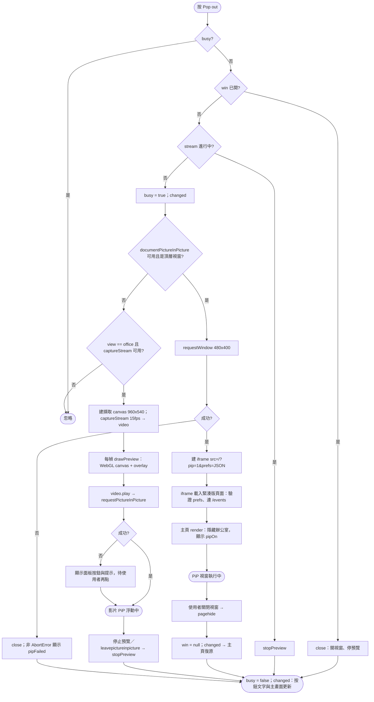
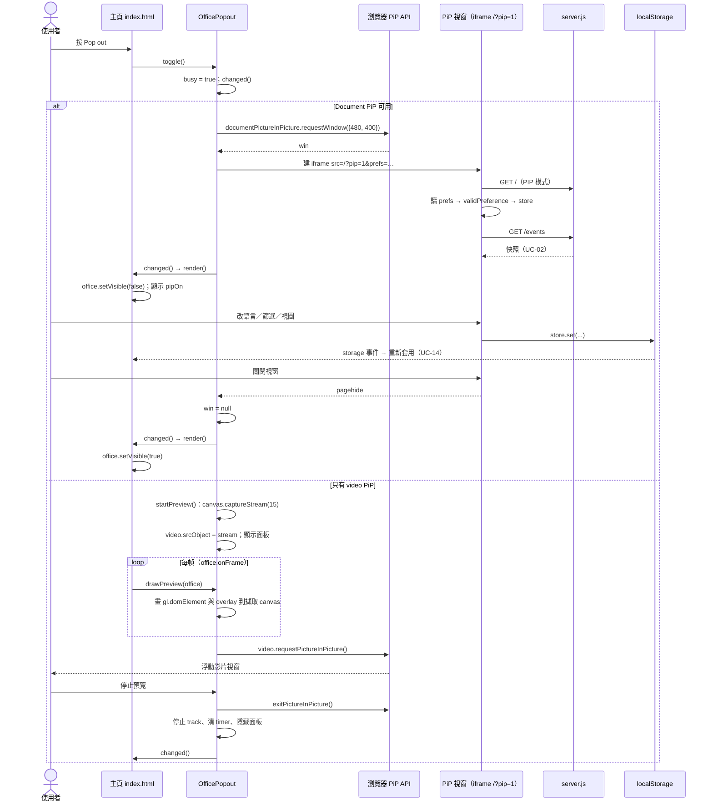

# UC-09 子母畫面（Pop out）

| 項目 | 內容 |
|---|---|
| 主要參與者 | 使用者 |
| 次要參與者 | 瀏覽器（Document Picture-in-Picture API、`HTMLCanvasElement.captureStream`、video PiP） |
| 前置條件 | 頁面已載入；主視窗不是 PiP 視窗（`window.top === window`） |
| 觸發 | 工具列 Pop out 按鈕 |
| 後置條件 | 辦公室或清單在永遠置頂的小視窗顯示；關閉後主畫面復原；只有主分頁發通知 |
| 相關程式 | `public/popout.js`（`OfficePopout`）、`public/index.html`（`PIP`、`prefs` 參數、`render`、`syncControls`）、`public/office.js`（`onFrame`、`frame`） |

## 主要流程

### Document PiP（Chrome 等支援的瀏覽器）

1. 使用者按 Pop out；`toggle()` 檢查 `busy`，清錯誤訊息，設 `busy`、`changed()`（讓按鈕停用）。
2. `documentSupported` 為真 → `openDocument()`：`documentPictureInPicture.requestWindow({width: 480, height: 400})`。
3. 在新視窗建立樣式與一個同源 iframe，`src = /?pip=1&prefs=<JSON 目前偏好>`；記下 `this.win`，監聽其 `pagehide`。
4. iframe 載入同一份 `index.html`：`PIP = true`，body 加 `pip` class（緊湊版）；從 `prefs` 參數讀入偏好（逐一 `validPreference()` 驗證後寫入 store）；自己連 `/events`（UC-02）。
5. 緊湊版差異：清單只顯示 Needs you 與 Working；Pop out 按鈕隱藏；不發通知；空清單顯示「目前沒有需要回應或工作中的 agent」。
6. 主視窗 `render()`：`popout.win` 存在 → 隱藏辦公室、`office.setVisible(false)`，主區顯示「儀表板正在子母畫面視窗中顯示」；按鈕文字改為「關閉子母畫面」。
7. 偏好變更經 `storage` 事件雙向同步（UC-14）。
8. 使用者關閉 PiP 視窗（原生 ✕ 或再按按鈕）：`pagehide` → `this.win = null` → `changed()` → 主視窗恢復辦公室。

### Video PiP 備援（無 Document PiP 時，僅辦公室模式）

9. `documentSupported` 為假 → `startPreview()`：建 960×540 的擷取 canvas，`captureStream(15)` 接到 `<video>`，顯示預覽面板。
10. 每一幀 `office.onFrame` → `drawPreview()`：把 3D 的 WebGL canvas 與 2D overlay canvas 畫進擷取 canvas。
11. 背景分頁 `requestAnimationFrame` 可能停住：每 250 ms 檢查 `document.hidden` 時手動呼叫 `office.frame()`。
12. `video.play()` 後嘗試 `requestPictureInPicture()`（或 WebKit presentation mode）；若使用者手勢已過期，面板提供另一顆按鈕與提示文字，也可用瀏覽器原生影片控制項。
13. 使用者按「停止預覽」或離開 PiP：`stopPreview()` 退出 PiP、停止所有 track、清 timer、`srcObject = null`、隱藏面板。

## 替代流程

- **A1 `requestWindow` 被拒／throw**：`close()` 清狀態；非 `AbortError` 時顯示翻譯過的「無法開啟子母畫面」訊息；按鈕恢復可用、主畫面不受影響。
- **A2 切到 List 時正在影片預覽**：`sync()` 偵測到 view 不是 office → `stopPreview()`；List 模式不提供影片備援按鈕。
- **A3 預覽中切換 2D／3D**：stream 不變，`drawPreview` 改畫新的 office canvas。
- **A4 主頁 `pagehide`**（關閉或重新整理）：`close()` 關掉 PiP 視窗與預覽。
- **A5 兩種都不支援**：Pop out 按鈕隱藏。
- **A6 localStorage 不可用**：PiP 視窗仍能從 URL `prefs` 取得偏好；但之後的雙向同步不會發生。

## 流程圖

## 循序圖

## 備註

- Document PiP 用獨立頁面而非共享 DOM，是為了讓動畫時鐘在主分頁隱藏時仍持續（`tests/ui.cjs` 驗證「pop-out keeps animating while another tab is foreground」）。
- 影片備援不需要螢幕分享權限，也不上傳任何影像；但不支援清單卡片與點擊角色。
