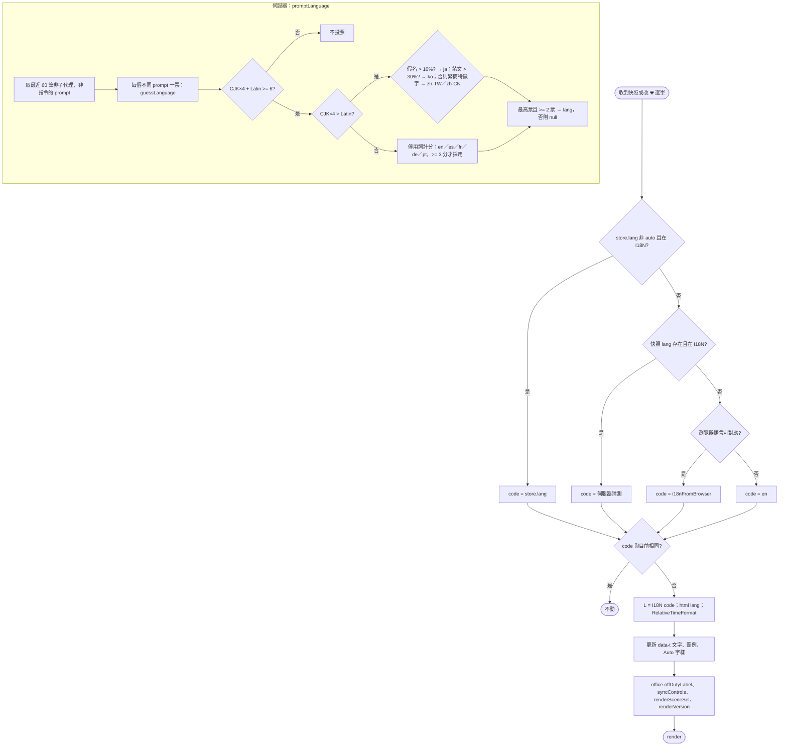
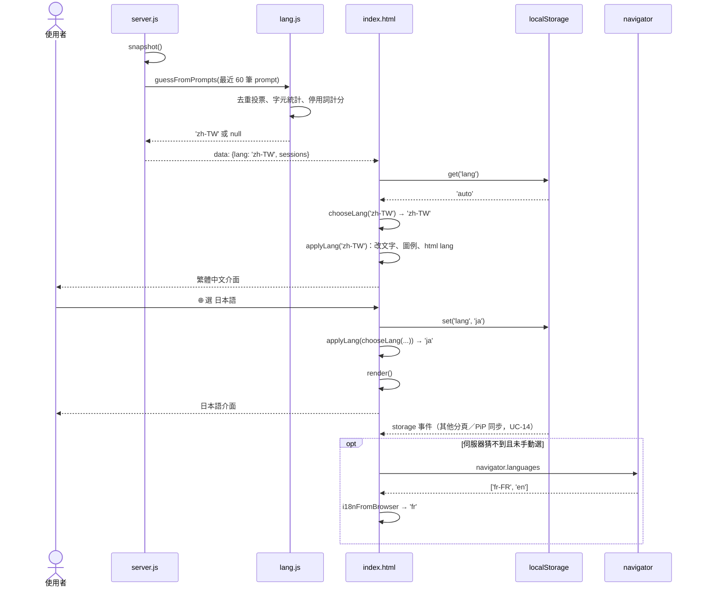

# UC-10 選擇介面語言

| 項目 | 內容 |
|---|---|
| 主要參與者 | 使用者 |
| 次要參與者 | 伺服器（從 prompt 猜語言）、瀏覽器（`navigator.languages`） |
| 前置條件 | 頁面已載入 |
| 觸發 | 每次收到快照（自動判定）；🌐 選單變更；偏好同步 |
| 後置條件 | 所有 `data-t` 元素、圖例、場景名稱、版本文字、辦公室標籤以該語言顯示；`<html lang>` 與相對時間格式同步 |
| 相關程式 | `src/lang.js`（`guessLanguage`、`guessFromPrompts`）、`src/server.js`（`promptLanguage`）、`public/i18n.js`（`I18N`、`i18nFromBrowser`）、`public/index.html`（`chooseLang`、`applyLang`、`langSel`） |

## 主要流程

### 自動判定

1. 伺服器產生快照時 `promptLanguage(raw)`：取非子代理、有 prompt 且不以 `/` 開頭的 session，依 `lastEventAt` 取最近 60 筆 prompt。
2. `guessFromPrompts()`：每個不同的 prompt（前 80 字去重）投一票；單一 prompt 以 `guessLanguage([p], 6)` 判定：
   - 統計假名、諺文、漢字（並分繁簡特徵字）、拉丁字母數。
   - CJK 權重 ×4；CJK 占優 → 假名多為 ja、諺文多為 ko，否則依繁簡特徵字分 zh-TW／zh-CN。
   - 拉丁占優 → 以 en／es／fr／de／pt 停用詞計分，最高且 ≥ 3 分者勝，否則 en。
3. 得票最高且 ≥ 2 票的語言作為 `lang` 隨快照送出；demo 模式為 null。
4. 瀏覽器 `onData` → `applyLang(chooseLang(data.lang))`：
   - `store.get('lang')` 不是 `auto` 且存在於 `I18N` → 用它。
   - 否則伺服器猜測存在於 `I18N` → 用它。
   - 否則 `i18nFromBrowser(navigator.languages)`。
   - 否則 `en`。
5. `applyLang(code)`：若與目前相同就略過；否則更新 `L`、`<html lang>`、`Intl.RelativeTimeFormat`、所有 `data-t` 文字、狀態圖例、🌐 選單的「Auto」字樣、辦公室的「回家」標籤、控制項、場景按鈕名稱、版本區塊。

### 手動覆寫

6. 使用者在 Settings 的 🌐 選單選語言；`store.set('lang', 值)`，`applyLang(chooseLang(state.data.lang))`，`render()`。
7. 其他分頁與 PiP 視窗經 `storage` 事件同步（UC-14）。

## 替代流程

- **A1 prompt 太少**：單一 prompt 的字元權重不足 6 → 不投票；總票不足 2 → `lang = null` → 退回瀏覽器語言。
- **A2 排程任務重複送同一句英文 prompt**：去重後只算一票，不會壓過使用者實際打字的語言。
- **A3 選回 Auto**：`store.set('lang', 'auto')`，下次快照依自動判定。
- **A4 伺服器猜到的語言不在 I18N**：`SUPPORTED` 與 `I18N` 鍵一致，理論上不會發生；仍有防呆退回瀏覽器語言。

## 流程圖

## 循序圖

## 備註

- 支援的語言：en、zh-TW、zh-CN、ja、ko、es、fr、de、pt；`tests/ui.cjs` 驗證九種語言的字串鍵完全一致。
- 場景名稱來自 `scenes.json` 與 manifest 的多語 `name` 物件，缺該語言時退回 `en`。
