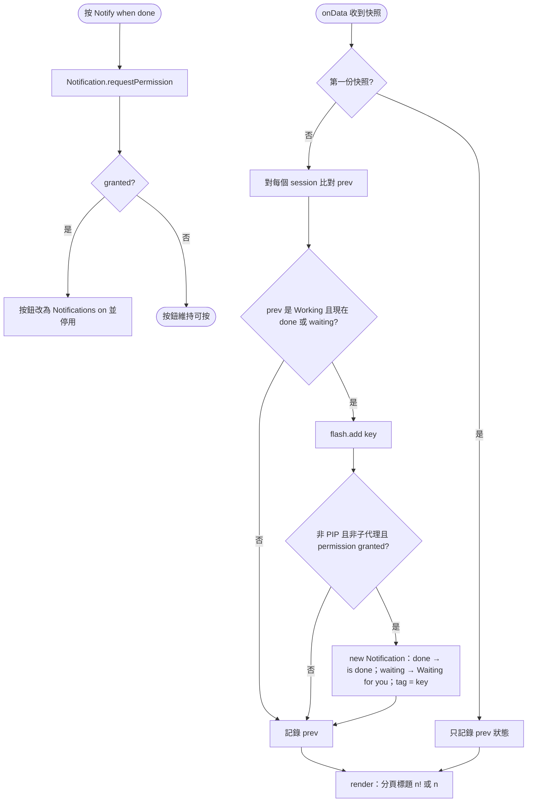
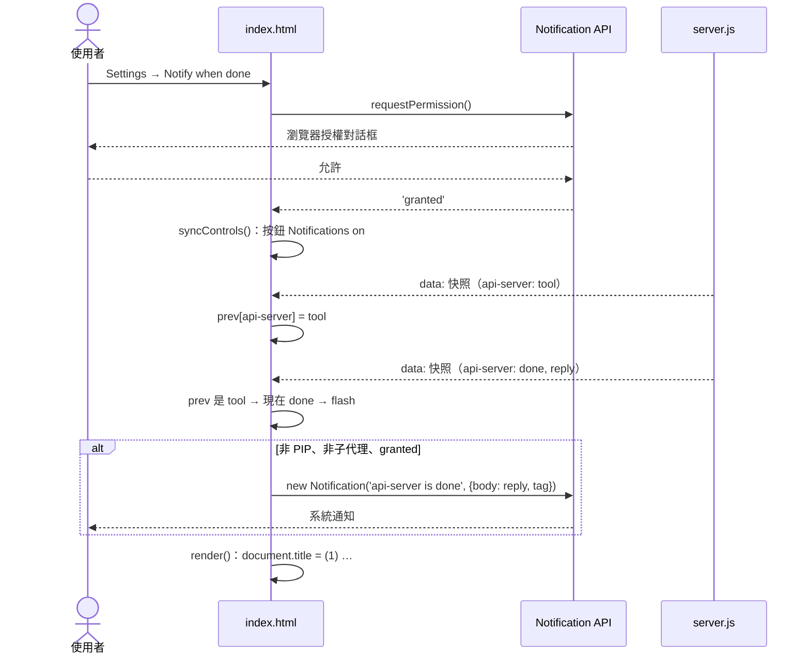

# UC-11 完成通知

| 項目 | 內容 |
|---|---|
| 主要參與者 | 使用者 |
| 次要參與者 | 瀏覽器 Notification API |
| 前置條件 | 瀏覽器支援 `Notification`；使用者已在主分頁授權 |
| 觸發 | Settings 的「Notify when done」按鈕；之後任何 agent 從 Working 變成 done 或 waiting |
| 後置條件 | 系統通知顯示專案名與回覆摘要；分頁標題顯示計數 |
| 相關程式 | `public/index.html`（`notifyBtn`、`syncControls`、`onData`、`render` 的 `document.title`） |

## 主要流程

1. 使用者開 Settings，按「Notify when done」。
2. `Notification.requestPermission()`；授權後 `syncControls()` 把按鈕改為「Notifications on」並停用。
3. 之後每次 `onData(data)`：
   - 第一份快照只記錄狀態，不通知（避免載入時轟炸）。
   - 對每個 session 比對 `state.prev` 的上一個狀態：上一個屬於 Working（thinking／tool／typing），現在是 done 或 waiting → 加入 `flash`（卡片閃一下）。
   - 若不是 PiP 視窗、不是子代理、`Notification.permission === 'granted'` → `new Notification(title, {body, tag: key})`：
     - done：標題「<專案> is done」，body 為最後回覆。
     - waiting：標題「<專案>: Waiting for you」，body 為 activity。
     - `tag` 用 session key，同一 session 的通知會彼此取代。
4. `render()` 更新分頁標題：有 Needs you 顯示 `(n!)`，否則有 Working 顯示 `(n)`，否則只顯示標題。

## 替代流程

- **A1 瀏覽器不支援**：按鈕隱藏。
- **A2 使用者拒絕授權**：按鈕維持可按，不發通知。
- **A3 PiP 視窗**：`PIP` 為真時不發通知，避免主頁與 PiP 重複（`tests/ui.cjs` 驗證只有主頁發出）。
- **A4 子代理完成**：不通知，只有主 session 的狀態變化才通知。
- **A5 `new Notification` throw**（部分平台）：try/catch 吞掉，不影響渲染。

## 流程圖

## 循序圖

