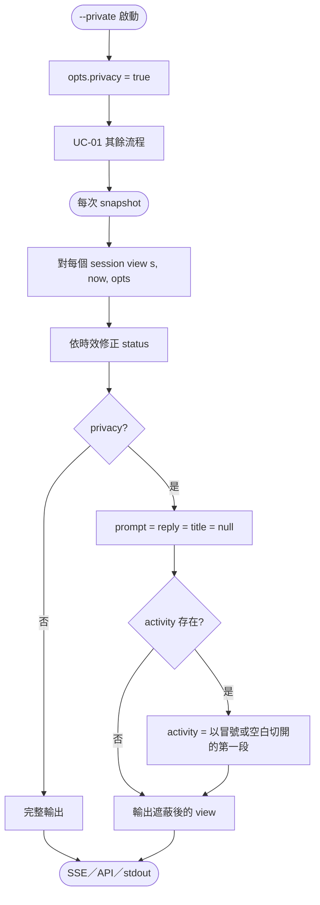
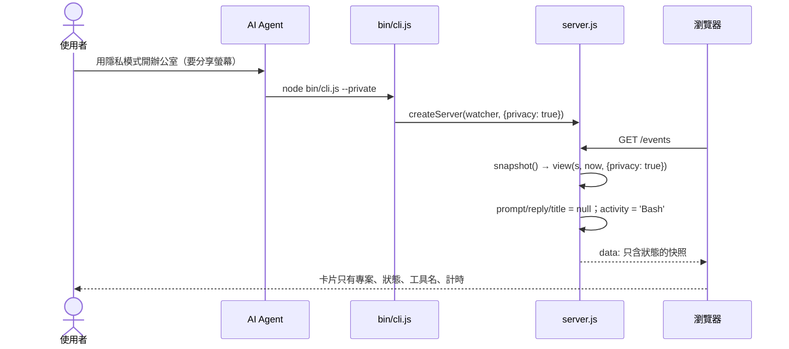

# UC-12 隱私模式

| 項目 | 內容 |
|---|---|
| 主要參與者 | 使用者（螢幕分享、錄影時） |
| 前置條件 | 以 `--private` 啟動 |
| 觸發 | `node bin/cli.js --private`；或請 agent「用隱私模式開」 |
| 後置條件 | 所有快照（SSE、`/api/sessions`、`--json`）不含 prompt、reply、title；activity 只剩工具名 |
| 相關程式 | `bin/cli.js`（`o.privacy`）、`src/server.js`（`view()` 的 `privacy` 分支） |

## 主要流程

1. CLI 解析 `--private` → `opts.privacy = true`，其餘與 UC-01 相同。
2. 每次 `snapshot()` 對每個 session 呼叫 `view(s, now, {privacy})`。
3. `privacy` 為真時：`prompt`、`reply`、`title` 設為 null；`activity` 以冒號或空白切開只留第一段（`Bash: npm test` → `Bash`、`Edit app.ts` → `Edit`、`github · create_pr` → `github`）。
4. 前端照常渲染：卡片沒有 prompt／reply／title 區塊，狀態列只剩工具名；辦公室角色行為不變。
5. 專案名（`cwd` 的 basename）、model、agent、狀態、計時仍顯示。

## 替代流程

- **A1 執行中切換**：隱私是行程旗標，無法在頁面切換；要改需 `--stop` 後以不同旗標重啟。
- **A2 已有非隱私實例在執行**：`alreadyRunning` 命中會只重開分頁（UC-01 A1），隱私旗標不生效；需先停止。
- **A3 `--json --private`**：輸出同樣遮蔽。

## 流程圖

## 循序圖

