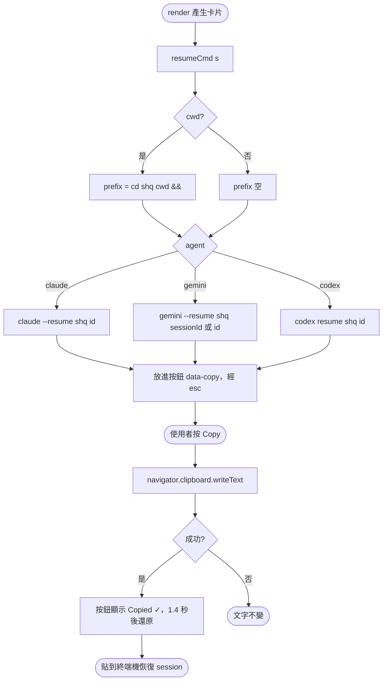
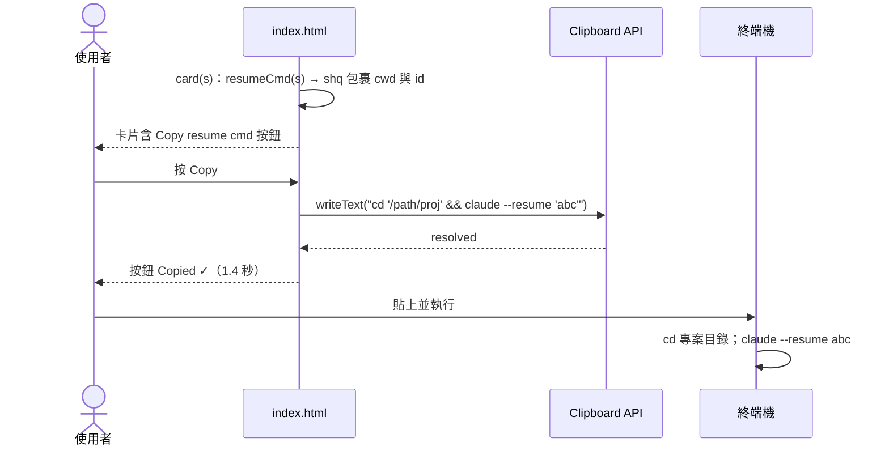

# UC-13 複製 resume 指令

| 項目 | 內容 |
|---|---|
| 主要參與者 | 使用者 |
| 次要參與者 | 瀏覽器 Clipboard API |
| 前置條件 | 清單卡片或辦公室 tooltip 顯示中；頁面為安全來源（localhost 視為安全） |
| 觸發 | 按卡片底部的「Copy resume cmd」 |
| 後置條件 | 剪貼簿內為可直接貼到終端機的指令，含 `cd` 到專案目錄 |
| 相關程式 | `public/index.html`（`shq`、`resumeCmd`、`card`、`data-copy` 點擊處理） |

## 主要流程

1. `card(s)` 產生卡片時呼叫 `resumeCmd(s)`：
   - 有 `cwd` → 前綴 `cd '<cwd>' && `。
   - claude → `claude --resume '<id>'`。
   - gemini → `gemini --resume '<sessionId 或 id>'`。
   - codex → `codex resume '<id>'`。
   - 所有值經 `shq()` 以單引號包裹，內部單引號換成 `'\''`，貼上時不會展開 `$()`、反引號或變數。
2. 指令放在按鈕的 `data-copy` 屬性（經 `esc()`）。
3. 使用者按 Copy；全域 click 監聽找到 `[data-copy]`，`navigator.clipboard.writeText()`。
4. 成功後按鈕文字改「Copied ✓」，1.4 秒後還原。
5. 使用者貼到終端機，回到該 session 繼續對話。

## 替代流程

- **A1 隱私模式**：指令仍可複製，`cwd` 與 id 不屬於遮蔽欄位。
- **A2 Clipboard 不可用**（非安全來源、權限被拒）：`navigator.clipboard?.writeText` 不執行或 reject，按鈕文字不變。
- **A3 辦公室視圖**：hover／click 角色的 tooltip 內是同一張卡片，Copy 鈕同樣可用（click 可釘住 tooltip 方便點按）。

## 流程圖

## 循序圖

