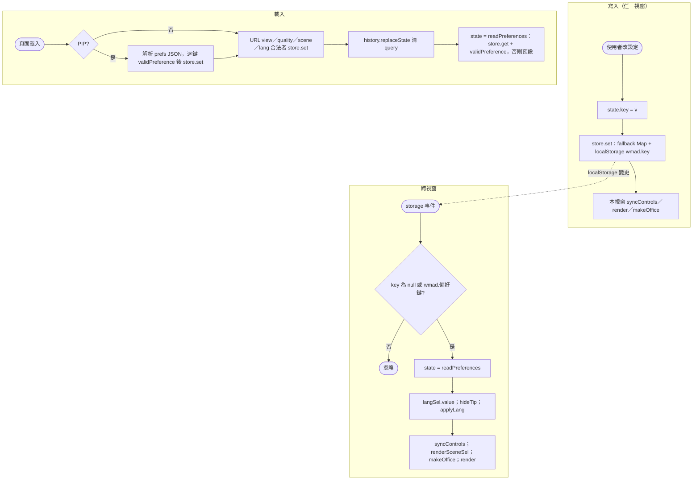
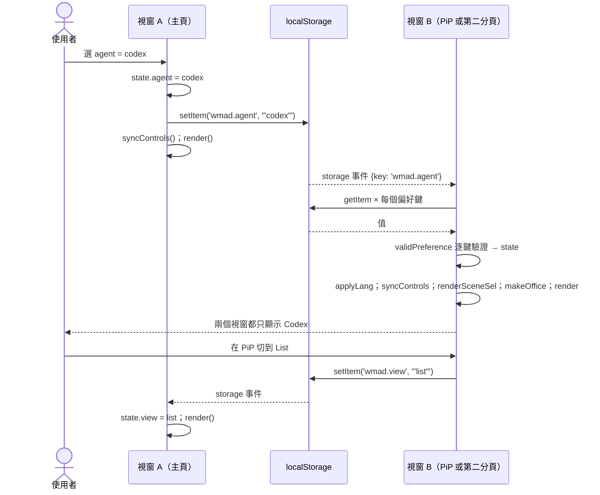

# UC-14 偏好設定同步

| 項目 | 內容 |
|---|---|
| 主要參與者 | 使用者 |
| 次要參與者 | 瀏覽器 localStorage、`storage` 事件、URL query |
| 前置條件 | 頁面已載入 |
| 觸發 | 改任何設定（視圖、畫質、場景、agent 篩選、子代理、idle、標記、語言）；開第二個分頁；開 PiP；以 `--scene` 開啟的網址 |
| 後置條件 | 同一瀏覽器的所有儀表板視窗顯示一致的設定；重新載入後保留 |
| 相關程式 | `public/index.html`（`store`、`PREF_DEFAULTS`、`validPreference`、`readPreferences`、URL 處理、`storage` 監聽）、`public/popout.js`（`preferences()`） |

## 主要流程

### 寫入

1. 任一設定控制項變更 → 更新 `state.<key>` → `store.set(key, value)`：先寫入記憶體 fallback Map，再嘗試 `localStorage.setItem('wmad.' + key, JSON)`（失敗吞掉）。
2. 該視窗自己立即 `syncControls()`／`render()`／`makeOffice()`（視設定而定）。

### 讀取（載入時）

3. `readPreferences()`：對 `PREF_DEFAULTS` 每個鍵 `store.get`，再經 `validPreference()` 白名單（型別、列舉值、`^[a-z0-9-]+$`），不合法用預設。
4. URL query：`?view=&quality=&scene=&lang=` 合法者寫入 store（`--scene` 開的網址即靠此）；PiP 視窗另從 `prefs` JSON 參數逐鍵驗證寫入。處理完 `history.replaceState` 把網址清乾淨（PiP 保留 `?pip=1`）。

### 跨視窗同步

5. 另一個視窗（第二個分頁或 PiP iframe）寫 localStorage → 本視窗收到 `storage` 事件。
6. 事件的 `key` 不屬於 `wmad.<偏好鍵>` 就忽略；否則 `Object.assign(state, readPreferences())`。
7. 重新套用：`langSel.value`、`hideTip()`、`applyLang(chooseLang(...))`、`syncControls()`、`renderSceneSel()`、`makeOffice()`、`render()`。

## 替代流程

- **A1 localStorage 不可用**（隱私模式、被封鎖）：`store` 用記憶體 Map，設定只在本視窗、本次有效；PiP 仍能從 URL `prefs` 取得當下設定，但不會雙向同步。
- **A2 儲存值被竄改或格式錯**：`validPreference` 不通過 → 用預設；`storage` 事件帶來的值同樣經驗證。
- **A3 `key === null`**（整個 storage 被清）：視為全部變更，重新讀取。
- **A4 `scene` 指到未安裝場景**：`makeOffice()` 檢查 `state.scenes` 不含該 id 時退回 `office`。

## 流程圖

## 循序圖

## 備註

- 偏好鍵與預設值見 structure.md 第 9 節。
- `tests/ui.cjs` 驗證「preferences synchronize in both directions」與「badge toggle persists across reload」。
