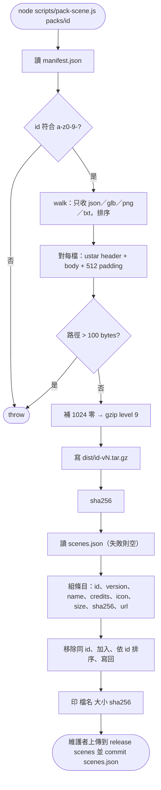
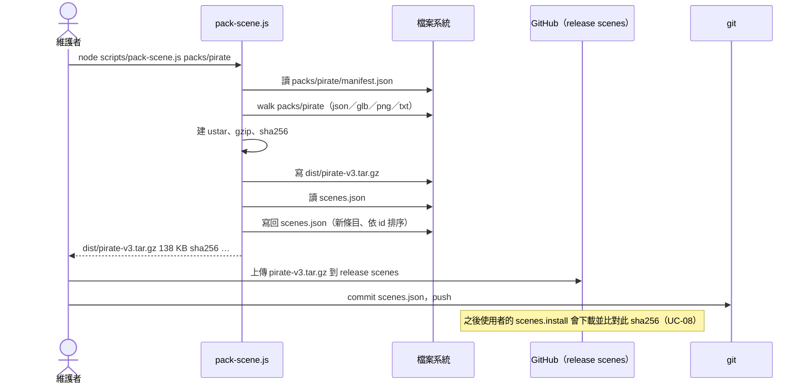

# UC-15 發布場景包

| 項目 | 內容 |
|---|---|
| 主要參與者 | 維護者 |
| 次要參與者 | GitHub releases（tag `scenes`） |
| 前置條件 | 有一個場景資料夾（如 `packs/pirate/`）含 `manifest.json`（`id`、`version`、`name`、`credits`、`icon`）、`models/*.glb`、貼圖等 |
| 觸發 | `node scripts/pack-scene.js packs/<id>` |
| 後置條件 | `dist/<id>-v<version>.tar.gz` 產生；`scenes.json` 新增或更新該條目（size、sha256、url）；維護者上傳檔案並 commit `scenes.json` |
| 相關程式 | `scripts/pack-scene.js`、`scenes.json`、`src/scenes.js`（下載端，UC-08） |

## 主要流程

1. 維護者執行 `node scripts/pack-scene.js packs/pirate`。
2. 讀取 `manifest.json`，驗證 `id` 符合 `^[a-z0-9-]+$`。
3. 遞迴走訪資料夾，只收 `.json/.glb/.png/.txt`，路徑以 `/` 分隔並排序（可重現）。
4. 對每個檔案產生 ustar 標頭（路徑 ≤ 100 bytes、mode 0644、type `0`、checksum）與 512 對齊的內容；最後補 1024 bytes 零。
5. `gzipSync(level 9)`，寫到 `dist/<id>-v<version>.tar.gz`。
6. 計算 SHA-256。
7. 讀 `scenes.json`，以 manifest 的 id、version、name、credits、icon（缺則沿用舊條目）、size、sha256、`https://github.com/<repo>/releases/download/scenes/<file>` 組成條目；移除同 id 舊條目、加入新條目、依 id 排序寫回。
8. 印出檔名、大小、sha256。
9. 維護者把 tar.gz 上傳到 GitHub release `scenes`，commit `scenes.json`。
10. 使用者更新後（UC-04）看到新場景可下載（UC-08）。

## 替代流程

- **A1 id 不合法**：throw，不產生檔案。
- **A2 路徑超過 100 bytes**：throw（自製 tar 不支援 ustar prefix 欄位的寫入）。
- **A3 `scenes.json` 不存在或壞掉**：從空目錄開始。
- **A4 同 id 再打包**：版本相同也會覆寫條目；使用者端 `install()` 以 `version >= catalog.version` 判斷是否重下載，所以版本不加就不會重抓。

## 流程圖

## 循序圖

