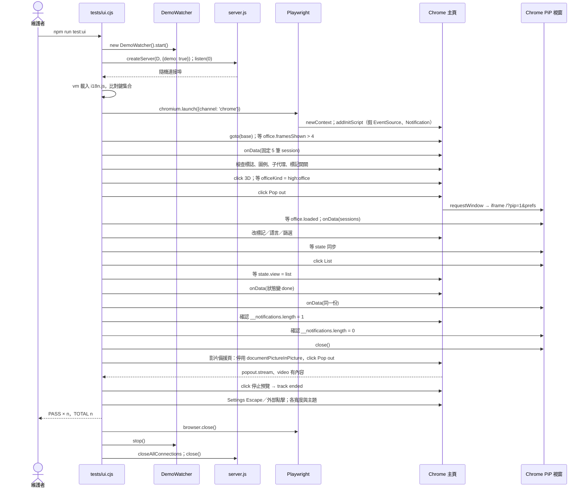

# UC-16 開發檢查（build／test:ui）

| 項目 | 內容 |
|---|---|
| 主要參與者 | 維護者 |
| 次要參與者 | esbuild、Playwright、Google Chrome |
| 前置條件 | Node.js 20+；`npm install`（devDependencies：esbuild、playwright、three）；UI 測試需本機 Chrome |
| 觸發 | `npm run build`、`npm run test:ui` |
| 後置條件 | `public/office3d.js` 為最新 bundle 並 commit；UI 回歸檢查全數 PASS |
| 相關程式 | `package.json` scripts、`web/office3d.js`、`tests/ui.cjs`、`src/demo.js`、`src/server.js` |

## 主要流程

### 建置 3D bundle

1. `npm run build` → esbuild 以 `web/office3d.js` 為進入點，bundle three.js 與 addons（GLTFLoader、OrbitControls、MeshoptDecoder、SkeletonUtils），ESM 格式、minify、target es2020，輸出 `public/office3d.js`，授權註解放檔尾。
2. 維護者 commit 產物（repo 執行時不需 `npm install`）。

### UI 回歸測試

3. `npm run test:ui` → `tests/ui.cjs`：設 `WMAD_NO_UPDATE_CHECK=1`；`new DemoWatcher().start()`；`createServer(watcher, {demo: true})`，`listen(0)` 取隨機連接埠。
4. 以 vm 載入 `public/i18n.js`，驗證九種語言的字串鍵集合一致。
5. 啟動 Chrome（`channel: 'chrome'`，預設 headless，移除背景節流的停用旗標以測真實節流行為）。
6. `addInitScript` 置換 `EventSource`（送一份固定的 5 筆假 session）與 `Notification`（記錄呼叫），收集 `pageerror`。
7. 依序檢查（每項 `check()` 印 PASS）：
   - 標誌載入並在 2D 與圖例繪出；子代理顯示；標記開關隱藏並在重載後保留。
   - 切 3D 後同樣的標誌繪出（等 `officeKind === 'high:office'` 且 `office.loaded`）。
   - Document PiP 開啟：PiP frame 載入、主頁 `office.visible` 為 false、PiP 繼承 `quality = high`、無橫向捲動。
   - 偏好雙向同步（標記、語言 zh-TW、agent 篩選、視圖）；緊湊清單只顯示 Needs you 與 Working。
   - 只有主頁發完成通知。
   - 其他分頁在前景時 PiP 仍持續畫幀。
   - 原生關閉與按鈕關閉都復原主畫面並可重開。
   - `requestWindow` 被拒時顯示翻譯錯誤且儀表板仍可用。
   - 影片備援：擷取到有內容的 3D 畫面、切 2D 後 stream 不變、停止後 track 全部 ended、`srcObject` 清空；List 模式不提供。
   - 空的緊湊清單顯示安靜狀態，重載仍為 PIP 模式。
   - Settings 以 Escape／外部點擊關閉並還原焦點；在 320／390／768／1280 寬與明暗主題下面板不溢出。
   - 無未捕捉的瀏覽器錯誤。
8. 印 `TOTAL <n>`；finally 關瀏覽器、停 watcher、關伺服器；失敗時 `exitCode = 1`。

## 替代流程

- **A1 `WMAD_HEADED=1`**：顯示測試視窗。
- **A2 `WMAD_SCREENSHOTS=<dir>`**：各階段存截圖（office-3d、pip-3d、pip-list、toolbar-<寬>-<主題>）。
- **A3 無 Chrome**：Playwright 啟動失敗，測試中止。
- **A4 任一 assert 失敗**：throw → 印錯誤、`exitCode = 1`，finally 仍清理。
- **A5 Firefox／Safari 的原生影片控制**：未自動化，需手動測。

## 流程圖

```mermaid
flowchart TD
  subgraph build["npm run build"]
    A([esbuild web/office3d.js]) --> B[bundle three.js + addons，ESM，minify，es2020]
    B --> C[輸出 public/office3d.js，授權註解在檔尾]
    C --> D([commit 產物])
  end

  subgraph test["npm run test:ui"]
    E([tests/ui.cjs]) --> F[WMAD_NO_UPDATE_CHECK=1；DemoWatcher + createServer listen 0]
    F --> G[vm 載入 i18n.js，驗證九語言鍵一致]
    G --> H[啟動 Chrome，注入假 EventSource 與 Notification]
    H --> I[主頁：標誌、子代理、標記開關、重載保留]
    I --> J[切 3D：標誌仍繪出]
    J --> K[開 Document PiP：繼承設定、主頁隱藏辦公室]
    K --> L[雙向同步、緊湊清單、只有主頁通知、背景持續畫幀]
    L --> M[關閉與重開、requestWindow 失敗處理]
    M --> N[影片備援：擷取內容、切 2D、停止釋放 track]
    N --> O[空緊湊清單、Settings 鍵盤與響應式、無 pageerror]
    O --> P{全部 assert 通過?}
    P -->|是| Q([印 TOTAL n，exit 0])
    P -->|否| R([印錯誤，exit 1])
    Q --> S[finally：關瀏覽器、停 watcher、關伺服器]
    R --> S
  end
```

## 循序圖

