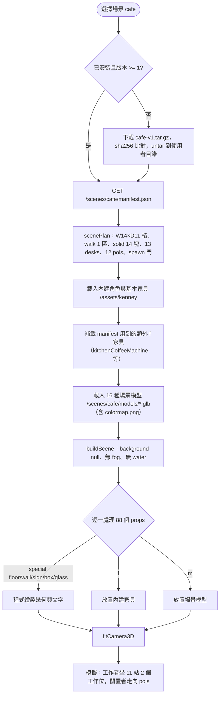
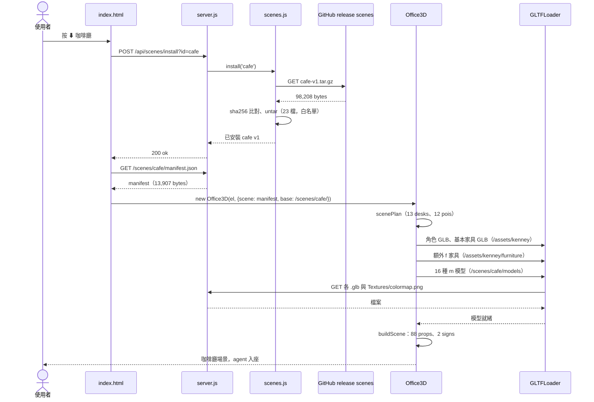

# 場景包 cafe-v1.tar.gz（咖啡廳）

依解開的檔案內容與 `web/office3d.js`、`src/scenes.js` 整理。本檔描述的是**資料包**本身：裡面有什麼、每個欄位被程式怎麼用、從下載到畫出來的流程。下載安裝的通用流程見 [UC-08](../UC-08-manage-scenes.md)，打包見 [UC-15](../UC-15-pack-scene.md)。

| 項目 | 內容 |
|---|---|
| 檔案 | `jerry-report/scenes/cafe-v1.tar.gz`（gzip 壓縮的 ustar） |
| 大小 | 壓縮 98,208 bytes；解開 321,039 bytes，23 個檔 |
| SHA-256 | `075df81768c19200c606649ff8db85b48c9abbf14d1fbd4fc0a58a1c787bf012`（與 `scenes.json` 一致） |
| `scenes.json` 條目 | id `cafe`、version `1`、icon ☕、file `cafe-v1.tar.gz` |
| 下載來源 | GitHub release `scenes`（host 由 `src/config.js` 推導） |
| 名稱 | en「Café」、zh-TW「咖啡廳」，共 9 種語言 |
| 授權 | Kenney Furniture Kit 2.0、Food Kit 2.0（CC0），兩份 LICENSE 隨包附上 |
| 場景尺寸 | W 14 × D 11 格，viewH 2.8 |
| 環境 | sky `#bfe3f2`；background `null`（畫布透明，透出頁面底色）；無霧、無水面 |
| 可走區 | 1 個矩形（幾乎全場）；14 個障礙矩形 |
| 道具 | 88 個：場景模型 39、內建家具 38、程式繪製 11 |
| 工作位 | 13 個（坐 11、站 2） |
| 休息點 | 12 個 |

## 內容結構

```
cafe-v1/
├── LICENSE-food-kit.txt            711
├── LICENSE-furniture-kit.txt       614
├── manifest.json                13,907
└── models/
    ├── Textures/colormap.png    10,715   （14 個 GLB 共用的外部貼圖）
    ├── bookcaseOpenLow.glb       5,540
    ├── cake.glb                 39,176
    ├── chairRounded.glb          7,568
    ├── cookie-chocolate.glb     16,196   ✗ 未被 manifest 使用
    ├── croissant.glb            16,776
    ├── cup-coffee.glb           14,852
    ├── cup-saucer.glb           14,760
    ├── cupcake.glb              21,420
    ├── donut-chocolate.glb      16,424
    ├── donut-sprinkles.glb      17,968
    ├── frappe.glb               17,536
    ├── kitchenBar.glb            6,596
    ├── kitchenBarEnd.glb         7,052
    ├── loaf-round.glb           15,848
    ├── loungeChair.glb           6,700
    ├── muffin.glb               15,752
    ├── mug.glb                  17,084
    ├── plate.glb                14,992   ✗ 未被 manifest 使用
    └── waffle.glb               22,852   ✗ 未被 manifest 使用
```

| 類型 | 數量 | bytes | 說明 |
|---|---|---|---|
| `.glb` | 19 | 295,092 | Kenney 模型，meshopt 壓縮，由 GLTFLoader 載入 |
| `.png` | 1 | 10,715 | colormap 貼圖，GLB 內以相對路徑 `Textures/colormap.png` 引用 |
| `.json` | 1 | 13,907 | manifest |
| `.txt` | 2 | 1,325 | 授權 |

包內只有資料，沒有任何可執行內容；解壓端的副檔名白名單也只收這四種。

## manifest.json 結構

| 欄位 | 值／型別 | 程式怎麼用 |
|---|---|---|
| `id`、`version` | `cafe`、`1` | `scenes.install()` 比對已安裝版本；`/scenes/cafe/` 路徑 |
| `name` | 9 語言物件 | 場景按鈕與 CLI 清單顯示 |
| `credits` | 字串 | 場景按鈕 tooltip、`scenes.json` 條目 |
| `W`、`D`、`viewH` | 14、11、2.8 | `OfficeGrid(W, D)` 建尋路格；相機取景高度 |
| `sky` | `#bfe3f2` | 窗玻璃材質的顏色與自發光；日夜循環時當白天背景色 |
| `background` | `null` | `scene.background = null`，畫布透明 |
| `spawn` | `{x: 0.5, y: 9.8}` | 新 agent 進場點（左下門口） |
| `walk` | 1 個 `[x0, y0, x1, y1]` | 可走格；其餘格成本 1（不可走） |
| `solid` | 14 個 `[x, y, w, d]` | `grid.block()`，吧台、桌子、櫃子等障礙 |
| `props` | 88 個物件 | `buildSceneProp()` 逐一放置，見下節 |
| `stations` | 13 個 `{x, y, yaw, pose｜anim}` | 轉成 `desks`：工作中的 agent 坐／站在這 |
| `pois` | 12 個 `{x, y, act, yaw, emoji, …}` | 閒置 agent 的去處 |

manifest 沒有 `icon` 欄位；`scenes.json` 的 ☕ 是 `pack-scene.js` 從舊條目沿用的。

## 道具（props）

三種來源，由 `buildSceneProp()` 依欄位分流：

- **`m`：場景包模型**，載入 `/scenes/cafe/models/<m>.glb`，共 39 個、16 種：mug 11、chairRounded 6、cup-coffee 5、kitchenBar 4、cake 2，frappe、kitchenBarEnd、croissant、donut-sprinkles、cupcake、muffin、donut-chocolate、loaf-round、cup-saucer、loungeChair、bookcaseOpenLow 各 1。
- **`f`：內建 Kenney 家具**，載入 `/assets/kenney/furniture/<f>.glb`，不在包內，共 38 個、14 種：laptop 11、stoolBar 5、kitchenCabinet 5、pottedPlant 4、tableRound 3、kitchenCoffeeMachine 2，rugRound、loungeSofa、tableCoffee、lampRoundFloor、books、coatRackStanding、trashcan、radio 各 1。這是四個包裡最依賴內建家具的一個。
- **`special`：程式繪製**，共 11 個：`floor` 2（木地板加吧台區黑白棋盤格）、`wall` 2（x 軸與 z 軸各一面，開窗洞與門）、`sign` 2（價目表「COFFEE · LATTE · MOCHA」與「OPEN」）、`box` 4、`glass` 1。

共同欄位：`x, y, w, d` 佈局腳印；`h` 高度；`rot` 旋轉角；`y0` 離地高；`stretch` 依 w×h×d 縱橫拉伸（本包 12 個）。無 `bob`、無 `abs`。

## 工作位與休息點

**stations（13）**：11 個 `pose: sit`（吧台與圓桌邊的座位，agent 工作時坐著打字）、2 個 `pose: stand` 附 `anim`（interact-right／interact-left，站在吧台後操作）。`scenePlan()` 把 `noNap` 固定為 true，所以工作位不會出現打瞌睡。

**pois（12）**：

| act | 數量 | emoji | 附加 |
|---|---|---|---|
| sofa | 3 | 😂 ☕ 📰 | sit；一個 prop cup、一個 sleepy |
| order | 2 | ☕ 🧾 | 站在櫃台前 |
| queue | 1 | ⏳ | 排隊 |
| pastry | 1 | 🥐 | anim interact-right |
| armchair | 1 | 📖 | sit、prop book、sleepy |
| read | 1 | — | prop book、anim holding-both |
| window | 1 | ☁️ | 看窗外 |
| chat | 1 | 💬 | anim emote-yes |
| phone | 1 | 📱 | anim holding-right |

`act` 名稱不在 office3d 的內建對照表時，動作退回 `anim` 欄位或 idle，泡泡顯示 `emoji`。`sleepy` 的點在 agent 狀態為 idle 時權重加高，呈現閉眼打盹。

## 使用流程

1. 使用者在 3D 視圖按「⬇ 咖啡廳」，或 CLI `--scene cafe`。
2. `scenes.install('cafe')` 下載 `cafe-v1.tar.gz`、比對 SHA-256、以白名單 untar 到 `~/.whatsmyagentdoing/scenes/cafe/`。
3. 頁面 `makeOffice()` 讀 `/scenes/cafe/manifest.json`，帶 `base: '/scenes/cafe/'` 建 `Office3D`。
4. `scenePlan()`：以 `W, D` 建格、`walk` 開路、`solid` 封鎖；`stations` 轉 desks、`pois` 轉休息點、`spawn` 當門。
5. `load()`：先載內建角色與基本家具；再補 manifest 用到但不在基本集的 `f`（如 kitchenCoffeeMachine）；最後載 16 種 `m` 模型，GLTFLoader 順帶抓 `Textures/colormap.png`。
6. `buildScene()`：背景設為透明、無霧無水；88 個 props 逐一放置，`sign` 以 canvas 畫字。
7. 模擬開始：工作中的 agent 分配到 13 個工作位；閒置者挑 poi 走過去，依 `act`／`anim` 播動作、頭上冒 `emoji`。

## 流程圖



## 循序圖



## 檢查結果

- SHA-256 與大小皆與 `scenes.json` 一致；從 fork release 下載亦相符。
- manifest 用到的 16 種 `m` 模型全部存在於包內。
- **3 個模型打包了但沒用到**：cookie-chocolate、plate、waffle，合計 54,040 bytes（解開後約 17%）。移除可縮小包體，不影響畫面。
- 14 個 GLB 引用外部 `Textures/colormap.png`，其餘 5 個自帶材質或無貼圖。
- 兩份 Kenney 授權檔齊全，對應 credits 提到的兩個 kit。
- `background: null` 是四個包中唯一的設定，畫布透明，顏色隨頁面主題。
