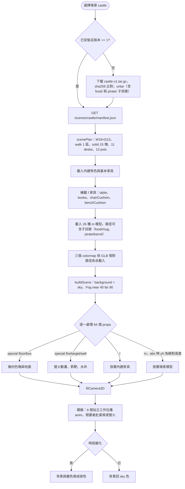
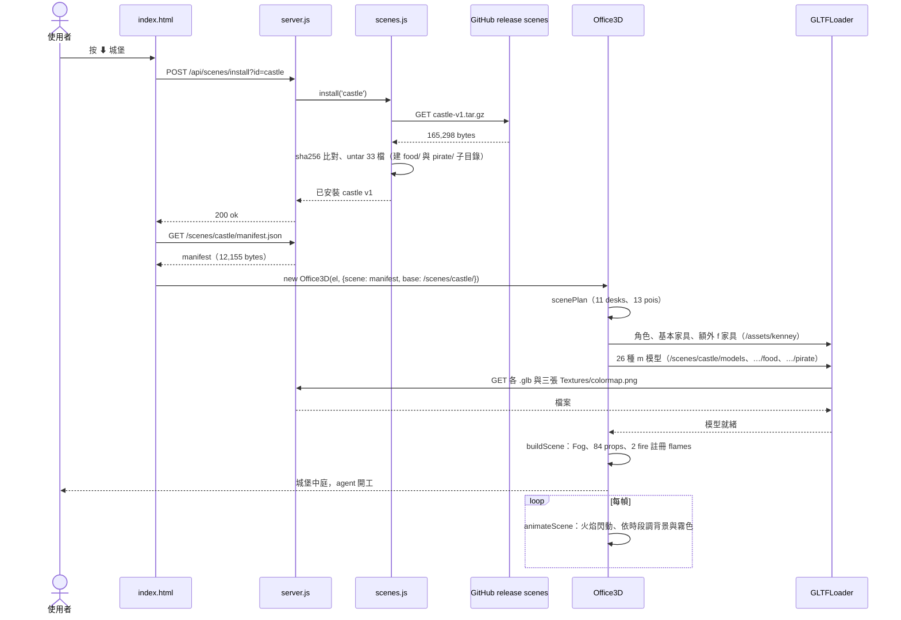

# 場景包 castle-v1.tar.gz（城堡）

依解開的檔案內容與 `web/office3d.js`、`src/scenes.js` 整理。本檔描述的是**資料包**本身：裡面有什麼、每個欄位被程式怎麼用、從下載到畫出來的流程。下載安裝的通用流程見 [UC-08](../UC-08-manage-scenes.md)，打包見 [UC-15](../UC-15-pack-scene.md)。

| 項目 | 內容 |
|---|---|
| 檔案 | `jerry-report/scenes/castle-v1.tar.gz`（gzip 壓縮的 ustar） |
| 大小 | 壓縮 165,298 bytes；解開 533,753 bytes，33 個檔 |
| SHA-256 | `cfdc4f138164597ca7ff70ef97284a82b0ceda50731dade94e39602696c5d8b6`（與 `scenes.json` 一致） |
| `scenes.json` 條目 | id `castle`、version `1`、icon 🏰、file `castle-v1.tar.gz` |
| 下載來源 | GitHub release `scenes`（host 由 `src/config.js` 推導） |
| 名稱 | en「Castle」、zh-TW「城堡」，共 9 種語言 |
| 授權 | credits 列 Castle Kit、Food Kit、Pirate Kit、Furniture Kit（CC0）；包內只附 Castle Kit 2.0 的 LICENSE |
| 場景尺寸 | W 18 × D 13 格，viewH 3 |
| 環境 | sky `#a9d8f0`；fog `#cfe8f3`，near 40、far 90；無水面 |
| 可走區 | 1 個矩形；15 個障礙矩形 |
| 道具 | 84 個：場景模型 59、內建家具 9、程式繪製 16 |
| 工作位 | 11 個（站 9、坐 2） |
| 休息點 | 13 個 |

## 內容結構

四個包裡唯一把模型分成子目錄的：`models/` 根目錄是 Castle Kit，`models/food/` 與 `models/pirate/` 各帶自己的 colormap。

```
castle-v1/
├── LICENSE-castle-kit.txt          713
├── manifest.json                12,155
└── models/
    ├── Textures/colormap.png     7,529   （Castle Kit 貼圖）
    ├── flag-banner-long.glb     11,404
    ├── flag-pennant.glb         13,108
    ├── metal-gate.glb           14,880
    ├── rocks-small.glb          13,404
    ├── siege-ballista.glb       27,804
    ├── siege-catapult.glb       35,636
    ├── siege-trebuchet.glb      46,556
    ├── stairs-stone.glb         11,784
    ├── tower-hexagon-base.glb   12,072
    ├── tower-hexagon-mid.glb    16,160
    ├── tower-hexagon-roof.glb   11,992
    ├── tower-square-base.glb    11,040
    ├── tower-square-roof.glb    12,664
    ├── tree-large.glb           14,804
    ├── tree-log.glb             11,924
    ├── tree-small.glb           13,608
    ├── wall-corner.glb          12,792   ✗ 未被 manifest 使用
    ├── wall-doorway.glb         16,336
    ├── wall.glb                 12,916
    ├── food/
    │   ├── Textures/colormap.png 10,715  （Food Kit 貼圖）
    │   ├── apple.glb            16,780
    │   ├── cheese.glb           43,748
    │   ├── loaf.glb             15,012
    │   ├── meat-cooked.glb      15,492   ✗ 未被 manifest 使用
    │   ├── mug.glb              17,084
    │   ├── pie.glb              17,572
    │   └── whole-ham.glb        15,952
    └── pirate/
        ├── Textures/colormap.png 10,061  （Pirate Kit 貼圖）
        ├── barrel.glb           15,716
        └── crate.glb            14,340
```

| 類型 | 數量 | bytes | 說明 |
|---|---|---|---|
| `.glb` | 28 | 492,580 | 根目錄 19、food 7、pirate 2 |
| `.png` | 3 | 28,305 | 三個 kit 各一張 colormap |
| `.json` | 1 | 12,155 | manifest |
| `.txt` | 1 | 713 | 授權 |

## manifest.json 結構

| 欄位 | 值／型別 | 程式怎麼用 |
|---|---|---|
| `id`、`version` | `castle`、`1` | 版本比對；`/scenes/castle/` 路徑 |
| `name`、`credits` | 9 語言物件、字串 | 按鈕、tooltip、CLI 清單 |
| `W`、`D`、`viewH` | 18、13、3 | 尋路格尺寸；相機取景高度 |
| `sky` | `#a9d8f0` | 白天背景色；夜間換成深藍 |
| `fog` | `["#cfe8f3", 40, 90]` | `THREE.Fog(color, near, far)`，遠處城牆與樹淡出；夜間霧色跟著變 |
| `spawn` | `{x: 0.3, y: 8.8}` | agent 進場點（左側城門） |
| `walk` | 1 個矩形 | 整個中庭可走 |
| `solid` | 15 個矩形 | 塔、桌、攻城器、井等障礙 |
| `props` | 84 個物件 | 見下節 |
| `stations` | 11 個 | 工作位，多數站著「做工」 |
| `pois` | 13 個 | 宴席、營火、水井等休息點 |

manifest 沒有 `icon`；`scenes.json` 的 🏰 來自舊條目。

## 道具（props）

- **`m`：場景包模型**，59 個、26 種。`m` 值可含子目錄：`pirate/barrel`、`food/mug` 會載 `/scenes/castle/models/pirate/barrel.glb`。計數：wall 21、tree-large 7、food/mug 4、tower-square-base 2、tower-square-roof 2、flag-banner-long 2、pirate/barrel 2，其餘各 1（wall-doorway、metal-gate、tower-hexagon-base／mid／roof、flag-pennant、siege-catapult、siege-ballista、siege-trebuchet、tree-log、rocks-small、tree-small、pirate/crate、stairs-stone、food/whole-ham、food/loaf、food/cheese、food/pie、food/apple）。
- **`f`：內建 Kenney 家具**，9 個、4 種：table 3、books 2、chairCushion 2、benchCushion 2（宴席長桌）。
- **`special`：程式繪製**，16 個：`floor` 4（一片 70×65 的草地鋪到場外、中庭草地、兩塊木板地）、`box` 7（可帶 `rough`、`metal` 的色塊）、`fire` 2（營火，火焰動畫）、`target` 2（箭靶）、`well` 1（水井）。

特有欄位：`abs` 5 個，表示 `y0` 是絕對高度、不疊在地表上（城牆段落放到場外負座標）；`stretch` 5 個。無 `bob`。

## 工作位與休息點

**stations（11）**：9 個 `pose: stand` 附 `anim`（interact-right 3、pick-up 2、holding-both 2、interact-left 1、idle 1），模擬搬石、操作攻城器；2 個 `pose: sit`。

**pois（13）**：

| act | 數量 | emoji | 附加 |
|---|---|---|---|
| feast | 5 | 🍗 🍺 😂 🧀 🍎 | 全部 sit，兩個 prop cup（宴席長桌） |
| fire | 3 | 🔥 🎶 💬 | sit，圍營火 |
| minstrel | 1 | 🎵 | anim emote-yes |
| well | 1 | 💧 | 打水 |
| shade | 1 | 😴 | sit、sleepy（樹下打盹） |
| banner | 1 | 🏰 | anim interact-right |
| chat | 1 | ⚔️ | anim emote-yes |

## 使用流程

1. 使用者按「⬇ 城堡」或 CLI `--scene castle`。
2. `scenes.install('castle')` 下載、驗 SHA-256、untar；自製 tar reader 會建出 `models/food/`、`models/pirate/` 子目錄（路徑含 `/`，不含 `..`，通過檢查）。
3. 頁面讀 `/scenes/castle/manifest.json`，建 `Office3D`。
4. `scenePlan()`：18×13 格、1 個可走區、15 個障礙、11 desks、13 pois。
5. `load()`：內建角色與基本家具；補載 chairCushion、benchCushion 等 `f`；載 26 種 `m`，其中帶子目錄的路徑直接拼在 `models/` 後，GLTFLoader 依各 GLB 相對路徑抓到對應目錄的 colormap。
6. `buildScene()`：背景設 sky 色、建 `Fog`；84 個 props 放置，`fire` 註冊到 `flames` 逐幀閃動。
7. 日夜循環：`animateScene()` 依時段改背景與霧色（本包無 `fixedSky`）。

## 流程圖



## 循序圖



## 檢查結果

- SHA-256 與大小皆與 `scenes.json` 一致；從 fork release 下載亦相符。
- manifest 用到的 26 種 `m`（含 8 個子目錄路徑）全部存在。
- **2 個模型打包了但沒用到**：wall-corner、food/meat-cooked，合計 28,284 bytes。
- 根目錄 19 個 GLB 全部引用外部 colormap；子目錄 GLB 各引用自己目錄下的 colormap，三張貼圖都必要。
- **授權檔不齊**：credits 寫了 Food Kit、Pirate Kit、Furniture Kit，包內只附 Castle Kit 的 LICENSE。Kenney 全部 CC0，法律上無需附，但與其他三個包「用到的 kit 都附 LICENSE」的慣例不一致。
- `abs` 欄位只有本包使用，用來把場外城牆壓到負座標而不受地表取樣影響。
