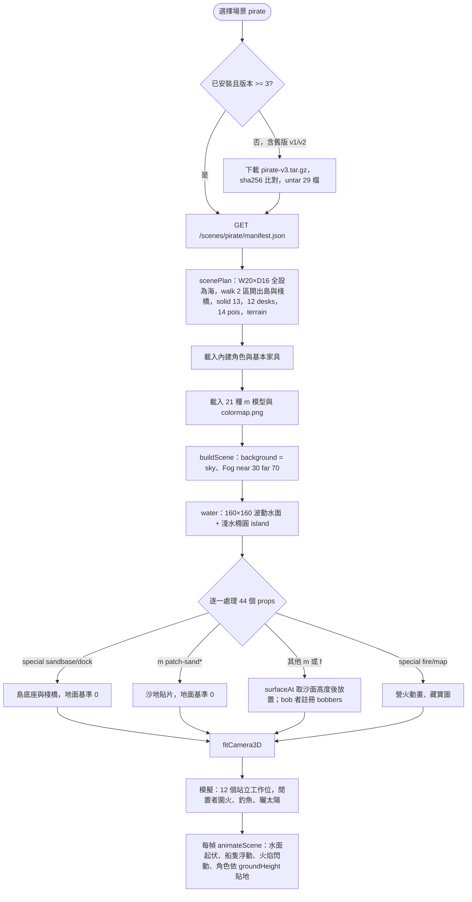
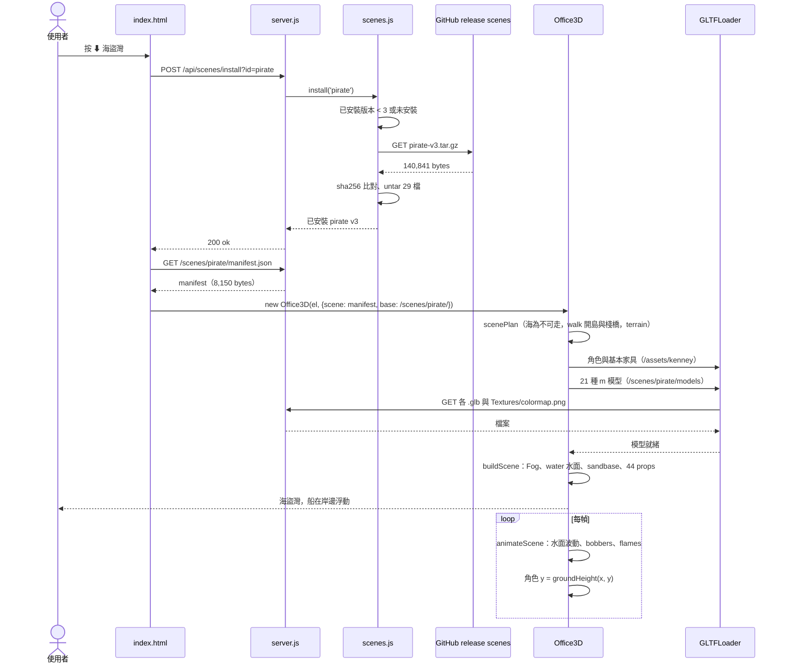

# 場景包 pirate-v3.tar.gz（海盜灣）

依解開的檔案內容與 `web/office3d.js`、`src/scenes.js` 整理。本檔描述的是**資料包**本身：裡面有什麼、每個欄位被程式怎麼用、從下載到畫出來的流程。下載安裝的通用流程見 [UC-08](../UC-08-manage-scenes.md)，打包見 [UC-15](../UC-15-pack-scene.md)。

| 項目 | 內容 |
|---|---|
| 檔案 | `jerry-report/scenes/pirate-v3.tar.gz`（gzip 壓縮的 ustar） |
| 大小 | 壓縮 140,841 bytes；解開 544,910 bytes，29 個檔 |
| SHA-256 | `5f8ce658a93aa73b02f63ba2c77f2cd8e65b63a66f47a0880e50ff4e564f4836`（與 `scenes.json` 一致） |
| `scenes.json` 條目 | id `pirate`、version `3`、icon 🏴‍☠️、file `pirate-v3.tar.gz` |
| 下載來源 | GitHub release `scenes`（host 由 `src/config.js` 推導） |
| 名稱 | en「Pirate Cove」、zh-TW「海盜灣」，共 9 種語言 |
| 授權 | Kenney Pirate Kit 2.1（CC0），LICENSE 隨包附上 |
| 場景尺寸 | W 20 × D 16 格，viewH 3.2（四包最大） |
| 環境 | sky `#8fd3f0`；fog `#bfe6f5`，near 30、far 70；**water** 深 `#1f8fb5`、淺 `#5cc8d8`、島橢圓 `[10, 9.6, 8.6, 6.2]`；**terrain: true** |
| 可走區 | 2 個矩形（島與棧橋）；13 個障礙矩形 |
| 道具 | 44 個：場景模型 39、內建家具 1、程式繪製 4 |
| 工作位 | 12 個（全部站立） |
| 休息點 | 14 個 |

版本 3 是四個包裡唯一改過版的；`install()` 以 `version >= catalog.version` 決定是否重抓，所以舊版使用者會在下次選場景時自動更新。

## 內容結構

```
pirate-v3/
├── LICENSE-pirate-kit.txt          699
├── manifest.json                 8,150
└── models/
    ├── Textures/colormap.png    10,061   （26 個 GLB 全部引用）
    ├── barrel.glb               15,716
    ├── boat-row-small.glb       18,092
    ├── bottle-large.glb         15,508
    ├── cannon-ball.glb          14,336
    ├── cannon.glb               20,996
    ├── chest.glb                20,508
    ├── crate-bottles.glb        26,272
    ├── crate.glb                14,340
    ├── flag-pirate-high.glb     15,812
    ├── grass-plant.glb          16,036
    ├── hole.glb                 19,004
    ├── palm-bend.glb            21,220
    ├── palm-detailed-bend.glb   24,828
    ├── palm-straight.glb        21,144
    ├── patch-sand-foliage.glb   26,040
    ├── patch-sand.glb           14,816
    ├── platform-planks.glb      14,056   ✗ 未被 manifest 使用
    ├── rocks-a.glb              18,824
    ├── rocks-sand-a.glb         25,312
    ├── rocks-sand-b.glb         24,516
    ├── ship-pirate-large.glb    47,944
    ├── structure-platform-dock-small.glb 19,112   ✗ 未被 manifest 使用
    ├── structure-platform-dock.glb       19,360   ✗ 未被 manifest 使用
    ├── structure-roof.glb       19,548   ✗ 未被 manifest 使用
    ├── tool-shovel.glb          15,960
    └── tower-watch.glb          16,700   ✗ 未被 manifest 使用
```

| 類型 | 數量 | bytes | 說明 |
|---|---|---|---|
| `.glb` | 26 | 526,000 | Pirate Kit 模型 |
| `.png` | 1 | 10,061 | colormap |
| `.json` | 1 | 8,150 | manifest（四包最小，因為地形多由程式畫） |
| `.txt` | 1 | 699 | 授權 |

## manifest.json 結構

| 欄位 | 值／型別 | 程式怎麼用 |
|---|---|---|
| `id`、`version` | `pirate`、`3` | 版本比對；`/scenes/pirate/` 路徑 |
| `name`、`credits` | 9 語言物件、字串 | 按鈕、tooltip、CLI 清單 |
| `W`、`D`、`viewH` | 20、16、3.2 | 尋路格尺寸；相機取景高度 |
| `sky` | `#8fd3f0` | 白天背景色 |
| `fog` | `["#bfe6f5", 30, 70]` | 遠海淡出 |
| `water` | `{color, shallow, island}` | 建 160×160、80×80 分段的波動水面，置於 y −0.08；`island` 在島周圍畫半透明淺水橢圓 |
| `terrain` | `true` | 角色腳底高度改用 `groundHeight(x, y)` 取樣沙地，不固定為 0 |
| `spawn` | `{x: 8, y: 1.2}` | 進場點在棧橋前端（船邊） |
| `walk` | 2 個矩形 | 島面與棧橋；其餘格是海，不可走 |
| `solid` | 13 個矩形 | 桌、砲、箱、營火等 |
| `props` | 44 個物件 | 見下節 |
| `stations` | 12 個 | 全部站立工作 |
| `pois` | 14 個 | 營火、釣魚、曬太陽等 |

manifest 沒有 `icon`；`scenes.json` 的 🏴‍☠️ 來自舊條目。

## 道具（props）

- **`m`：場景包模型**，39 個、21 種：barrel 6、cannon-ball 5、patch-sand 3、crate 3、cannon 3、grass-plant 3、boat-row-small 2，其餘各 1（patch-sand-foliage、ship-pirate-large、bottle-large、crate-bottles、flag-pirate-high、hole、tool-shovel、chest、palm-bend、palm-detailed-bend、palm-straight、rocks-sand-a、rocks-sand-b、rocks-a）。
- **`f`：內建家具**，只有 1 個 `table`（藏寶圖桌，`stretch`）。
- **`special`：程式繪製**，4 個：`sandbase`（島底座，橢圓柱體，讓沙地拼縫間露出沙而不是海）、`dock`（木棧橋）、`map`（桌上藏寶圖）、`fire`（營火）。

特有欄位：`bob` 2 個（大海盜船與小划艇，隨波上下）；以 `patch-` 開頭的 `m` 與 `sandbase`／`dock` 視為地面，`y0` 以 0 為基準，其他道具的 `y0` 疊在 `surfaceAt()` 取到的沙面上。`stretch` 5 個。

## 工作位與休息點

**stations（12）**：全部 `pose: stand`，`anim` interact-right 6、interact-left 3、pick-up 3，模擬裝砲、搬貨、挖寶。

**pois（14）**：

| act | 數量 | emoji | 附加 |
|---|---|---|---|
| fire | 4 | 🔥 🍖 🎶 💬 | sit 0.1（席地圍火） |
| fish | 2 | 🎣 🎣 | sit，坐棧橋邊 |
| rum | 2 | 🍺 🍺 | sit、prop cup |
| sun | 2 | ☀️ 🌊 | anim sit／idle，曬太陽 |
| treasure | 1 | 💰 | 寶箱邊 |
| shade | 1 | 😴 | sit、sleepy（棕櫚樹下） |
| watch | 1 | 🔭 | 瞭望 |
| chat | 1 | 🦜 | anim emote-yes |

## 使用流程

1. 使用者按「⬇ 海盜灣」或 CLI `--scene pirate`。
2. `scenes.install('pirate')`：已裝 v1／v2 者因 `version < 3` 重新下載；驗 SHA-256、untar。
3. 頁面讀 `/scenes/pirate/manifest.json`，建 `Office3D`。
4. `scenePlan()`：20×16 格全部先設為海（不可走），再由 2 個 `walk` 矩形開出島與棧橋；13 個障礙；12 desks、14 pois；`terrain` 旗標傳入 plan。
5. `load()`：內建角色與基本家具（含 table）；載 21 種 `m` 與一張 colormap。
6. `buildScene()`：背景、`Fog`；建波動水面與淺水橢圓；放 `sandbase`、`patch-sand` 鋪出島面，再放其餘道具，船與划艇註冊到 `bobbers`。
7. 每幀 `animateScene()`：水面頂點正弦起伏並每 3 幀重算法向量；`bobbers` 上下浮動；火焰閃動。角色移動時 `groundHeight()` 取沙面高度。

## 流程圖



## 循序圖



## 檢查結果

- SHA-256 與大小皆與 `scenes.json` 一致；從 fork release 下載亦相符。
- manifest 用到的 21 種 `m` 全部存在。
- **5 個模型打包了但沒用到**：platform-planks、structure-platform-dock-small、structure-platform-dock、structure-roof、tower-watch，合計 88,776 bytes（解開後約 16%）。棧橋改由 `special: dock` 程式繪製，這幾個應是改版前的殘留。
- 26 個 GLB 全部引用同一張 colormap，貼圖必要。
- Pirate Kit 授權檔齊全。
- 四個包裡唯一用到 `water`、`terrain`、`bob`、`sandbase`、`dock`、`map` 的場景，是 office3d 這幾個分支的唯一消費者。
