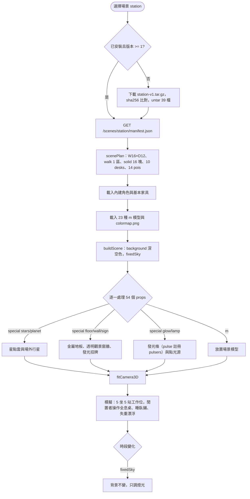
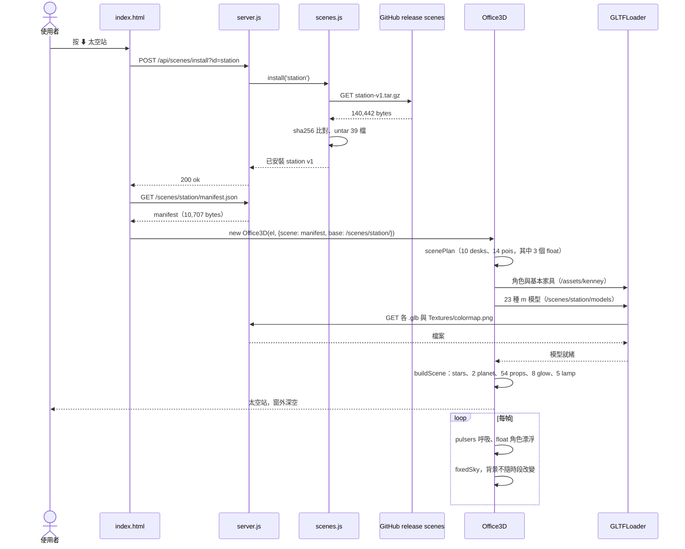

# 場景包 station-v1.tar.gz（太空站）

依解開的檔案內容與 `web/office3d.js`、`src/scenes.js` 整理。本檔描述的是**資料包**本身：裡面有什麼、每個欄位被程式怎麼用、從下載到畫出來的流程。下載安裝的通用流程見 [UC-08](../UC-08-manage-scenes.md)，打包見 [UC-15](../UC-15-pack-scene.md)。

| 項目 | 內容 |
|---|---|
| 檔案 | `jerry-report/scenes/station-v1.tar.gz`（gzip 壓縮的 ustar） |
| 大小 | 壓縮 140,442 bytes；解開 529,341 bytes，39 個檔 |
| SHA-256 | `15b11fcbd89d67f8e69b9b8fa7ef97a2b58be83ec18c12d0c333f66cfc2fbb31`（與 `scenes.json` 一致） |
| `scenes.json` 條目 | id `station`、version `1`、icon 🚀、file `station-v1.tar.gz` |
| 下載來源 | GitHub release `scenes`（host 由 `src/config.js` 推導） |
| 名稱 | en「Space Station」、zh-TW「太空站」，共 9 種語言 |
| 授權 | Kenney Space Kit 2.0、Space Station Kit 1.0（CC0），兩份 LICENSE 隨包附上 |
| 場景尺寸 | W 16 × D 12 格，viewH 2.8 |
| 環境 | background `#060915`、sky `#060915`、**fixedSky: true**（不隨日夜變色）；無霧、無水面 |
| 可走區 | 1 個矩形；16 個障礙矩形 |
| 道具 | 54 個：場景模型 33、內建家具 0、程式繪製 21 |
| 工作位 | 10 個（坐 5、站 5） |
| 休息點 | 14 個 |

## 內容結構

```
station-v1/
├── LICENSE-space-kit.txt           610
├── LICENSE-space-station-kit.txt   720
├── manifest.json                10,707
└── models/
    ├── Textures/colormap.png     7,440   （25 個 GLB 引用）
    ├── alien.glb                31,736
    ├── astronautA.glb           32,236
    ├── barrels.glb               9,804
    ├── bed-single-cover.glb     11,140
    ├── bed-single.glb           11,352   ✗ 未被 manifest 使用
    ├── chair-armrest-headrest.glb 13,160
    ├── chair-headrest.glb       12,372
    ├── computer-screen.glb      14,004   ✗ 未被 manifest 使用
    ├── computer-system.glb      13,748
    ├── computer-wide.glb        13,552
    ├── computer.glb             13,140   ✗ 未被 manifest 使用
    ├── container-flat.glb       12,772   ✗ 未被 manifest 使用
    ├── container-tall.glb       14,532
    ├── container-wide.glb       12,620
    ├── container.glb            12,232   ✗ 未被 manifest 使用
    ├── display-wall-wide.glb    12,160
    ├── display-wall.glb         11,960   ✗ 未被 manifest 使用
    ├── machine_barrelLarge.glb  10,928
    ├── machine_generator.glb    16,608   ✗ 未被 manifest 使用
    ├── machine_generatorLarge.glb 8,924
    ├── machine_wireless.glb     10,128
    ├── pipe-bend.glb            11,496   ✗ 未被 manifest 使用
    ├── pipe-end-colored.glb     11,080   ✗ 未被 manifest 使用
    ├── pipe-ring-colored.glb    11,112
    ├── pipe.glb                 10,660
    ├── rail.glb                 11,944   ✗ 未被 manifest 使用
    ├── rock_crystals.glb        13,384
    ├── rover.glb                10,412
    ├── satelliteDish_detailed.glb 15,792
    ├── skip-rocks.glb           12,836   ✗ 未被 manifest 使用
    ├── structure-barrier.glb    41,564   ✗ 未被 manifest 使用
    ├── table-display-planet.glb 16,940
    ├── table-display-small.glb  19,576
    ├── table-large.glb          12,000
    └── table.glb                11,960
```

| 類型 | 數量 | bytes | 說明 |
|---|---|---|---|
| `.glb` | 35 | 509,864 | Space Kit 與 Space Station Kit 模型（四包最多） |
| `.png` | 1 | 7,440 | colormap |
| `.json` | 1 | 10,707 | manifest |
| `.txt` | 2 | 1,330 | 授權 |

## manifest.json 結構

| 欄位 | 值／型別 | 程式怎麼用 |
|---|---|---|
| `id`、`version` | `station`、`1` | 版本比對；`/scenes/station/` 路徑 |
| `name`、`credits` | 9 語言物件、字串 | 按鈕、tooltip、CLI 清單 |
| `W`、`D`、`viewH` | 16、12、2.8 | 尋路格尺寸；相機取景高度 |
| `background` | `#060915` | 固定深空底色 |
| `fixedSky` | `true` | `animateScene()` 跳過日夜換色，背景永遠是深空 |
| `sky` | `#060915` | 窗玻璃材質顏色（與背景同色，窗外是太空） |
| `spawn` | `{x: 0.45, y: 6.25}` | 進場點（左側氣閘） |
| `walk` | 1 個矩形 | 站內全區可走 |
| `solid` | 16 個矩形 | 控制台、床、機器、容器等 |
| `props` | 54 個物件 | 見下節 |
| `stations` | 10 個 | 控制台與工作台 |
| `pois` | 14 個 | 全息投影、臥鋪、餐區、失重漂浮等 |

manifest 沒有 `icon`；`scenes.json` 的 🚀 來自舊條目。

## 道具（props）

- **`m`：場景包模型**，33 個、23 種：computer-wide 5、chair-headrest 5、bed-single-cover 2、chair-armrest-headrest 2，其餘各 1（display-wall-wide、table-large、computer-system、table-display-small、table-display-planet、machine_generatorLarge、machine_barrelLarge、machine_wireless、pipe、pipe-ring-colored、table、container-tall、astronautA、rover、alien、container-wide、barrels、rock_crystals、satelliteDish_detailed）。
- **`f`：內建家具**：無。四包中唯一完全不用內建 Kenney 家具的場景。
- **`special`：程式繪製**，21 個，是四包中程式繪製比例最高的：
  - `stars` 1：1,100 顆星點、半徑 75、點大小 0.32 的點雲環繞場景。
  - `planet` 2：場外兩顆球體（半徑 5 與 1.6），各帶色帶陣列。
  - `floor` 1：16×12 棋盤格金屬地板。
  - `wall` 2：帶 `frame` 色與 `clear: true` 的透明觀景窗牆，開洞與氣閘門。
  - `sign` 2：「ORBITAL STATION 7」與「AIRLOCK」，帶 `glow`。
  - `glow` 8：發光條，部分帶 `pulse`，註冊到 `pulsers` 逐幀呼吸。
  - `lamp` 5：`THREE.PointLight`，帶 `color`、`intensity`、`range`。

`stretch` 5 個；無 `bob`、無 `abs`。

## 工作位與休息點

**stations（10）**：5 個 `pose: sit`（控制台前，工作時打字），5 個 `pose: stand` 附 `anim`（interact-right 3、interact-left 1、pick-up 1）。

**pois（14）**：

| act | 數量 | emoji | 附加 |
|---|---|---|---|
| holo | 3 | 🪐 🌍 ☄️ | anim interact-right／left，操作全息桌 |
| float | 3 | 🌌 🛸 ✨ | **float: true**，anim fall；角色離地 0.45 並正弦漂浮，不轉向 |
| bunk | 2 | 😴 😴 | sit、sleepy（臥鋪） |
| meal | 2 | 🍜 🍜 | sit、prop cup |
| window | 2 | 🌍 🔭 | 看觀景窗 |
| drink | 1 | 🧃 | prop cup、anim holding-right |
| alien | 1 | 👽 | anim emote-yes，跟外星人打招呼 |

`float` 是本包獨有的 poi 欄位：`office3d` 對 `p.poi.float` 的角色改用漂浮高度、略過 `facing()` 轉向、腳底不貼地。

## 使用流程

1. 使用者按「⬇ 太空站」或 CLI `--scene station`。
2. `scenes.install('station')` 下載、驗 SHA-256、untar 39 檔。
3. 頁面讀 `/scenes/station/manifest.json`，建 `Office3D`。
4. `scenePlan()`：16×12 格、1 個可走區、16 個障礙、10 desks、14 pois。
5. `load()`：內建角色與基本家具（本包用不到基本家具以外的 `f`）；載 23 種 `m` 與一張 colormap。
6. `buildScene()`：背景固定 `#060915`；先畫 `stars` 點雲與兩顆 `planet`，再鋪地板、建透明觀景窗牆、放 33 個模型、8 條 `glow`、5 盞 `lamp`、2 面發光招牌。
7. 每幀：`pulsers` 呼吸、`float` 角色上下漂；`fixedSky` 讓時段變化不影響背景。

## 流程圖



## 循序圖



## 檢查結果

- SHA-256 與大小皆與 `scenes.json` 一致；從 fork release 下載亦相符。
- manifest 用到的 23 種 `m` 全部存在。
- **12 個模型打包了但沒用到**：bed-single、computer-screen、computer、container-flat、container、display-wall、machine_generator、pipe-bend、pipe-end-colored、rail、skip-rocks、structure-barrier，合計 180,988 bytes（解開後約 34%，四包中殘留最多）。
- 25 個 GLB 引用外部 colormap；其餘 10 個（alien、astronautA 等）自帶材質。
- 兩份授權檔齊全，對應 credits 的兩個 kit。
- 本包是 `stars`、`planet`、`glow`、`lamp`、`fixedSky` 與 poi `float` 的唯一消費者。
