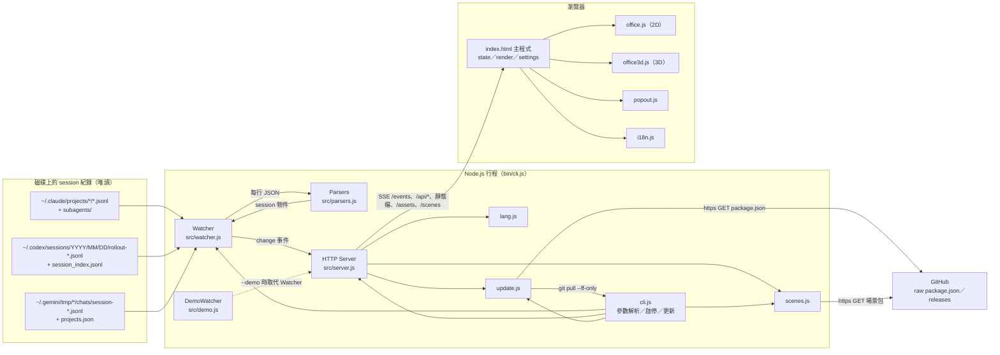
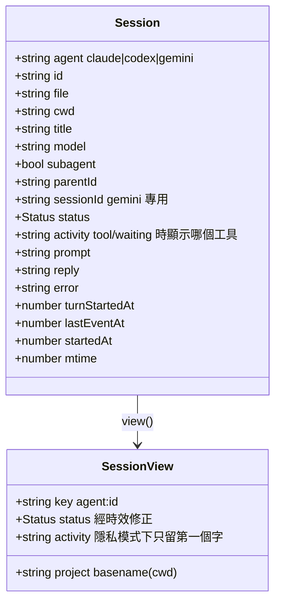
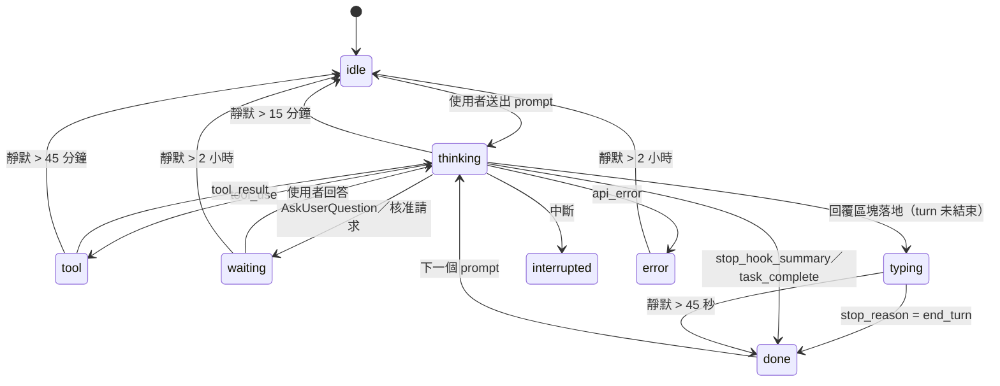

# 系統結構

## 1. 專案定位

本機執行的儀表板。讀取 Claude Code、Codex、Gemini CLI 各自寫在磁碟上的 session（工作階段）紀錄（JSONL），解析出每個 agent 當下的狀態，透過 Server-Sent Events（SSE）推到瀏覽器，以「辦公室」（2D／3D）或「清單」呈現。無 runtime 相依套件，伺服器只綁 `127.0.0.1`，不對外送資料。

同時是一個 Claude Code／Codex skill：使用者輸入 `/myoffice`，agent 依 `SKILL.md` 在背景執行 `node bin/cli.js`。

## 2. 目錄結構

```
<專案根>
├── bin/cli.js            CLI 進入點：解析參數、啟停伺服器、更新、場景管理、JSON 快照
├── src/
│   ├── watcher.js        找出近期 session 檔並持續讀取增量（1 秒輪詢）
│   ├── parsers.js        三種 agent 的紀錄格式 → 共用的 session 物件
│   ├── server.js         HTTP 伺服器：靜態檔、API、SSE、快照、狀態時效判定
│   ├── lang.js           從使用者 prompt 猜測 UI 語言
│   ├── update.js         版本檢查（GitHub raw）與自我更新（git pull --ff-only）
│   ├── scenes.js         場景包目錄、下載、SHA-256 驗證、安全解壓、移除
│   └── demo.js           --demo 用的虛構團隊（與 Watcher 同介面）
├── public/               瀏覽器端（伺服器直接提供）
│   ├── index.html        頁面、樣式、主程式（狀態、渲染、設定、SSE、版本、場景）
│   ├── office.js         2D 等角辦公室（canvas，零相依）；Office、OfficeGrid 類別
│   ├── office3d.js       3D 辦公室 bundle（由 web/office3d.js + three.js 建置，已 commit）
│   ├── popout.js         子母畫面：Document PiP 或 video PiP 備援
│   ├── sw.js             service worker：對 /api/time 校準、各分頁共用的時鐘偏移
│   └── i18n.js           九種語言的 UI 字串、瀏覽器語言判定
├── web/office3d.js       3D 辦公室原始碼（Office3D extends Office）
├── assets/
│   ├── agents/           Claude／Codex／Gemini 標誌（PNG）
│   └── kenney/           Kenney CC0 角色與家具模型（GLB）
├── scenes.json           可下載場景包目錄（id、版本、大小、sha256、下載 URL）
├── scripts/pack-scene.js 維護者用：把場景資料夾打包成 tar.gz 並更新 scenes.json
├── tests/ui.cjs          Playwright 瀏覽器回歸測試（需 Chrome）
├── SKILL.md              skill 描述：agent 如何啟動、更新、停止、換場景、查 JSON
├── package.json          版本、scripts（build／start／test:ui）、devDependencies
└── docs/                 GIF 示意圖與安全審查報告
```

使用者端資料目錄：`~/.whatsmyagentdoing/scenes/<id>/`（下載的場景包）。

## 3. 執行時架構



## 4. 模組職責

| 模組 | 職責 | 關鍵對外介面 |
|---|---|---|
| `bin/cli.js` | 解析參數；判斷已在執行就只重開分頁；建立 Watcher 與 Server；連接埠被占用就往後找（最多 10 次）；開瀏覽器；`--stop`／`--update`／`--json`／`--scenes`／`--scene`／`--remove-scene` | `main()` |
| `src/watcher.js` | 每 1 秒 `tick()`：每 5 秒重新走訪目錄，其餘只 stat 已知檔；新檔整檔讀或「頭 128 KB + 尾 768 KB」；檔案變長讀增量、變短則重開；讀不到的檔記入 `failed` 一分鐘後重試；超出時間窗的 session 移除；有變更就 emit `change` | `Watcher.start/stop/tick/sessions`、`CLAUDE_DIR`、`CODEX_DIR`、`GEMINI_DIR` |
| `src/parsers.js` | `applyClaude`／`applyCodex`／`applyGemini`／`applyGeminiDocument`：把一行紀錄套到 session 物件，更新 status、activity、prompt、reply、error、時間戳；`clean()` 去除注入的 context 區塊與 Markdown 雜訊 | `newSession`、三個 apply 函式 |
| `src/server.js` | 路由；`view()` 以時鐘修正狀態並套用隱私；`snapshot()` 排序並附語言猜測；SSE 推送去重（忽略 `now` 欄位）；每 5 秒重算、每 20 秒 ping；Host 白名單；自訂標頭守門 | `createServer(watcher, opts, {onShutdown, onRestart})`、`snapshot()` |
| `src/lang.js` | 以 CJK 字元計數與 Latin 停用詞投票猜語言；每個不同 prompt 一票，至少兩票才採信 | `guessLanguage`、`guessFromPrompts`、`SUPPORTED` |
| `src/update.js` | 讀本機版本；預設只在頁面按「檢查更新」（`/api/version?check=1`）時抓 GitHub raw `package.json`，`src/config.js` 的 `AUTO_UPDATE_CHECK = true` 時改為自動（30 分鐘快取）；`git pull --ff-only`（只在 git clone 可用） | `localVersion`、`checkLatest`、`info`、`update` |
| `src/scenes.js` | 目錄（scenes.json）、已安裝（使用者目錄 + 內建目錄）、下載（https、跟隨 ≤5 次轉址、上限 30 MB）、SHA-256 比對、自製 ustar reader（只收一般檔、副檔名白名單、擋 `..`）、暫存目錄後 rename | `catalog`、`installed`、`sceneDir`、`install`、`remove` |
| `src/demo.js` | 10 個虛構 session 依固定腳本循環狀態；每 0.5 秒 tick | `DemoWatcher`（與 Watcher 同介面） |
| `public/index.html` | 前端狀態 `state`、偏好 `store`（localStorage + fallback）、`render()`、設定選單、SSE 連線、版本與更新、場景選擇、語言、通知、tooltip | 全域函式 `onData`、`render`、`makeOffice` 等 |
| `public/office.js` | 2D 辦公室：工作中的 agent 坐桌（`WORKING` = thinking／tool／typing／waiting／error），最多 7 位下班者閒晃，其餘「回家」；hover／click 回呼 | `window.Office`、`window.OfficeGrid`、`OFFICE_AGENT_BADGES` |
| `web/office3d.js` | 同一套行為以 three.js 渲染；載入 `/assets/kenney/*.glb`；場景包時改讀 manifest 與 `/scenes/<id>/models/*.glb`；WebGL 不可用時 `markReady(false)` 讓頁面退回 2D | `Office3D` |
| `public/popout.js` | Document PiP（同源 iframe `/?pip=1&prefs=…`）或 canvas `captureStream` + video PiP 備援 | `OfficePopout` |
| `public/sw.js` | service worker：收到 `{type: 'time'}` 時對 `/api/time` 校準（扣掉半個往返、5 分鐘內共用），回 `{offset, now}`；不攔截任何請求 | — |
| `public/i18n.js` | `I18N` 字串表（en、zh-TW、zh-CN、ja、ko、es、fr、de、pt）、`i18nFromBrowser` | `window.I18N`、`window.i18nFromBrowser` |

## 5. 資料來源

| Agent | 路徑 | 覆寫環境變數 | 補充資料 |
|---|---|---|---|
| Claude Code | `~/.claude/projects/<project>/<session>.jsonl`、`<project>/<session>/subagents/*.jsonl` | `CLAUDE_CONFIG_DIR` | 子代理由目錄位置判定 |
| Codex | `~/.codex/sessions/YYYY/MM/DD/rollout-*.jsonl` | `CODEX_HOME` | `session_index.jsonl` 提供 thread 名稱（只讀最後 2 MB） |
| Gemini CLI | `~/.gemini/tmp/<project>/chats/session-*.jsonl`（舊版 `.json`）、`chats/<parent>/<id>.jsonl` | `GEMINI_CLI_HOME` | `projects.json` 把 tmp 目錄名對回專案路徑；另掃 `~/.cache/.gemini` |

時間窗：`--hours`（預設 24）。Codex 只走訪時間窗內的日期目錄。

## 6. Session 資料模型



## 7. 狀態定義與時效判定

| 狀態 | 意義 | 來源（parsers.js） |
|---|---|---|
| thinking | 推理中，或正在讀工具結果 | thinking 區塊、tool_result、user prompt、task_started、reasoning |
| tool | 工具呼叫進行中 | tool_use、function_call、CommandExecution 開始、Gemini toolCalls 進行中 |
| typing | 已開始寫回覆、turn 未結束 | text 區塊且 stop_reason 非 end_turn、agent_message |
| waiting | 需要使用者（提問或核准） | AskUserQuestion／ExitPlanMode、request_user_input、*_approval_request、awaiting_approval |
| done | turn 結束 | stop_reason end_turn、stop_hook_summary、task_complete |
| interrupted | 被中斷 | `[Request interrupted`、turn_aborted、Gemini info 含 cancel |
| error | 錯誤 | api_error、isApiErrorMessage、event error |
| idle | 無活動 | 初始值，或由時效判定降級 |

紀錄只在區塊結束時寫入，所以 `view()` 用時鐘補足：



前端分組：Needs you（waiting、error）→ Working（thinking、tool、typing）→ Finished（done、interrupted）→ Idle。

## 8. HTTP API

伺服器只監聽 `127.0.0.1`；所有請求先檢查 `Host` 是否為 `localhost`／`127.0.0.1`／`[::1]`，否則 403。

| 方法 | 路徑 | 用途 | 守門 |
|---|---|---|---|
| GET | `/`、`/office.js`、`/office3d.js`、`/i18n.js`、`/popout.js`、`/sw.js` | 靜態頁面與腳本（`no-store`） | — |
| GET | `/assets/**` | Kenney 模型、agent 標誌（副檔名白名單、路徑穿越檢查） | — |
| GET | `/scenes/<id>/**` | 已安裝場景包的檔案 | id 須符合 `^[a-z0-9-]+$` |
| GET | `/events` | SSE：連線即送一次快照，之後有變更才推；每 20 秒 ping | — |
| GET | `/api/sessions` | 一次性快照（JSON） | — |
| GET | `/api/ping` | 身分確認 `{app: "whatsmyagentdoing"}`，CLI 用來判斷是否已在執行 | — |
| GET | `/api/time` | 主機目前時間 `{now: <unix ms>}`（`no-store`），`sw.js` 用來校準頁面右下角的時鐘 | — |
| GET | `/api/scenes` | 已安裝與可下載的場景清單 | — |
| POST | `/api/scenes/install?id=` | 下載並安裝場景包 | 標頭 `x-whatsmyagentdoing: install` |
| GET | `/api/version` | 本機版本、最新版本、是否可更新、`auto`；帶 `?check=1` 才連 GitHub 抓最新版（`AUTO_UPDATE_CHECK` 開啟時不帶也抓，30 分鐘快取） | — |
| POST | `/api/update` | `git pull` 後重啟行程 | 標頭 `x-whatsmyagentdoing: update` |
| POST | `/api/shutdown` | 關閉伺服器 | 標頭 `x-whatsmyagentdoing: stop` |

自訂標頭的作用：跨站網頁無法在不觸發 CORS preflight 的情況下加上自訂標頭，而伺服器從不回應 preflight，所以三個有副作用的端點不會被其他網站觸發。

## 9. 前端狀態與偏好

| 偏好鍵（localStorage `wmad.*`） | 預設 | 可選值 |
|---|---|---|
| view | office | office、list |
| quality | high | mid（2D）、high（3D） |
| scene | office | office 或已安裝場景 id |
| hiddenAgents | [] | 取消勾選的 agent（claude、codex、gemini、opencode）；空陣列＝全選 |
| hiddenPlatforms | [] | 取消勾選的平台（vscode、cli、other）；空陣列＝全選 |
| showSub | false | 顯示子代理 |
| showNeedsYou、showError、showWorking、showFinished | true | 各狀態組是否顯示（頁首計數 chip 與設定面板共用） |
| showIdle | false | 顯示 idle（同上，預設關） |
| showAgent | true | 顯示 agent 標記與圖例 |
| lang | auto | auto 或 I18N 的語言碼 |

來源優先序：URL query（`?view=&quality=&scene=&lang=`，讀完即從網址移除）→ PiP 的 `prefs` 參數 → localStorage → 預設值。所有值先經 `validPreference()` 白名單。跨分頁與 PiP 視窗透過 `storage` 事件同步（見 UC-14）。

## 10. 安全邊界

- 綁定 loopback；Host 白名單擋 DNS rebinding
- 不送任何 `Access-Control-*` 標頭，跨站無法讀 `/api/sessions` 與 `/events`
- 有副作用的 POST 端點要求自訂標頭
- 靜態檔與場景檔：`path.normalize` 後要求落在根目錄內、副檔名白名單
- 場景包：URL 固定來自 repo 內 `scenes.json`、強制 https、先比對 SHA-256 再解壓；自製 tar reader 只收一般檔、擋 `..` 與絕對路徑、副檔名白名單、寫入前再驗目的路徑
- 前端所有 `innerHTML` 插值經 `esc()`；resume 指令以單引號包裹（`shq`）
- child_process 只有三處（開瀏覽器、重啟自身、`git pull --ff-only`），全為陣列參數且不受請求控制
- 詳見 `docs/security-review-v0.3.0.md`

## 11. 環境變數

| 變數 | 用途 |
|---|---|
| `CLAUDE_CONFIG_DIR`、`CODEX_HOME`、`GEMINI_CLI_HOME` | 覆寫三種 agent 的資料目錄 |
| `WMAD_NO_UPDATE_CHECK` | 設定後不檢查新版 |
| （非環境變數）`src/config.js` 的 `AUTO_UPDATE_CHECK` | `true` 時自動檢查新版（頁面載入、每 30 分鐘、CLI 啟動）；預設 `false` 只手動 |
| `WMAD_LATEST_VERSION` | 測試用：假裝最新版本 |
| `WMAD_SCENES_LOCAL` | 測試用：從本機資料夾讀場景包，不下載 |
| `WMAD_HEADED` | 測試用：顯示瀏覽器視窗 |
| `WMAD_SCREENSHOTS` | 測試用：截圖輸出資料夾 |

## 12. 建置與測試

- 執行：Node.js 18+，不需 `npm install`
- 建置 3D bundle：Node.js 20+，`npm install` 後 `npm run build`（esbuild 把 `web/office3d.js` 與 three.js 打包成 `public/office3d.js`，ESM、minify、target es2020）
- UI 測試：`npm run test:ui`（Playwright + Chrome，使用 DemoWatcher 與固定假 session，見 UC-16）
