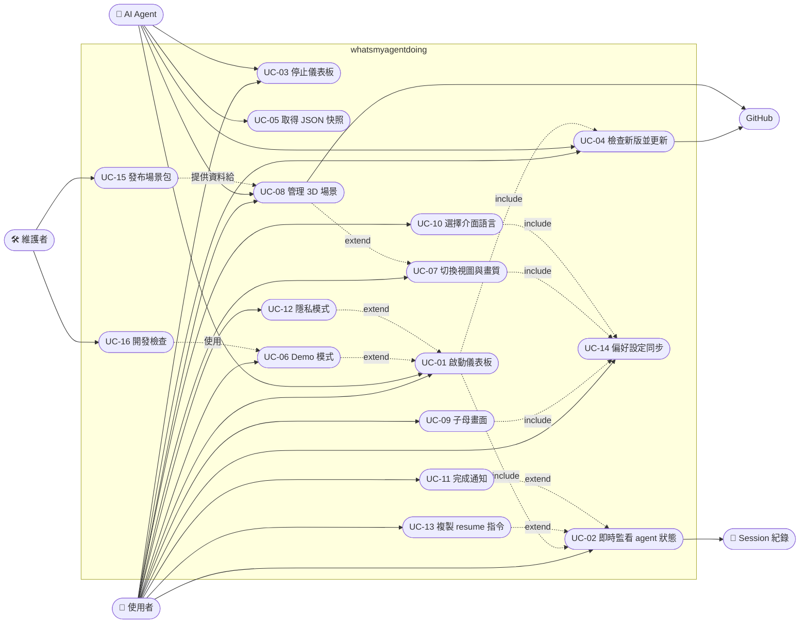

# Use case 總覽

## 參與者

| 參與者 | 說明 |
|---|---|
| 使用者 | 在同一台機器上使用 Claude Code／Codex／Gemini CLI 的開發者；透過瀏覽器看儀表板、透過 agent 或終端機下指令 |
| AI Agent | Claude Code 或 Codex 本身。使用者輸入 `/myoffice` 時，agent 依 `SKILL.md` 執行 CLI；也會用 `--json` 在對話中回答「其他 agent 在做什麼」 |
| 維護者 | 本專案的開發者：建置 3D bundle、跑 UI 測試、打包與發布場景包 |
| 瀏覽器 | 執行前端；提供 localStorage、EventSource、Notification、Document PiP、video PiP、WebGL |
| Session 紀錄 | 三種 agent 寫在磁碟上的 JSONL；被動資料來源，只讀 |
| GitHub | 版本檢查讀 raw `package.json`；場景包從 releases 下載；更新走 `git pull` |

## Use case 圖

## 總表

| ID | 名稱 | 主要參與者 | 觸發 | 進入點 | 檔案 |
|---|---|---|---|---|---|
| UC-01 | 啟動儀表板 | 使用者／AI Agent | `/myoffice`、`node bin/cli.js` | `bin/cli.js main()` | [UC-01](UC-01-start-dashboard.md) |
| UC-02 | 即時監看 agent 狀態 | 使用者 | 頁面開啟後自動 | `Watcher.tick` → `server push` → `onData` | [UC-02](UC-02-live-monitoring.md) |
| UC-03 | 停止儀表板 | 使用者／AI Agent | `--stop`、`/myoffice stop` | `stopAt()` → `/api/shutdown` | [UC-03](UC-03-stop-dashboard.md) |
| UC-04 | 檢查新版並更新 | 使用者／AI Agent | 頁面 Update 鈕、`--update`、`/myoffice update` | `update.js`、`/api/version`、`/api/update` | [UC-04](UC-04-check-and-update.md) |
| UC-05 | 取得 JSON 快照 | AI Agent | `--json` | `snapshot()` | [UC-05](UC-05-json-snapshot.md) |
| UC-06 | Demo 模式 | 使用者 | `--demo` | `DemoWatcher` | [UC-06](UC-06-demo-mode.md) |
| UC-07 | 切換視圖與畫質 | 使用者 | 工具列 List／Office、設定的 2D／3D | `render()`、`makeOffice()` | [UC-07](UC-07-switch-view.md) |
| UC-08 | 管理 3D 場景 | 使用者／AI Agent | 場景按鈕、`--scenes`、`--scene`、`--remove-scene` | `scenes.js`、`/api/scenes*` | [UC-08](UC-08-manage-scenes.md) |
| UC-09 | 子母畫面 | 使用者 | Pop out 鈕 | `OfficePopout` | [UC-09](UC-09-popout.md) |
| UC-10 | 選擇介面語言 | 使用者 | 自動／🌐 選單 | `promptLanguage()`、`chooseLang()` | [UC-10](UC-10-language.md) |
| UC-11 | 完成通知 | 使用者 | Notify when done 鈕 | `onData()` | [UC-11](UC-11-notifications.md) |
| UC-12 | 隱私模式 | 使用者 | `--private` | `view()` | [UC-12](UC-12-private-mode.md) |
| UC-13 | 複製 resume 指令 | 使用者 | 卡片 Copy 鈕 | `resumeCmd()` | [UC-13](UC-13-copy-resume.md) |
| UC-14 | 偏好設定同步 | 使用者 | 改任何設定、開第二個分頁或 PiP | `store`、`storage` 事件 | [UC-14](UC-14-preferences-sync.md) |
| UC-15 | 發布場景包 | 維護者 | `node scripts/pack-scene.js` | `scripts/pack-scene.js` | [UC-15](UC-15-pack-scene.md) |
| UC-16 | 開發檢查 | 維護者 | `npm run build`、`npm run test:ui` | `tests/ui.cjs` | [UC-16](UC-16-dev-checks.md) |

## 關係說明

- UC-01 啟動後必然進入 UC-02（頁面連 SSE），也會在啟動時做一次版本提示（UC-04 的檢查部分）
- UC-06、UC-12 是 UC-01 的旗標變體：換掉資料來源或遮蔽內容，其餘流程相同
- UC-08 只在 UC-07 選到 3D 時才有意義；`--scene` 旗標則同時觸發 UC-01 與 UC-08
- UC-07、UC-09、UC-10 的設定值都經 UC-14 的 `store` 持久化與跨視窗同步
- UC-11、UC-13 是 UC-02 畫面上的延伸操作
- UC-15 產出的 `scenes.json` 條目與 release 檔案是 UC-08 的下載來源
- UC-16 的 UI 測試以 UC-06 的 DemoWatcher 為資料來源
